# Klassifizierung und Extraktion

<figure>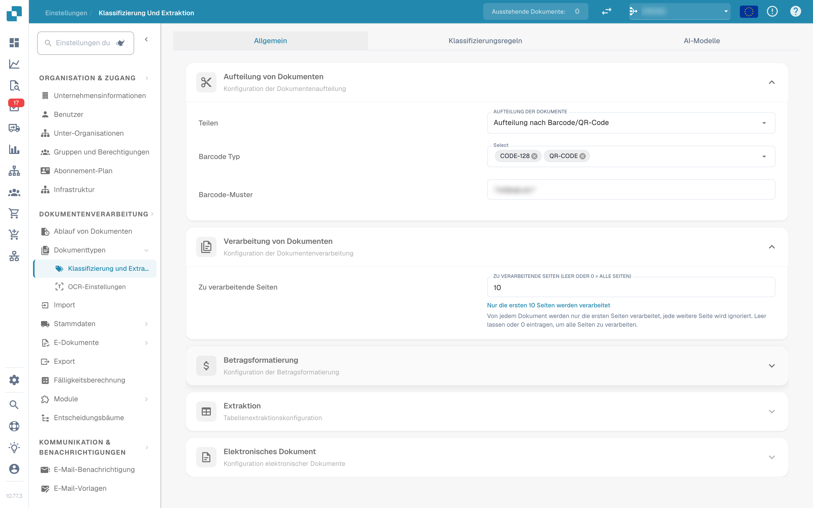<figcaption>
Einstellungen für Klassifizierung und Extraktion
</figcaption></figure>

## Übersicht

In den Einstellungen für **Klassifizierung und Extraktion** können Sie:

* steuern, wie hochgeladene Dokumente **aufgeteilt** werden und wie viele Seiten verarbeitet werden
* die **Betragsformatierung** für den Betragsvergleich konfigurieren
* die **Tabellenextraktion** einrichten, inklusive des KI-Modells pro Lieferant
* die Verarbeitung nicht unterstützter **ZUGFeRD**-Dateien ein- oder ausschalten
* **Klassifizierungsregeln** definieren, die automatisch einen Dokumenttyp zuweisen
* die **KI-Modelle** und ihre trainierten Labels prüfen

Die Seite hat drei Tabs: **Allgemein**, **Klassifizierungsregeln** und **AI-Modelle**. Der Tab *AI-Modelle* wird nur angezeigt, wenn das Modul für Modelle und Labels für Ihre Organisation aktiviert ist.

| Tab | Inhalt |
|---|---|
| Allgemein | Aufteilung von Dokumenten, Verarbeitung von Dokumenten, Betragsformatierung, Extraktion, Elektronisches Dokument |
| Klassifizierungsregeln | Regex-Regeln, die Dokumente anhand des Quellnamens klassifizieren |
| AI-Modelle | Individuell trainierte Modelle mit Labels, Dokumenttypen und Priorität |

## Zugriff auf die Einstellungen für Klassifizierung und Extraktion

Gehen Sie zu **Einstellungen → Dokumenttypen → Klassifizierung und Extraktion**.

## Allgemein

Der Tab **Allgemein** gruppiert die Einstellungen in aufklappbare Abschnitte. Alle Änderungen werden sofort gespeichert, sobald Sie einen Wert ändern; es gibt keine separate Schaltfläche zum Speichern.

### Aufteilung von Dokumenten

**Teilen** legt fest, ob ein hochgeladenes Dokument in mehrere Dokumente aufgeteilt wird, sobald auf einer seiner Seiten ein Barcode erscheint. Das Dropdown bietet:

* **Hochgeladene Dokumente nicht aufteilen** – der Standardwert; das Dokument wird als eine Datei verarbeitet.
* **Aufteilung nach Barcode/QR-Code** – das Dokument wird an jedem erkannten Barcode aufgeteilt.

<figure>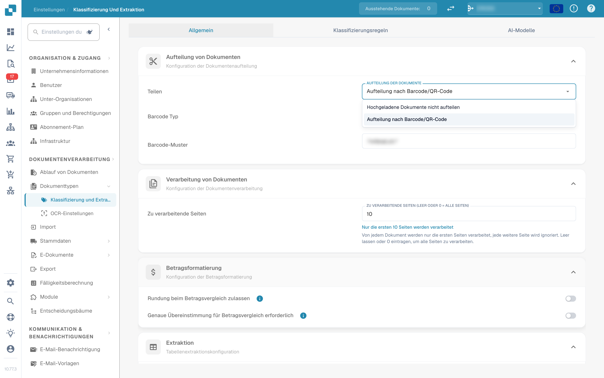<figcaption>
Aufteilungsoptionen im Abschnitt „Aufteilung von Dokumenten“
</figcaption></figure>

Wenn **Aufteilung nach Barcode/QR-Code** gewählt ist, erscheinen zwei weitere Felder:

* **Barcode Typ** – ein oder mehrere zu erkennende Barcode-Typen, zum Beispiel *CODE-128* oder *QR-CODE*.
* **Barcode-Muster** – ein regulärer Ausdruck, dem der Barcode-Wert entsprechen muss, bevor die Aufteilung ausgelöst wird. Lassen Sie das Feld leer, um bei jedem Barcode der gewählten Typen aufzuteilen. Das Muster wird vor dem Speichern geprüft; ein ungültiger Ausdruck wird sofort gemeldet.

Nach einer erfolgreichen Aufteilung wird das übergeordnete Dokument gelöscht und die Seiten laufen als separate Dokumente weiter, die denselben Batch teilen.

### Verarbeitung von Dokumenten

**Zu verarbeitende Seiten** begrenzt, wie viele Seiten pro Dokument per OCR erkannt, klassifiziert und extrahiert werden.

<figure>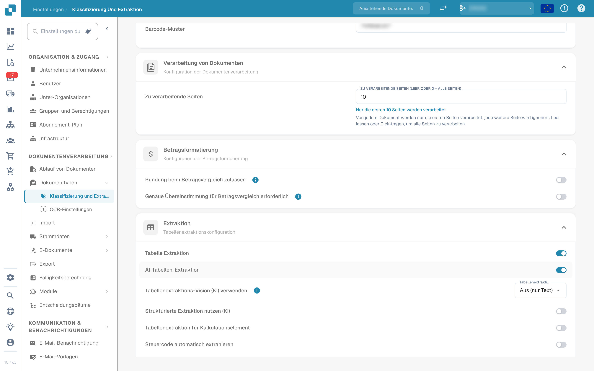<figcaption>
Zu verarbeitende Seiten im Abschnitt „Verarbeitung von Dokumenten“
</figcaption></figure>

* Leer oder **0** bedeutet, dass alle Seiten verarbeitet werden.
* Eine Zahl *N* begrenzt OCR, Klassifizierung und Extraktion auf die ersten *N* Seiten. Das vollständige Dokument wird weiterhin gespeichert, angezeigt und exportiert; Seiten über dem Limit erscheinen schreibgeschützt.

### Betragsformatierung

Zwei Schalter steuern, wie Beträge mit Stammdaten und Bestellungen verglichen werden.

<figure>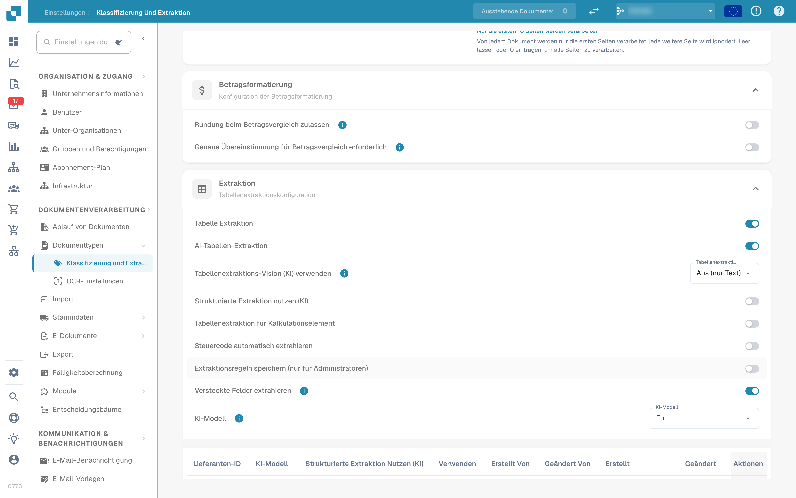<figcaption>
Abschnitt „Betragsformatierung“
</figcaption></figure>

* **Rundung beim Betragsvergleich zulassen** – wenn aktiviert, ist eine Toleranz von ±0,5 zulässig. Wenn deaktiviert, gilt ±0,05.
* **Genaue Übereinstimmung für Betragsvergleich erforderlich** – wenn aktiviert, müssen die Beträge exakt übereinstimmen, ohne Toleranz. Wenn deaktiviert, gilt ±0,05.

Es kann immer nur einer der beiden Schalter aktiv sein; das Aktivieren des einen deaktiviert den anderen.

### Extraktion


**Voraussetzungen für eine funktionierende Tabellenextraktion**

* Der Dokumenttyp hat **Tabellenspalten** (Einstellungen → Globale Einstellungen → Dokumenttypen → [Tabellenspalten](../../global-settings/document-types/table-columns/README.md)). Ohne Spalten gibt es nichts, in das extrahiert werden könnte.
* **Tabelle Extraktion** oder **AI-Tabellen-Extraktion** ist unten für die gesamte Organisation eingeschaltet.
* Das Dokument enthält lesbaren Text: OCR wurde ausgeführt, oder bei digital erzeugten PDFs wird E-Text verwendet ([OCR-Einstellungen](../ocr-settings.md)).
* Training und KI-Modelle gelten **pro Lieferant**. Eine trainierte Tabelle wird nur auf Dokumente des Lieferanten angewendet, für den sie trainiert wurde.


Sie können Tabellen aus Dokumenten extrahieren, indem Sie entweder **Tabelle Extraktion** oder **AI-Tabellen-Extraktion** aktivieren. Eine trainierte Tabelle (ob KI-basiert oder manuell) ist immer an einen bestimmten Lieferanten gebunden.

<figure>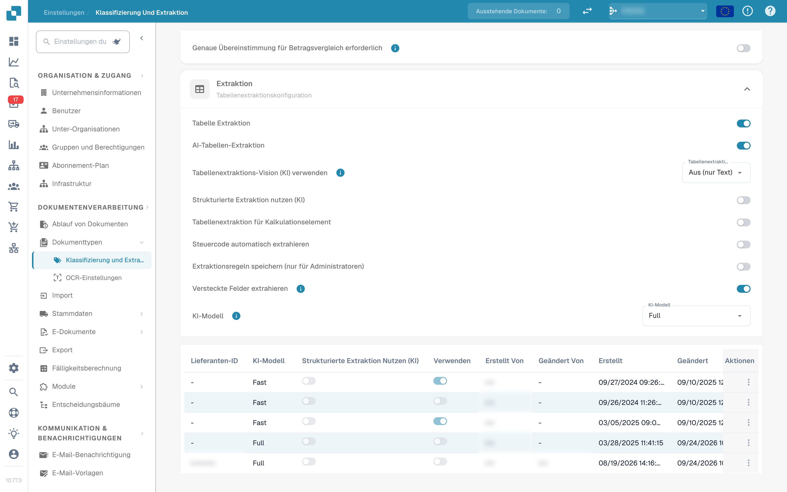<figcaption>
Schalter der Tabellenextraktion
</figcaption></figure>

**Tabelle Extraktion:** Aktiviert die regelbasierte Tabellenextraktion. Tabellen werden pro Lieferant im Prüfbildschirm trainiert (*Go to table extraction view*).\
Mehr zum Training erfahren Sie [hier](../../../setup/document-training/training-line-fields-table-training/defining-tables-and-columns.md).

**AI-Tabellen-Extraktion:** Nutzt KI, um die Tabelle beliebiger Lieferanten ohne Training zu extrahieren. Wenn die Ergebnisse für einen Lieferanten nicht genau genug sind, trainieren Sie die Tabelle dieses Lieferanten; die gespeicherten Regeln haben dann für diesen Lieferanten Vorrang vor der KI.

**Tabellenextraktions-Vision (KI) verwenden:** Die KI liest das Seitenbild statt der Textebene. Hilft bei gescannten Dokumenten und Tabellen ohne klare Textstruktur; langsamer. Das Dropdown neben dem Schalter legt fest, wie stark das Seitenbild genutzt wird:

* **Aus (nur Text)** – Es wird nur die Textebene verwendet. Dies ist der Standardwert.
* **Nur Bilder** – Es wird nur das Seitenbild gelesen.
* **Hybrid (Text und Bilder)** – Textebene und Seitenbild werden in derselben Anfrage kombiniert.
* **Auto (pro Dokument entschieden)** – DocBits entscheidet pro Dokument, ob die Textebene ausreicht.

**Strukturierte Extraktion nutzen (KI):** Die KI liefert die Tabelle in einer festen Struktur, die direkt auf die konfigurierten Tabellenspalten abgebildet wird. Empfohlen, wenn die Spaltenüberschriften auf den Dokumenten stark variieren. Ein Klick auf die Einstellung öffnet eine Vorschau, welche Felder und Spalten die KI genau anfordert: Kopffelder und Zeilenspalten werden mit ihrer Quelle aufgelistet (angeforderte oder deaktivierte Standardfelder), ebenso der erwartete Ausgabemodus (zum Beispiel *strict* – keine zusätzlichen Spalten). Felder, die für den Dokumenttyp konfiguriert, aber ausgeschaltet sind, werden nicht bei der KI angefordert.

**Tabellenextraktion für Kalkulationselement:** Wenn aktiviert, kann DocBits Kostenelemente aus Tabellen auf Positionsebene extrahieren und entsprechend klassifizieren.\
Eine ausführliche Erklärung finden Sie [hier](table-extraction-for-costing-element.md).

**Steuercode automatisch extrahieren:** Wenn aktiviert, füllt das System das Feld **Steuercode** im Prüfbildschirm automatisch aus, sofern ein Steuercode-Feld konfiguriert ist.\
Weitere Informationen zu dieser Einstellung finden Sie [hier](auto-extract-tax-code.md).

**Extraktionsregeln speichern (nur für Administratoren):** Nur Administratoren können im Tabellentraining auf *Save Rules* klicken. Schalten Sie diese Einstellung ein, wenn Benutzer immer wieder Regeln speichern, welche die Extraktion eines Lieferanten beeinträchtigen.

**Versteckte Felder extrahieren:** Felder, die in den Feldeinstellungen als versteckt markiert sind, werden ebenfalls extrahiert. Nützlich, wenn ein Wert für eine Regel oder einen Export benötigt wird, aber im Prüfbildschirm nicht angezeigt werden soll.

**KI-Modell:** Wählt die KI-Stufe für die Tabellenextraktion. Es stehen sechs Optionen zur Verfügung: **Full** (höchste Genauigkeit, am langsamsten, 2 Tokens pro Dokument), **Fast** (Standard; 1 Token pro Dokument), **Nexus** und **Nexus Flash** (alternative Modellfamilie, optional) sowie **Auto** und **Auto Nexus**, bei denen DocBits pro Dokument entscheidet, wie stark ein Modell sein muss. Die Tabelle unterhalb der Auswahl zeigt:

* welche **Lieferanten** welches KI-Modell verwenden
* ob sie strukturierte Extraktion (KI) und E-Text verwenden
* Optionen, um einen Eintrag zu löschen und den Lieferanten damit auf den Standard zurückzusetzen

Diese Einstellung wird [hier](ai-model.md) ausführlich erklärt.

#### Warum sieht die Tabelle pro Lieferant anders aus?

Alles, was DocBits über eine Tabelle lernt, wird **pro Lieferant** gespeichert:

* **Gespeicherte Regeln** (Tabellentraining): Position der Tabelle und Zuordnung ihrer Spalten im Layout dieses Lieferanten.
* **KI-Tabellen-Tags und Formatierungsregeln**: Hinweise, die der Benutzer für die KI-Tabelle dieses Lieferanten gespeichert hat.
* **Lieferantenspezifisches KI-Modell**: die Stufe, die für diesen Lieferanten unter *More settings* im Prüfbildschirm gewählt wurde.

Lieferant A mit gespeicherten Regeln zeigt daher im Tab *Extracted table* des Prüfbildschirms eine deterministische Tabelle, während Lieferant B ohne Regeln die *AI Extracted table* erhält. Damit sich Lieferant B wie A verhält, trainieren Sie die Tabelle von B einmal. Um einen Lieferanten zurückzusetzen, löschen Sie seine Regeln im Prüfbildschirm oder setzen Sie seine Trainingsdaten in der Tabelle KI-Modell zurück.

#### Preference-Schlüssel

Jeder Schalter in diesem Abschnitt wird als Organisations-Preference gespeichert. Verwenden Sie den Schlüssel, wenn Sie den Wert über die API (`/preferences/set_preference`), ein Skript oder den DocBits MCP (`get_preference` / `set_preference`) setzen.

| Einstellung (UI-Bezeichnung) | Preference-Schlüssel | Werte |
|---|---|---|
| Teilen | `SPLIT_DOCUMENT_ON_BARCODE` | `true` / `false` |
| Barcode Typ | `SPLIT_DOCUMENT_BARCODE_TYPE` | Liste von Barcode-Typnamen |
| Barcode-Muster | `SPLIT_DOCUMENT_BARCODE_PATTERN` | Regex-String |
| Zu verarbeitende Seiten | `RESTRICT_TO_PAGES` | Zahl; leer oder `0` = alle Seiten |
| Rundung beim Betragsvergleich zulassen | `AMOUNTS_ROUNDING` | `true` / `false` |
| Genaue Übereinstimmung für Betragsvergleich erforderlich | `AMOUNTS_NO_ROUNDING` | `true` / `false` |
| Tabelle Extraktion | `TABLE_EXTRACTION_SETTING` | `true` / `false` |
| AI-Tabellen-Extraktion | `USE_AI_TABLE_EXTRACTION` | `true` / `false` |
| Tabellenextraktions-Vision (KI) verwenden | `TABLE_EXTRACTION_VISION_MODE` | `off` (Standard), `vision`, `hybrid`, `auto` |
| Tabellenextraktions-Vision (KI) – alter Schalter | `TABLE_EXTRACTION_USE_VISION` | `true` / `false`; entspricht faktisch `vision` |
| Strukturierte Extraktion nutzen (KI) | `USE_STRUCTURED_EXTRACTION` | `true` / `false` |
| Tabellenextraktion für Kalkulationselement | `CHARGES_TABLE_EXTRACTION` | `true` / `false` |
| Steuercode automatisch extrahieren | `AUTO_EXTRACT_TAX_CODE` | `true` / `false` |
| Extraktionsregeln speichern (nur für Administratoren) | `ONLY_ADMIN_CAN_SAVE_RULES` | `true` / `false` |
| Versteckte Felder extrahieren | `EXTRACT_HIDDEN_FIELDS` | `true` / `false` |
| KI-Modell | `AI_MODEL` | `gpt-6-sol` (Full), `gpt-6-luna` (Fast), `qwen3.8-max` (Nexus), `glm-5.3-flash` (Nexus Flash), `auto` (Auto), `auto-nexus` (Auto Nexus) |
| Version der Tabellenextraktion (Bestätigungsdialog) | `TBL_EXT_VERSION` | Versions-String |
| OCR-Einstellungen → KI-Daten für Tabellen verwenden, falls vorhanden | `USE_AI_DATA_FOR_TABLE` | `true` / `false` |
| OCR-Einstellungen → E-Text verwenden, falls vorhanden | `USE_ETEXT_IF_AVAILABLE` | `true` / `false` |

Hinweise:

* Boolesche Preferences werden als Strings `true` / `false` gespeichert; ein Schlüssel, der nie gesetzt wurde, gilt als `false`. Wenn Sie `1` oder `0` senden, speichert DocBits `true` / `false`.
* Ein nicht gesetztes `AI_MODEL` bedeutet **Fast**.
* Ein nicht gesetztes `TABLE_EXTRACTION_VISION_MODE` wird aus dem alten Schalter `TABLE_EXTRACTION_USE_VISION` abgeleitet: `true` ergibt `vision`, alles andere `off`.
* Eine Änderung des Schlüssels wirkt für danach verarbeitete Dokumente. Starten Sie ein Dokument neu, um es mit der neuen Einstellung erneut zu extrahieren.
* Lieferantenspezifische Einstellungen (E-Text, KI-Modell, gespeicherte Regeln) sind keine Organisations-Preferences; sie werden im Prüfbildschirm unter *More settings* für ein Dokument des jeweiligen Lieferanten gesetzt.

### Elektronisches Dokument

**Nicht unterstützte ZUGFeRD PDF verarbeiten:** Wenn aktiviert, werden nicht unterstützte **ZUGFeRD**-Versionen als Standard-PDFs verarbeitet und die eingebettete XML wird ignoriert.

Die Liste der unterstützten **ZUGFeRD**-Versionen finden Sie [hier](../../global-settings/document-types/edi/zugferd/README.md).

## Klassifizierungsregeln

Der Tab **Klassifizierungsregeln** listet die Regeln, die während der Verarbeitung automatisch einen Dokumenttyp zuweisen. Jede Regel gleicht ein **Regex-Muster** mit dem Quellnamen des Dokuments ab und setzt bei einem Treffer den Dokumenttyp und optional einen Unterdokumenttyp.

Wechseln Sie in den Tab, indem Sie oben auf der Seite auf **Klassifizierungsregeln** klicken.

<figure>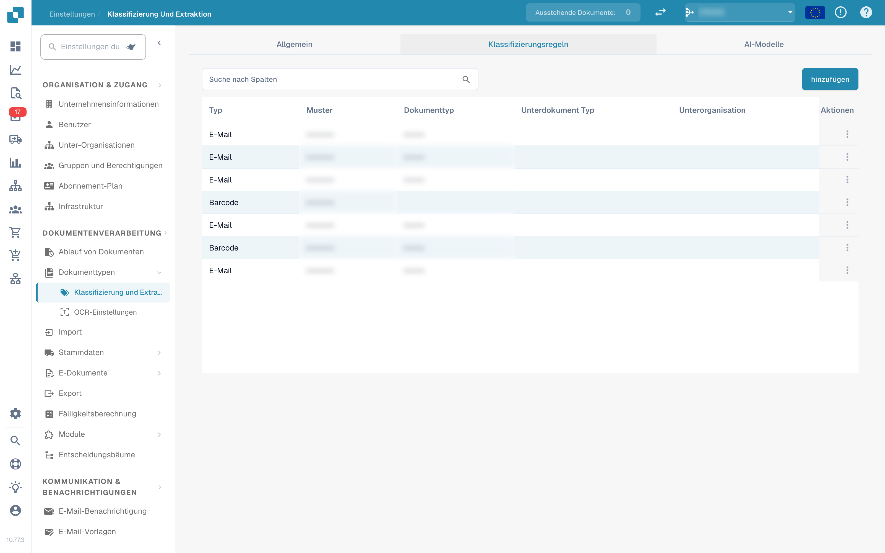<figcaption>
Tab „Klassifizierungsregeln“ mit der Regeltabelle
</figcaption></figure>

Die Tabelle hat eine Zeile pro Regel mit diesen Spalten:

* **Typ** – wo das Muster angewendet wird. Es gibt zwei Typen: **Barcode** und **E-Mail**.
* **Muster** – der für die Regel gespeicherte reguläre Ausdruck.
* **Dokumenttyp** – der Dokumenttyp, der bei einem Treffer zugewiesen wird.
* **Unterdokument Typ** – der Unterdokumenttyp, der bei einem Treffer zugewiesen wird.
* **Unterorganisation** – die Unterorganisation, auf die die Regel beschränkt ist. Leer bedeutet, die Regel gilt für alle Unterorganisationen.
* **Aktionen** – das Zeilenmenü mit *Bearbeiten* und *Löschen*.

Das Suchfeld über der Tabelle filtert alle Spalten, einschließlich der Anzeigetexte der Dropdown-Spalten.

### Neue Klassifizierungsregel hinzufügen

1.  Klicken Sie über der Tabelle auf **hinzufügen**.

    <figure>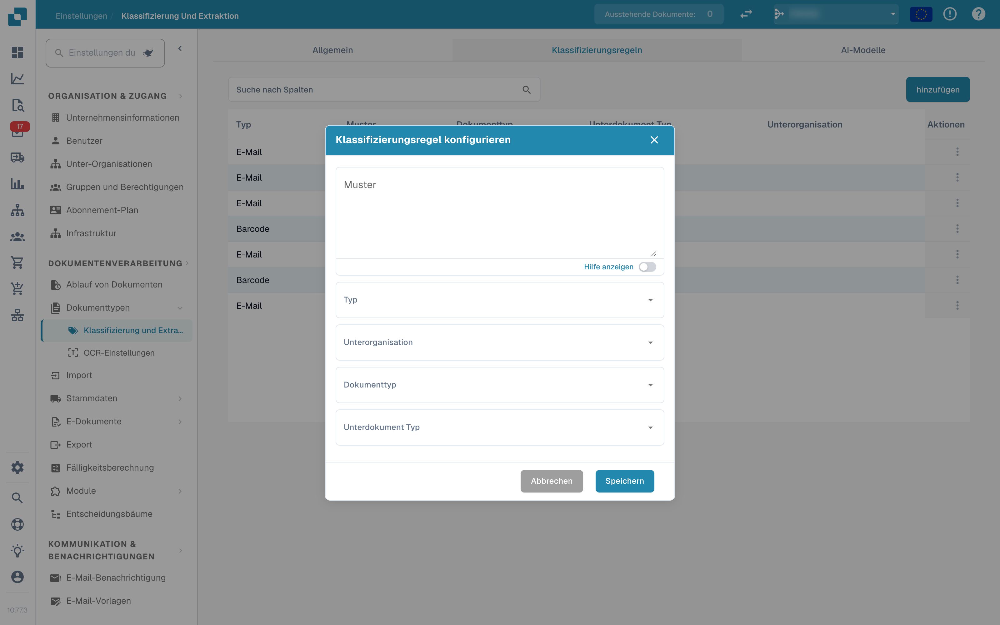<figcaption>
Dialog „Klassifizierungsregel konfigurieren“
</figcaption></figure>
2. Füllen Sie die Felder aus:
   * **Muster** (erforderlich) – der reguläre Ausdruck, nach dem die Regel sucht.
   * **Typ** (erforderlich) – **Barcode** oder **E-Mail**. Das entscheidet, gegen welchen Quellnamen das Muster geprüft wird.
   * **Unterorganisation** *(optional)* – beschränkt die Regel auf eine Unterorganisation.
   * **Dokumenttyp** – der Dokumenttyp, der bei einem Treffer zugewiesen wird.
   * **Unterdokument Typ** *(optional)* – ein spezifischerer Typ; die Liste hängt vom gewählten Dokumenttyp ab. Ein Wechsel des Dokumenttyps setzt den Unterdokumenttyp zurück.
3.  Klicken Sie auf **Speichern**.

Der Dialog prüft das Muster vor dem Speichern. Ein Muster, das bereits von einer anderen Regel verwendet wird, wird mit *Muster existiert bereits* abgelehnt; ein leeres Muster wird mit der Meldung zum Pflichtfeld abgelehnt.

#### Hilfe zum Muster

Der Schalter **Hilfe anzeigen** unterhalb des Muster-Felds öffnet eine Inline-Referenz mit den Formaten des Quellnamens, gegen die das Muster geprüft wird:

* **O365** – `Gemeinsame E-Mail + Ordner › Gemeinsame E-Mail › Ordner › E-Mail › ID`
* **Gmail** – `E-Mail + Ordner › Ordner › E-Mail › ID`

<figure>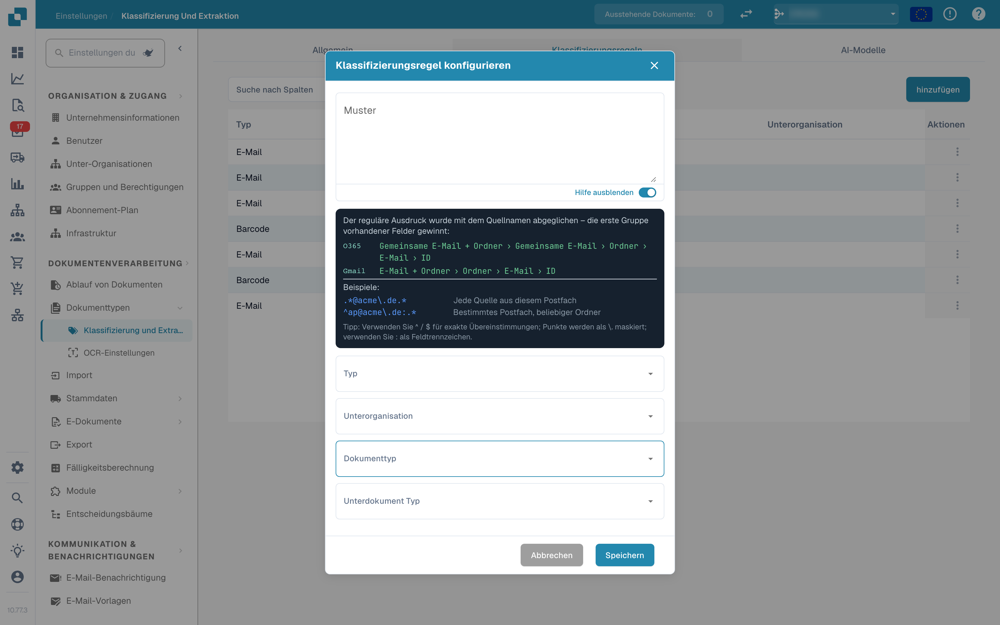<figcaption>
Muster-Hilfe im Regel-Dialog
</figcaption></figure>

Beispiele im Panel:

* `.*@acme\.de.*` – jede Quelle aus diesem Postfach
* `^ap@acme\.de:.*` – ein bestimmtes Postfach, beliebiger Ordner

Tipp: Verwenden Sie `^` / `$` für exakte Übereinstimmungen, maskieren Sie Punkte als `\.` und nutzen Sie `:` als Feldtrennzeichen. Die erste Gruppe vorhandener Felder im Quellnamen gewinnt.

Wenn Sie den Typ **E-Mail** verwenden, wird das Muster gegen die Postfach- und Ordnernamen der importierten Mail geprüft, nicht gegen den Dokumentinhalt.

### Klassifizierungsregel bearbeiten

1.  Klicken Sie in der Spalte **Aktionen** der Regel, die Sie ändern möchten, auf die drei Punkte.

    <figure>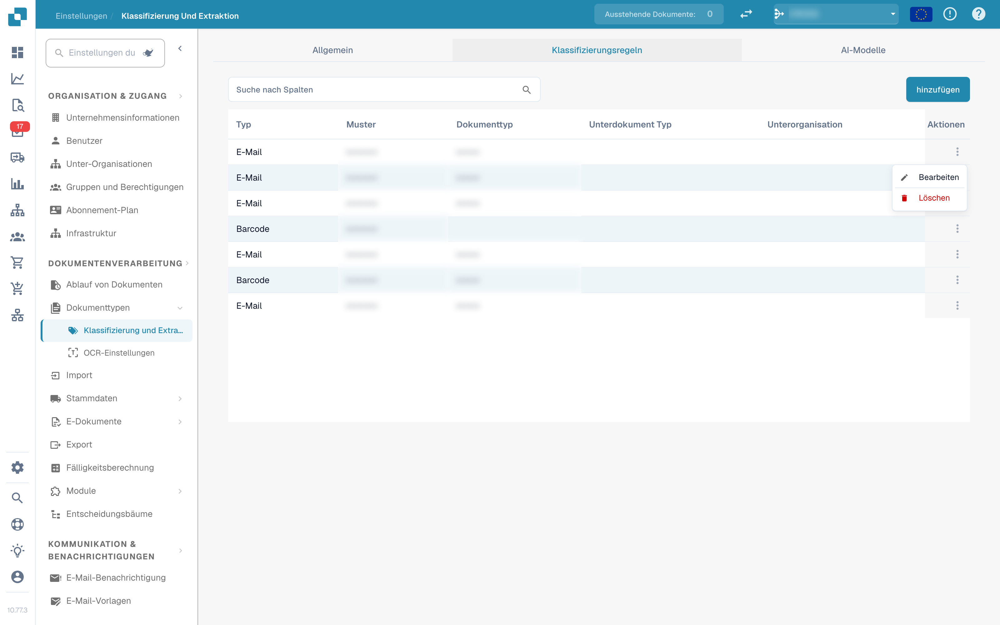<figcaption>
Zeilenmenü mit Bearbeiten und Löschen
</figcaption></figure>
2.  Wählen Sie **Bearbeiten**. Der Dialog öffnet sich mit den aktuellen Werten der Regel.

    <figure>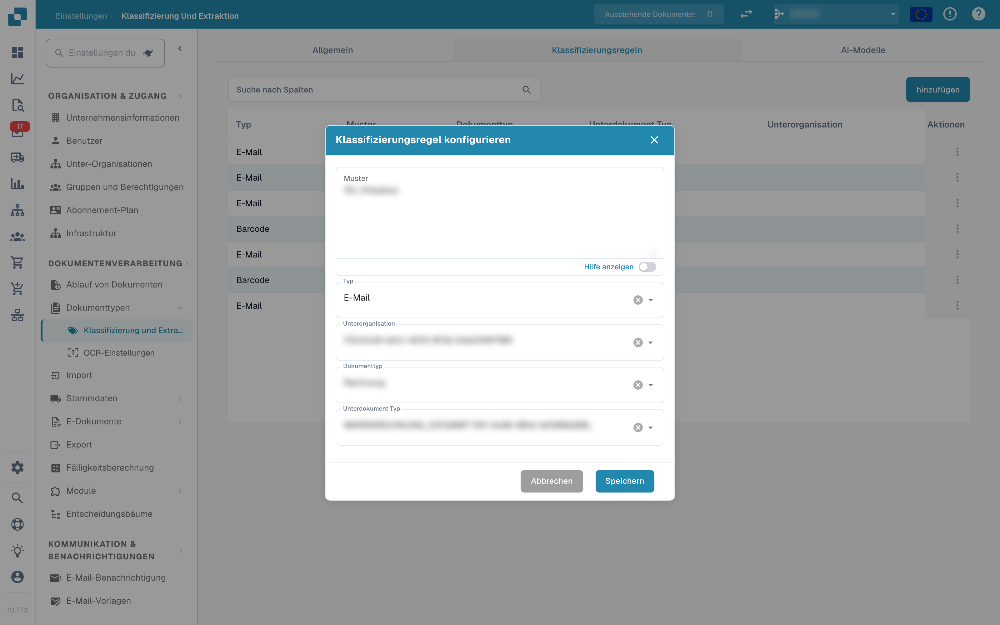<figcaption>
Bearbeiten einer bestehenden Klassifizierungsregel
</figcaption></figure>
3. Nehmen Sie Ihre Änderungen an Muster, Typ, Unterorganisation, Dokumenttyp oder Unterdokumenttyp vor.
4.  Klicken Sie auf **Speichern**.

Es gilt dieselbe Prüfung wie beim Hinzufügen: Das Muster darf nicht leer sein und darf kein Muster einer anderen Regel duplizieren.

### Klassifizierungsregel löschen

1. Klicken Sie in der Spalte **Aktionen** auf die drei Punkte.
2. Wählen Sie **Löschen**.

Die Regel wird sofort aus der Liste entfernt. Das Löschen einer Regel ändert keine Dokumente, die bereits mit ihr klassifiziert wurden.

## AI-Modelle

Der Tab **AI-Modelle** zeigt die individuell trainierten Modelle, die für die Dokumentklassifizierung verfügbar sind, sowie ihre Labels. Er erscheint nur, wenn das Modul für Modelle und Labels für Ihre Organisation aktiviert ist.

<figure>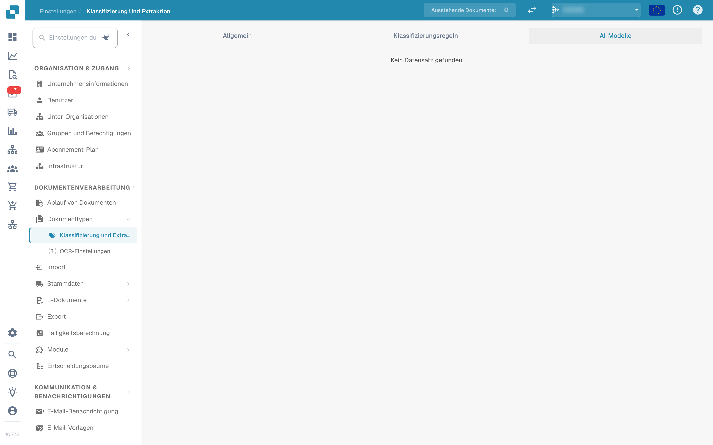<figcaption>
Tab „AI-Modelle“
</figcaption></figure>

Ist für die Organisation kein eigenes Modell verfügbar, zeigt der Tab *Kein Datensatz gefunden!*.

### Modelle

Jedes Modell ist ein aufklappbarer Eintrag mit:

* dem **Modellnamen** und dem Badge **Standard** an dem Modell, das verwendet wird, wenn nichts anderes zutrifft.
* der Anzahl der für dieses Modell trainierten **Labels**.
* pro Modell nach dem Aufklappen: **Typ**, **Nur erste Seite** und **Version**.

Unter diesen Informationen werden die Labels des Modells aufgelistet.

### Labels

Labels sind das, was das Modell lernt. Jedes Label ordnet ein Muster, das das Modell erkennt, einem Dokumenttyp zu.

* **Name** – der Name des Labels.
* **Nächstes Modell** – ein Modell, das die Ausgabe dieses Labels weiterverarbeitet.
* **DOC-TYP** – der Dokumenttyp, den das Label zuweist.
* **Unterdokument Typ** – ein spezifischerer Typ für das Label.
* **Priorität** – die Reihenfolge, in der die Labels ausgewertet werden; niedrigere Zahlen zuerst.

Das Suchfeld über der Label-Tabelle filtert die Labels des ausgewählten Modells.

### Label bearbeiten

Klicken Sie auf das Stift-Symbol einer Label-Zeile, um den Bearbeitungsdialog zu öffnen. Er bietet **Nächstes Modell** und **Dokumenttyp**; setzen Sie eines davon, da der Dialog entweder ein nächstes Modell oder einen Dokumenttyp verlangt. Klicken Sie auf **Speichern**, um die Änderung zu übernehmen.

## Verwandte Seiten

* [KI-Modell](ai-model.md) – die sechs Extraktionsstufen und wie ein Lieferant sein eigenes Modell erhält
* [Steuercode automatisch extrahieren](auto-extract-tax-code.md)
* [Tabellenextraktion für Kalkulationselement](table-extraction-for-costing-element.md)
* [OCR-Einstellungen](../ocr-settings.md)
