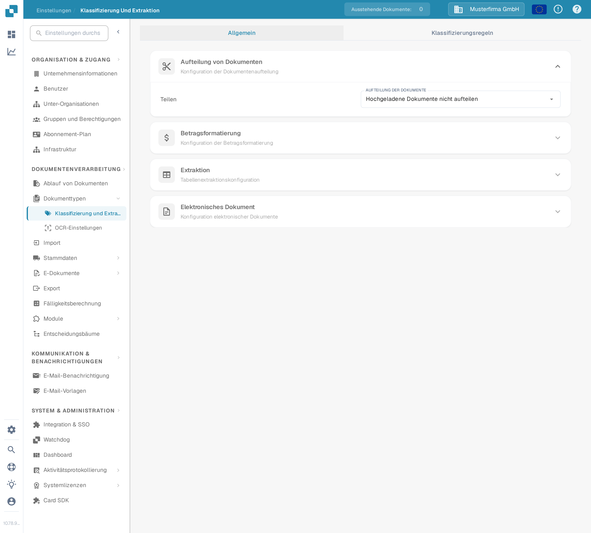
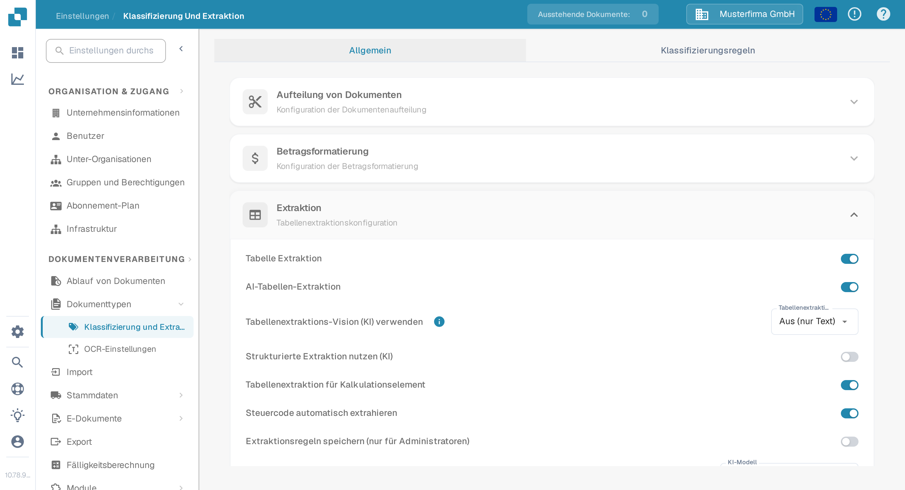
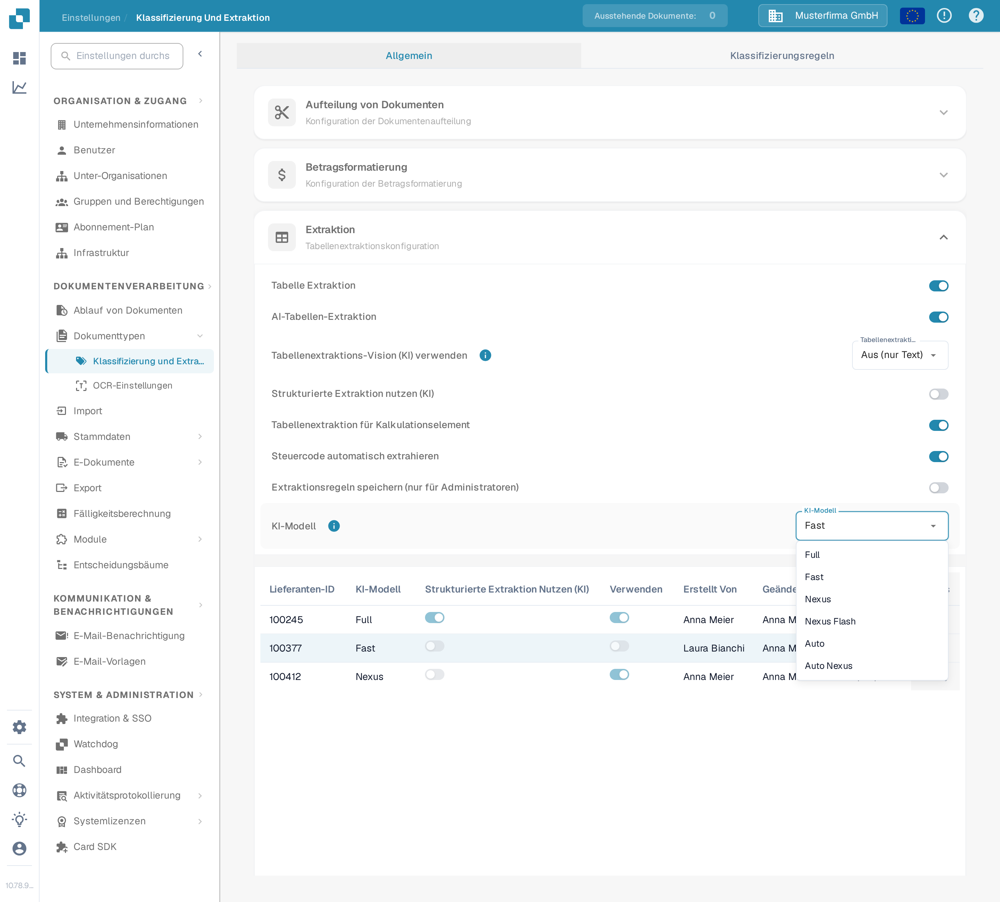
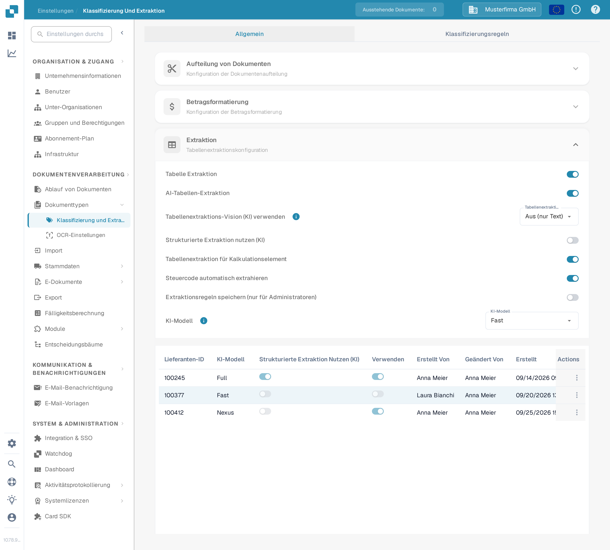
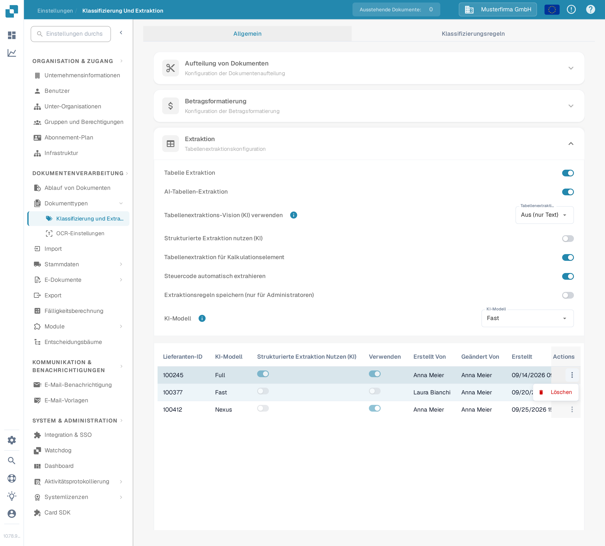
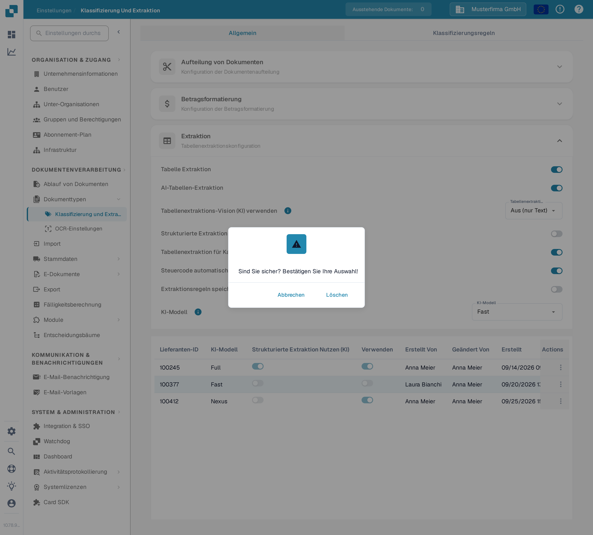

# AI-Modell

## Übersicht

Die Einstellung **AI-Modell** ermöglicht es Ihnen zu definieren, welches AI-Modell standardmäßig für die **Feldextraktion** und **Tabelle Extraktion** während der Dokumentenverarbeitung verwendet wird.\
In diesem Abschnitt können Sie die Token-Kosten für jedes Modell einsehen und sehen, welches Modell derzeit jedem Lieferanten zugewiesen ist.

## So greifen Sie zu

1.  Navigieren Sie zu **Einstellungen** → **Verarbeitung von Dokumenten** → **Klassifizierung und Extraktion**

    <figure><figcaption>
Öffnen Sie <strong>Einstellungen → Verarbeitung von Dokumenten → Klassifizierung und Extraktion</strong>.
</figcaption></figure>
2.  Scrollen Sie nach unten zum Abschnitt **Extraktion**

    <figure><figcaption>
Im Abschnitt <strong>Extraktion</strong> finden Sie die Einstellung <strong>KI-Modell</strong> und die Tabelle zur Lieferanten-Zuweisung.
</figcaption></figure>

## AI-Modell-Optionen

DocBits bietet sechs AI-Modell-Optionen für die Feld- und Tabellenextraktion. Sie unterscheiden sich im Gleichgewicht zwischen **Extraktionsgenauigkeit**, **Verarbeitungsgeschwindigkeit** und **Token-Kosten pro Dokument** – so können Sie die Option an die Art Ihrer Dokumente anpassen. Fahren Sie mit der Maus über das Informationssymbol neben der Einstellung, um die Token-Kosten der aktuell gewählten Option zu sehen. Wenn für einen Lieferanten kein Modell gesetzt ist, bedeutet das, dass Fast verwendet wird.

* **Full** – Die gründlichste Option mit der höchsten Extraktionsgenauigkeit. Am besten für komplexe Layouts, Scans schlechter Qualität oder Dokumente, bei denen Präzision am wichtigsten ist. Als leistungsstärkste Option ist sie auch die langsamste, bei **2 Token pro Dokument**.
* **Fast** – Eine ausgewogene Option, die starke Genauigkeit mit schnellerer Verarbeitung bei geringeren Kosten verbindet. Das ist die Standardstufe: Lieferanten ohne eigenes AI-Modell verwenden Fast, bei **1 Token pro Dokument**.
* **Nexus** – Eine optionale Stufe, die auf einer anderen Modellfamilie läuft (Qwen 3.8 Max). Nützlich, wenn Sie bei Lieferanten, bei denen Fast und Full unterschiedliche Ergebnisse liefern, eine zweite Meinung wünschen, oder wenn das alternative Modell ein bestimmtes Layout besser liest, bei **1 Token pro Dokument**.
* **Nexus Flash** – Eine schnellere Stufe der Nexus-Familie (GLM-5.3 Flash). Sie verarbeitet Dokumente schneller als Nexus bei gleichen Token-Kosten, bei **1 Token pro Dokument**.
* **Auto** – Kein eigenes Modell: DocBits entscheidet pro Dokument, ob Fast ausreicht oder Full nötig ist, so erhalten komplexe Dokumente automatisch das stärkere Modell, bei **1 Token pro Dokument**.
* **Auto Nexus** – Wie Auto, aber auf die Nexus-Modellfamilie beschränkt (Nexus Flash und Nexus). Dokumente bleiben vollständig außerhalb der Standard-Modellfamilie, bei **1 Token pro Dokument**.

| Option | Am besten für | Genauigkeit | Geschwindigkeit | Token-Kosten |
|--------|---------------|-------------|-----------------|--------------|
| **Full** | Komplexe Layouts, schlechte Scans, hohe Präzision | Höchste | Langsamste | 2 / Dokument |
| **Fast** | Alltägliche Dokumente (Standard, wenn nichts gesetzt ist) | Hoch | Schnell | 1 / Dokument |
| **Nexus** | Lieferanten, bei denen die alternative Modellfamilie besser abschneidet (optional) | Hoch | Schnell | 1 / Dokument |
| **Nexus Flash** | Nexus-Qualität mit schnellerer Verarbeitung | Hoch | Schneller | 1 / Dokument |
| **Auto** | Unterschiedliche Dokumentqualität ohne manuelle Anpassung | Pro Dokument | Pro Dokument | 1 / Dokument |
| **Auto Nexus** | Auto-Entscheidungen, beschränkt auf die Nexus-Familie | Pro Dokument | Pro Dokument | 1 / Dokument |

<figure><figcaption>
Das Dropdown <strong>KI-Modell</strong> mit den sechs verfügbaren Optionen.
</figcaption></figure>

## AI-Modell-Zuweisungstabelle

Sie können lieferantenspezifische **AI-Modelle** auch direkt im **Validierung**-Bildschirm konfigurieren, wodurch Sie die Extraktionsgenauigkeit für einzelne Lieferanten feinabstimmen können.\
\
Weitere Informationen finden Sie in der entsprechenden Dokumentation [hier](../../../../end-user-and-partner-section/end-user-section/validation-screen/supplier-specific-ai-model-for-field-and-table-extraction.md).

Die Zuweisungstabelle zeigt die AI-Modell-Einstellungen für jeden Lieferanten an und enthält die folgenden Details:

* **Lieferanten-ID** – Die eindeutige Kennung des Lieferanten
* **KI-Modell** – Die dem Lieferanten derzeit zugewiesene AI-Stufe
* **Strukturierte Extraktion nutzen (KI)** – Ob die strukturierte Extraktion für diesen Lieferanten aktiviert ist
* **E-Text** – Schalter für die E-Text-Funktion; die deutsche Oberfläche beschriftet diese Spalte derzeit nur mit **Verwenden**
* **Erstellt Von / Geändert Von / Erstellt / Geändert** – Wer den Eintrag gesetzt hat und wann
* **Actions** – Enthält die Option zum Löschen des Eintrags

<figure><figcaption>
Die Zuweisungstabelle zeigt pro Lieferant die Stufenbezeichnung, nie die rohe Modell-ID.
</figcaption></figure>

### Eintrag löschen – Lieferantenspezifische Einstellungen zurücksetzen

Um die AI-Modell-Einstellung eines Lieferanten auf die Standardeinstellung zurückzusetzen:

1.  Klicken Sie auf die drei Punkte in der Spalte **Actions** neben dem Lieferanteneintrag und wählen Sie **Löschen**.

    <figure><figcaption>
Öffnen Sie das Reihenaktionsmenü und wählen Sie <strong>Löschen</strong>.
</figcaption></figure>
2.  Ein Bestätigungsdialog wird angezeigt – bestätigen Sie, dass Sie den Eintrag löschen möchten.

    <figure><figcaption>
Bestätigen Sie das Löschen im Dialog.
</figcaption></figure>

Nach dem Löschen verwendet der Lieferant wieder das Standard-**AI-Modell** für die **Feldextraktion** und **Tabelle Extraktion**.
