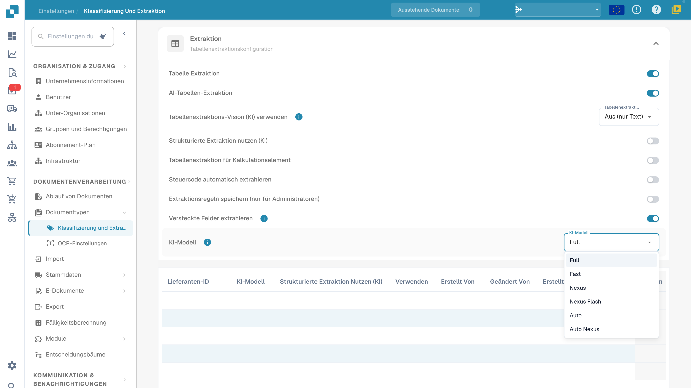

# KI-Modell

## Übersicht

Die Einstellung **KI-Modell** ermöglicht es Ihnen zu definieren, welches KI-Modell standardmäßig für die **Feldextraktion** und **Tabellenextraktion** während der Dokumentenverarbeitung verwendet wird.\
Hier prüfen Sie das Organisationsmodell und vorlagenbezogene Überschreibungen. Verbindliche Kosten entnehmen Sie den aktuellen Angaben Ihrer Umgebung und den vereinbarten Konditionen.

## So greifen Sie zu

1.  Navigieren Sie zu **Einstellungen** → **Dokumentenverarbeitung** → **Klassifizierung und Extraktion**

    <!-- Obsolete illustration retired: Retire historical navigation, table or deletion illustration; current view is shown in the model-options section and deletion was not performed -->
2.  Scrollen Sie nach unten zum Abschnitt **Extraktion**

    <!-- Obsolete illustration retired: Retire historical navigation, table or deletion illustration; current view is shown in the model-options section and deletion was not performed -->

## KI-Modell-Optionen

Das Menü bietet **Full**, **Fast**, **Nexus**, **Nexus Flash**, **Auto** und **Auto Nexus**. Dies sind Produktstufen. Verfügbare Optionen, zugrunde liegende Modelle und Token-Kosten können sich ändern. Prüfen Sie die Angaben Ihrer aktuellen Umgebung und die vereinbarten Konditionen; historische Modellnamen oder feste Preise sind keine dauerhafte Zusage.

| Option | Was Sie mit repräsentativen Dokumenten prüfen sollten |
| --- | --- |
| **Full** | Extraktion bei komplexen Layouts, Verarbeitungszeit und Kosten. |
| **Fast** | Ergebnisse und Laufzeit bei Alltagsdokumenten; der Name garantiert nicht für jedes Dokument eine schnellere Verarbeitung. |
| **Nexus** | Vergleich dieser Alternative mit derselben Dokumentstichprobe. |
| **Nexus Flash** | Qualität und Laufzeit bei den tatsächlich verarbeiteten Layouts. |
| **Auto** | Ergebnisse und Kosten der automatischen Auswahl. |
| **Auto Nexus** | Ergebnisse und Kosten der automatischen Auswahl innerhalb der Nexus-Optionen. |

Ohne Überschreibung für die aktuelle Extraktionsvorlage gilt die Organisationseinstellung. Ein nicht gesetztes lieferantenspezifisches Modell bedeutet daher nicht allgemein „Fast“. Vergleichen Sie Modelle mit einer festen Stichprobe. Ein Modellwechsel allein garantiert weder Feldvalidierung noch Bestellabgleich, Freigabe oder Export.

<figure><figcaption>
Aktuelle deutsche Extraktionseinstellungen mit den sechs KI-Modellstufen Full, Fast, Nexus, Nexus Flash, Auto und Auto Nexus. Die Tabellenspalte „Verwenden“ bezeichnet E-Text. Private Werte sind ausgeblendet; es wurde kein Modell gewechselt.
</figcaption></figure>

## KI-Modell-Zuweisungstabelle

Der **Validierungsbildschirm** bietet einen Einstieg für lieferantenspezifische Modelle. Die Überschreibung wird für die Organisation und die aktuelle Extraktionsvorlage (`tfidf_id`) gespeichert. Sie ändert nicht automatisch sämtliche Vorlagen oder historischen Dokumente desselben Lieferanten.\
\
Weitere Informationen finden Sie in der entsprechenden Dokumentation [hier](../../../../end-user-and-partner-section/end-user-section/validation-screen/supplier-specific-ai-model-for-field-and-table-extraction.md).

Die Zuweisungstabelle fasst vorlagenbezogene Extraktionseinstellungen zusammen. Die Spalten können je nach Version abweichen; prüfen Sie die aktuellen Überschriften für Lieferantenzuordnung, Modell, Extraktionsoptionen und Änderungsinformationen:

* **Lieferanten-ID** – Die eindeutige Kennung des Lieferanten
* **KI-Modell** – Die für diesen Vorlageneintrag festgelegte Stufe
* **Strukturierte Extraktion nutzen (KI)**, falls angezeigt – Die entsprechende Extraktionseinstellung dieses Eintrags
* **E-Text** – Schalter für die E-Text-Funktion; die deutsche Oberfläche beschriftet diese Spalte derzeit nur mit **Verwenden**
* **Erstellt Von / Geändert Von / Erstellt / Geändert** – Wer den Eintrag gesetzt hat und wann
* **Zeilenmenü** – Enthält gegebenenfalls die Aktion zum Entfernen des Eintrags

<!-- Obsolete illustration retired: Retire historical navigation, table or deletion illustration; current view is shown in the model-options section and deletion was not performed -->

### Eintrag löschen – Vorlagenbezogene Überschreibungen entfernen

Prüfen Sie vor dem Löschen, welche Extraktionsvorlage und welche Überschreibungen der Eintrag betrifft. Das Löschen kann mehrere Einstellungen dieser Vorlage entfernen, nicht nur das Modell:

1.  Öffnen Sie das Zeilenmenü des betroffenen Vorlageneintrags und wählen Sie **Löschen**, wenn Sie die enthaltenen Überschreibungen tatsächlich entfernen möchten.

    <!-- Obsolete illustration retired: Retire historical navigation, table or deletion illustration; current view is shown in the model-options section and deletion was not performed -->
2.  Ein Bestätigungsdialog wird angezeigt – bestätigen Sie, dass Sie den Eintrag löschen möchten.

    <!-- Obsolete illustration retired: Retire historical navigation, table or deletion illustration; current view is shown in the model-options section and deletion was not performed -->

Nach dem Löschen liest die nachfolgende Verarbeitung die anwendbare Organisationskonfiguration und Rückfallwerte für diese Vorlage. Andere Vorlagen desselben Lieferanten können eigene Überschreibungen behalten. Historische Dokumente werden nicht automatisch erneut verarbeitet. Für diese Anleitung wurde kein Eintrag gelöscht und kein daraus resultierendes Extraktionsergebnis getestet.
