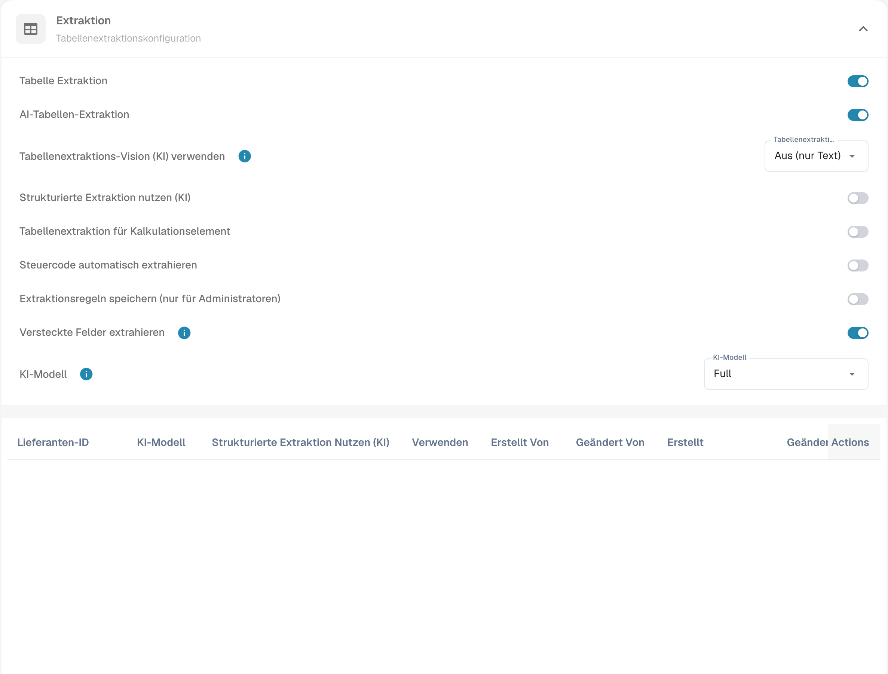

# Steuercode automatisch extrahieren

## Aktivierung

1. Öffnen Sie **Einstellungen → Klassifizierung und Extraktion**.
2. Aktivieren Sie im Bereich **Extraktion** die Option **Steuercode automatisch extrahieren**.

<figure><figcaption>
Deutsche Einstellungen zur automatischen Steuercode-Erkennung.
</figcaption></figure>

## Funktion

Wenn die Funktion aktiv und ein Steuercode-Feld eingerichtet ist, befüllt DocBits dieses Feld automatisch in der **Feldvalidierung**.

Die folgende Tabelle beschreibt die Regeln zur Ermittlung des Steuercodes. Technische Steuer- und ERP-Feldcodes bleiben unverändert.

<table data-full-width="true"><thead><tr><th>Rechnungsart</th><th></th><th>Steuercode</th><th>Alternativ im Textfeld</th><th>Bestellnummer</th><th>Lieferantenland</th><th>Regel</th></tr></thead><tbody><tr><td>Kostenrechnung</td><td>Mit Steuerbetrag</td><td>NAGDH</td><td>LD + % (auf den höchsten Absolutbetrag gerundet)</td><td>Leer</td><td>Erste zwei Zeichen der Steuer-ID oder Land der Lieferantenadresse: tccom120.cadr → tccom130.cadr, Feld tcom130.ccty</td><td>Lieferantenland entspricht dem Unternehmensland</td></tr><tr><td>Kostenrechnung</td><td>Ohne Steuerbetrag</td><td>NAGD0</td><td>LD + % (auf den höchsten Absolutbetrag gerundet)</td><td>Leer</td><td>Erste zwei Zeichen der Steuer-ID oder Land der Lieferantenadresse: tccom120.cadr → tccom130.cadr, Feld tcom130.ccty</td><td>Lieferantenland entspricht dem Unternehmensland</td></tr><tr><td>Kostenrechnung</td><td>Ohne Steuerbetrag</td><td>EUDH</td><td>ED 0 %</td><td>Leer</td><td>Erste zwei Zeichen der Steuer-ID oder Land der Lieferantenadresse: tccom120.cadr → tccom130.cadr, Feld tcom130.ccty</td><td>Anderes Lieferantenland, das in der Ländertabelle (tcmcs010) als EU-Land geführt wird</td></tr><tr><td>Bestellrechnung</td><td>Mit Steuerbetrag</td><td>NAHGH</td><td>IG + % (auf den höchsten Absolutbetrag gerundet)</td><td>Nicht leer</td><td>Erste zwei Zeichen der Steuer-ID oder Land der Lieferantenadresse: tccom120.cadr → tccom130.cadr, Feld tcom130.ccty</td><td>Lieferantenland entspricht dem Unternehmensland</td></tr><tr><td>Bestellrechnung</td><td>Ohne Steuerbetrag</td><td>NAHG0</td><td>IG + % (auf den höchsten Absolutbetrag gerundet)</td><td>Nicht leer</td><td>Erste zwei Zeichen der Steuer-ID oder Land der Lieferantenadresse: tccom120.cadr → tccom130.cadr, Feld tcom130.ccty</td><td>Lieferantenland entspricht dem Unternehmensland</td></tr><tr><td>Bestellrechnung</td><td>Mit Steuerbetrag</td><td>EUGH</td><td>ED 0 %</td><td>Nicht leer</td><td>Erste zwei Zeichen der Steuer-ID oder Land der Lieferantenadresse: tccom120.cadr → tccom130.cadr, Feld tcom130.ccty</td><td>Anderes Lieferantenland, das in der Ländertabelle (tcmcs010) als EU-Land geführt wird</td></tr><tr><td>Kostenrechnung</td><td>Ohne Steuerbetrag</td><td>IMGD</td><td>ID 0 %</td><td>Leer</td><td>Erste zwei Zeichen der Steuer-ID oder Land der Lieferantenadresse: tccom120.cadr → tccom130.cadr, Feld tcom130.ccty</td><td>Anderes Lieferantenland, das in der Ländertabelle (tcmcs010) nicht als EU-Mitglied geführt wird</td></tr><tr><td>Bestellrechnung</td><td>Mit Steuerbetrag</td><td>IMHG</td><td>IG 0 %</td><td>Nicht leer</td><td>Erste zwei Zeichen der Steuer-ID oder Land der Lieferantenadresse: tccom120.cadr → tccom130.cadr, Feld tcom130.ccty</td><td>Anderes Lieferantenland, das in der Ländertabelle (tcmcs010) nicht als EU-Mitglied geführt wird</td></tr></tbody></table>
