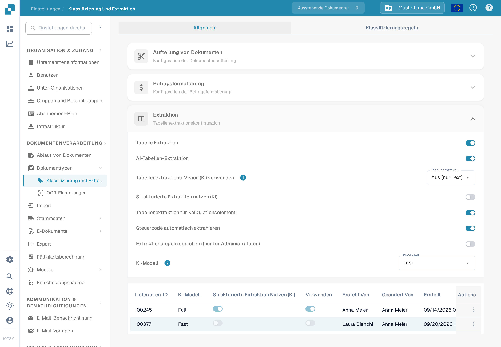

# Tabellenextraktion für Kostenelemente

Kostenelemente sind Gebühren oder sonstige Beträge, die als Positionen in der Rechnungstabelle dargestellt werden. Ist diese Funktion aktiviert und enthält das Dokument extrahierte Positionen, kann DocBits diese Positionen anhand der für die Organisation konfigurierten Kostenelemente klassifizieren. Ein Prüfer kann die Klassifizierung einer Position in der Dokumenttabelle korrigieren.

## Einstellung aktivieren

1. Öffnen Sie **Einstellungen → Dokumentenverarbeitung → Klassifizierung und Extraktion**.
2. Bleiben Sie auf **Allgemein** und klappen Sie **Extraktion** auf.
3. Suchen Sie **Tabellenextraktion für Kalkulationselement** unterhalb der Felder, die für die Tabellenextraktion angefordert wurden. Ein Administrator kann diesen Schalter für die Organisation einschalten.

<figure><figcaption>
Der Schalter erscheint in dieser synthetischen Aufnahme eingeschaltet. Das Bild belegt nicht den Zustand einer realen Organisation.
</figcaption></figure>


Der Schalter allein erzeugt keine Kostenelemente oder Rechnungspositionen. Konfigurieren Sie zuerst die Kostenelemente und importieren Sie die benötigten Daten. Die verknüpfte [Anleitung zur Einrichtung von Kostenelementen](../../../../infor-integration-and-configuration/importing-customer-master-data/m3/table-extraction-for-costing-element.md) zeigt das M3-Beispiel. Weitere Extraktionseinstellungen finden Sie unter [Klassifizierung und Extraktion](README.md).


## Position prüfen oder korrigieren

Öffnen Sie ein Dokument, dessen Rechnungstabelle extrahierte Positionen enthält, und sehen Sie sich das Kostenelement-Symbol neben der betreffenden Position an. Wählen Sie das Symbol aus, um die verfügbaren Klassifizierungen zu öffnen. Wählen Sie das richtige konfigurierte Kostenelement, oder wählen Sie **Uncategorize**, wenn die Position ein gewöhnlicher Artikel ist. Prüfen Sie anschließend die resultierende Position und die Summen, bevor Sie das Dokument speichern.

Wenn das Symbol oder eine Klassifizierung fehlt, prüfen Sie zuerst, ob das Dokument extrahierte Positionen hat, die Funktion aktiviert ist und ein Kostenelement für die Organisation konfiguriert wurde. Das synthetische Testdokument der Organisation A, das für diese Dokumentenprüfung verwendet wurde, hatte keine extrahierten Rechnungspositionen; deshalb konnte das Klassifizierungsmenü nicht abgebildet oder ausprobiert werden. Die obigen Schritte entsprechen dem aktuellen Steuerelement im Dokument; bei dieser Prüfung wurde keine Klassifizierung gespeichert.
