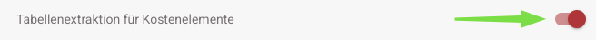

# Tabellenextraktion für Kostenelemente

### **Was macht es?**

Wenn aktiviert, kann **DocBits** **Kostenelemente** aus Tabellen auf **Zeilenebene** extrahieren und entsprechend klassifizieren.

* Wenn das System einen Artikel nicht klassifiziert oder ihn falsch klassifiziert, erscheint ein **Symbol** auf der linken Seite.
* Ein Klick auf dieses Symbol öffnet eine Liste aller **konfigurierten Kostenelemente**, die es Ihnen ermöglicht:
  * **Die Klassifizierung zu ändern**, wenn sie falsch ist.
  * **Den Artikel auf "Unkategorisiert" zu setzen**, wenn es sich um einen regulären Artikel und nicht um ein Kostenelement handelt.

### **Wie man Kostenelemente konfiguriert**

Sie finden die **Anleitung zur Einrichtung von Kostenelementen** in **DocBits** hier.


[table-extraction-for-costing-element.md](../../../../infor-integration-and-configuration/exporting-to-infor/exporting-to-idm/table-extraction-for-costing-element.md)


### **Wo man es aktivieren kann**

1. Gehen Sie zu **Einstellungen → Dokumentenverarbeitung → Klassifizierung und Extraktion → Tabellenextraktion**.
2. Aktivieren Sie **Kostenelementextraktion**.

<figure><figcaption></figcaption></figure>

### **Wie man die Klassifizierung festlegt oder ändert**

1.  Klicken Sie auf das **Kästchen-Symbol** neben dem Artikel.\\

    
2.  Ein **Dropdown-Menü** mit allen konfigurierten Kostenelementen erscheint.\\

    
3.  Wählen Sie den richtigen **Kostenelementtyp** aus.\\

    
4. Die Klassifizierung wird nun entsprechend aktualisiert.

