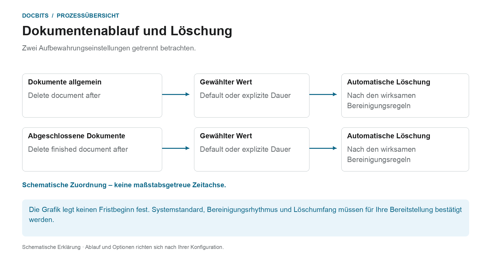

# Dokumentenablauf

## Zwei Aufbewahrungsregeln statt einer allgemeinen Löschfrist

<figure><figcaption>
Zwei Aufbewahrungseinstellungen getrennt betrachten. Die Grafik ist schematisch; maßgeblich sind die aktiven Einstellungen Ihrer Organisation.
</figcaption></figure>

Der Dokumentenablauf unterscheidet die allgemeine Dokumentenaufbewahrung von der Aufbewahrung abgeschlossener Dokumente. Prüfen Sie beide Einstellungen zusammen mit den Anforderungen Ihres Prozesses und dem vorgesehenen Zielarchiv.

| Einstellung | Was Sie klären sollten |
| --- | --- |
| **Delete document after** | Welcher Aufbewahrungswert für Dokumente in Ihrer Organisation tatsächlich wirksam ist. |
| **Delete finished document after** | Welcher Wert für abgeschlossene, vollständig verarbeitete und exportierte Dokumente gilt. |
| **Default** | Welcher Systemstandard in Ihrer Bereitstellung hinterlegt ist. Die Bezeichnung allein nennt keine Dauer. |

Die Grafik ist **keine maßstabsgetreue Zeitachse**. Sie legt weder den technischen Beginn der Frist noch den Vorrang der beiden Einstellungen fest. Aus einem Dropdown-Wert allein lässt sich kein sekundengenauer Löschzeitpunkt ableiten. Lassen Sie für eine verbindliche Planung auch den Bereinigungsrhythmus bestätigen.

### Export, Aufbewahrung und Backups trennen

Ein erfolgreicher Export ist kein Beleg, dass die DocBits-Kopie bereits gelöscht wurde. Umgekehrt entfernt eine Löschung in DocBits keine unabhängig gespeicherte ERP- oder Archivkopie. Sicherungen können eigene Aufbewahrungsregeln haben; die produktive Dokumentenlöschung belegt nicht die gleichzeitige Entfernung aller Backup-Kopien.

Prüfen Sie die Fristen vor Änderungen und stimmen Sie das Zielarchiv sowie die Behandlung von Sicherungen ab. Die Übersicht [Datenspeicherung, Aufbewahrung und Löschung](../../../security/data-storage-and-retention.md) erklärt die Unterschiede zwischen Dokumenten, OCR-Zwischendateien, Protokollen und Backups.

<figure><figcaption>
Einstellungen für den Dokumentenablauf
</figcaption></figure>

Unter **Document Processing → Documents Expiry** steuern Sie, wie lange DocBits Ihre Dokumente aufbewahrt, bevor sie automatisch gelöscht werden. Das hilft Ihnen, Speicherplatz zu verwalten, Richtlinien zur Datenaufbewahrung durchzusetzen und gesetzliche oder organisatorische Vorgaben zur Dauer der Dokumentenspeicherung einzuhalten.

Zwei Einstellungen steuern die automatische Löschung:

| Einstellung | Was sie steuert |
|---------|------------------|
| **Delete document after** | Wie lange ein verarbeitetes Dokument aufbewahrt wird, bevor es automatisch gelöscht wird. |
| **Delete finished document after** | Wie lange ein abgeschlossenes (vollständig verarbeitetes und exportiertes) Dokument aufbewahrt wird, bevor es automatisch gelöscht wird. |

Für jede Einstellung wählen Sie im Dropdown-Menü einen Zeitraum:

<figure><figcaption>
Verfügbare Aufbewahrungszeiträume
</figcaption></figure>

| Option | Bedeutung |
|--------|---------|
| **Default** | Der Standard-Aufbewahrungszeitraum des Systems wird verwendet (keine benutzerdefinierte Abweichung). |
| **48 Hours** | Expliziter Aufbewahrungswert von 48 Stunden; Fristbeginn und Bereinigungsrhythmus gesondert bestätigen. |
| **1 Week** | Expliziter Aufbewahrungswert von einer Woche. |
| **2 Weeks** | Expliziter Aufbewahrungswert von zwei Wochen. |
| **4 Weeks** | Expliziter Aufbewahrungswert von vier Wochen. |

Die Einstellungen unterstützen die geplante Dokumentenaufbewahrung. Sie ersetzen keine Abstimmung der wirksamen Fristen, des Zielarchivs und des Löschumfangs für Ihre Organisation.
