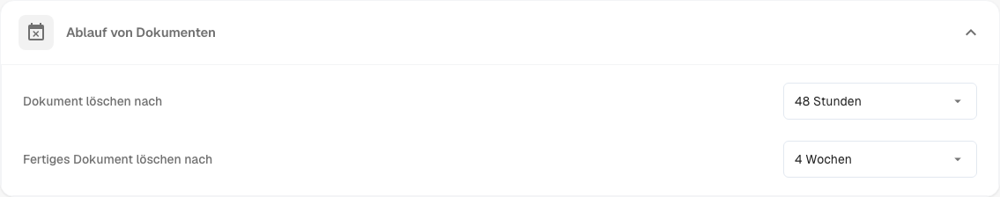
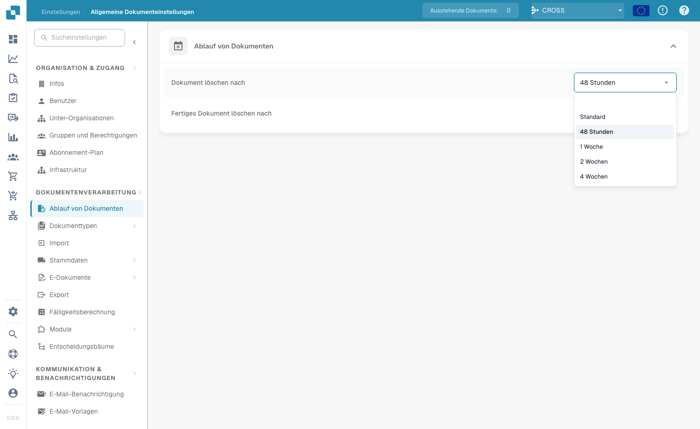

# Dokumentenablauf

<figure><figcaption>
Einstellungen für den Dokumentenablauf
</figcaption></figure>

Unter **Document Processing → Documents Expiry** steuern Sie, wie lange DocBits Ihre Dokumente aufbewahrt, bevor sie automatisch gelöscht werden. Das hilft Ihnen, Speicherplatz zu verwalten, Richtlinien zur Datenaufbewahrung durchzusetzen und gesetzliche oder organisatorische Vorgaben zur Dauer der Dokumentenspeicherung einzuhalten.

Zwei Einstellungen steuern die automatische Löschung:

| Einstellung | Was sie steuert |
|---------|------------------|
| **Delete document after** | Wie lange ein verarbeitetes Dokument aufbewahrt wird, bevor es automatisch gelöscht wird. |
| **Delete finished document after** | Wie lange ein abgeschlossenes (vollständig verarbeitetes und exportiertes) Dokument aufbewahrt wird, bevor es automatisch gelöscht wird. |

Für jede Einstellung wählen Sie im Dropdown-Menü einen Zeitraum:

<figure><figcaption>
Verfügbare Aufbewahrungszeiträume
</figcaption></figure>

| Option | Bedeutung |
|--------|---------|
| **Default** | Der Standard-Aufbewahrungszeitraum des Systems wird verwendet (keine benutzerdefinierte Abweichung). |
| **48 Hours** | Löschung 48 Stunden nach der Verarbeitung. |
| **1 Week** | Löschung nach einer Woche. |
| **2 Weeks** | Löschung nach zwei Wochen. |
| **4 Weeks** | Löschung nach vier Wochen. |

Beide Einstellungen stellen sicher, dass Dokumente nicht länger als nötig im System verbleiben. So vermeiden Sie unnötigen Speicherverbrauch und halten den Dokumenten-Workflow übersichtlich. Besonders wichtig sind sie für Organisationen, die bestimmte regulatorische Anforderungen an die Dokumentenaufbewahrung erfüllen müssen.
