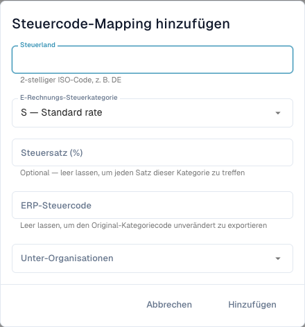

# E-Rechnungs-Steuerkategorien ERP-Steuercodes zuordnen

<figure><figcaption>
Formular für die Steuercode-Zuordnung vor dem Speichern eines Eintrags.
</figcaption></figure>

E-Rechnungen können eine Umsatzsteuerkategorie wie **S** statt des benötigten ERP-Steuercodes enthalten. Die Steuercode-Zuordnung definiert diese Umsetzung. Sie ist von Steuerbetragskorrekturen und E-Rechnungs-Prüfregeln getrennt.

## Voraussetzungen

Sie benötigen Administratorrechte, Steuerland, Kategorie und Steuersatz der Rechnung sowie einen mit der ERP-Verwaltung abgestimmten Steuercode. Prüfen Sie Organisation und Unterorganisation. Die Seite muss in Ihrer Version verfügbar sein.

## Zuordnung erstellen und prüfen

1. Öffnen Sie **Einstellungen → E-Dokumente → Steuercode-Zuordnung** und prüfen Sie bestehende Einträge.
2. Wählen Sie **Steuercode-Mapping hinzufügen**.
3. Geben Sie das Steuerland als zweistelligen ISO-Code ein, beispielsweise `DE`.
4. Wählen Sie die Umsatzsteuerkategorie: etwa **S** für regulären Steuersatz, **Z** für Nullsatz, **E** für steuerbefreit oder **O** für außerhalb des Steuerumfangs. Tauschen Sie Kategorien nicht zum Umgehen einer Fehlermeldung aus.
5. Geben Sie einen bestimmten Steuersatz ein. Leer bedeutet laut Formular jeden Steuersatz dieser Kategorie.
6. Geben Sie den ERP-Steuercode und gegebenenfalls die Unterorganisationen an. Ein leerer ERP-Code erlaubt ausdrücklich die unveränderte Rohkategorie; verwenden Sie dies nur, wenn das Ziel sie akzeptiert.
7. Fügen Sie den Eintrag hinzu. Prüfen Sie gespeichertes Land, Kategorie, Satz, ERP-Code, Geltungsbereich und Aktivstatus.
8. Testen Sie eine passende E-Rechnung mit kontrolliertem Exportziel. Prüfen Sie tatsächlichen ERP-Code und Antwort sowie den Fehlerfall einer fehlenden/falschen Zuordnung.

Eine deutsche Rechnung mit `S` und Satz `19` benötigt den dafür eingerichteten ERP-Code. Entnehmen Sie ihn Ihrer Konfiguration; ein Democode ist kein Produktivstandard.

## Fehler beheben

Vergleichen Sie bei fehlender Zuordnung tatsächliches Land, Kategorie, Satz, Geltungsbereich und Aktivstatus. Prüfen Sie die Integrationsantwort, bevor Sie einen Export mit unklarem Zielergebnis wiederholen. Das Entfernen einer Zuordnung verändert zukünftige Vorgänge und macht frühere Exporte nicht rückgängig.

Siehe [E-Rechnungsprüfung](validation-rules.md) und [Export](../export.md).
