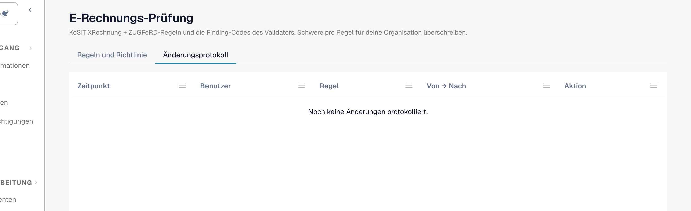

# Änderungsprotokoll

Das **Änderungsprotokoll** hält jede Änderung der Prüfungseinstellungen fest. Es gehört zur [E-Rechnungs-Prüfung](validation-rules.md). Nur Organisationsadministratoren können es sehen.

Öffnen Sie den Tab **Änderungsprotokoll** neben **Regeln und Richtlinie**.

<figure><figcaption>
Das Änderungsprotokoll mit vier Beispiel-Einträgen. Der Benutzername ist durch einen Beispielnamen ersetzt.
</figcaption></figure>

| Spalte | Was sie zeigt |
| --- | --- |
| **Zeitpunkt** | Der Zeitpunkt der Änderung. |
| **Benutzer** | Der Benutzer, der die Änderung vorgenommen hat. |
| **Regel** | Die Einstellung oder Regel, die sich geändert hat. |
| **Von → Nach** | Der alte und der neue Wert. |
| **Aktion** | Die Art der Änderung. Zeilen aus dem Setup-Assistenten können Sie öffnen, um die einzelnen Änderungen zu sehen. |

Die Liste zeigt 50 Einträge pro Seite.

Jede Änderung in der Tabelle [Prüfung je Dokumenttyp](validation-per-document-type.md) erzeugt nach Ihrer Bestätigung einen Eintrag.
