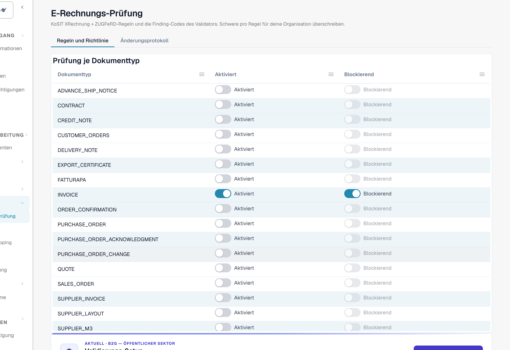

# E-Rechnungs-Prüfung

Die Seite **E-Rechnungs-Prüfung** (**Einstellungen → E-Dokumente → E-Rechnungs-Prüfung**, Pfad `/settings/einvoice-validation`; früher *Validierungsregeln* genannt) steuert, wie DocBits eingehende E-Rechnungen validiert. Sie basiert auf dem offiziellen **KoSIT XRechnung + ZUGFeRD**-Regelsatz sowie den internen Finding-Codes des Validators und ermöglicht es Ihnen, den Schweregrad jeder Regel für Ihre Organisation zu überschreiben.

> Diese Seite gilt für **E-Rechnungen** (XRechnung, ZUGFeRD, Factur-X). Sie ist nicht dasselbe wie die **Datenvalidierungsregeln**, die extrahierte Dokumentfelder prüfen.

## Was Sie auf dieser Seite finden

<figure><figcaption>
Die Seite E-Rechnungs-Prüfung. Der Tab <strong>Regeln und Richtlinie</strong> beginnt mit der Tabelle <strong>Prüfung je Dokumenttyp</strong>. Beispielorganisation.
</figcaption></figure>

| Thema | Was es bewirkt | Wer |
| --- | --- | --- |
| [Validierungs-Setup und akzeptierte Versionen](validation-setup.md) | Der Setup-Assistent, die akzeptierten XRechnung-Versionen, die akzeptierten Profile und die Bedeutung jedes Schweregrads. | Organisationsadministratoren |
| [Regel-Schweregrade](validation-rule-severities.md) | Die Regeltabelle: Ändern Sie den Schweregrad jeder Regel für Ihre Organisation. | Organisationsadministratoren |
| [Prüfung je Dokumenttyp](validation-per-document-type.md) | Prüfung einschalten (**Aktiviert**) und festlegen, ob eine fehlgeschlagene Prüfung das Dokument stoppt (**Blockierend**). Jede Änderung muss bestätigt werden. | Organisationsadministratoren |
| [Änderungsprotokoll](validation-change-log.md) | Jede Änderung der Einstellungen: wann, wer, welche Regel, von → nach. | Organisationsadministratoren |
| [Prüfbericht](validation-report.md) | Was ein Benutzer sieht, wenn eine Rechnung die Prüfung nicht besteht: die Findings in verständlicher Sprache. Er öffnet sich am Dokument, nicht auf dieser Seite. | Alle, die Rechnungen bearbeiten |
| [Nächster Schritt und Dokument ablehnen](validation-next-step-and-reject.md) | Was Sie nach dem Lesen des Berichts tun, der Download des Berichts und **Dokument ablehnen**. | Alle, die Rechnungen bearbeiten |
