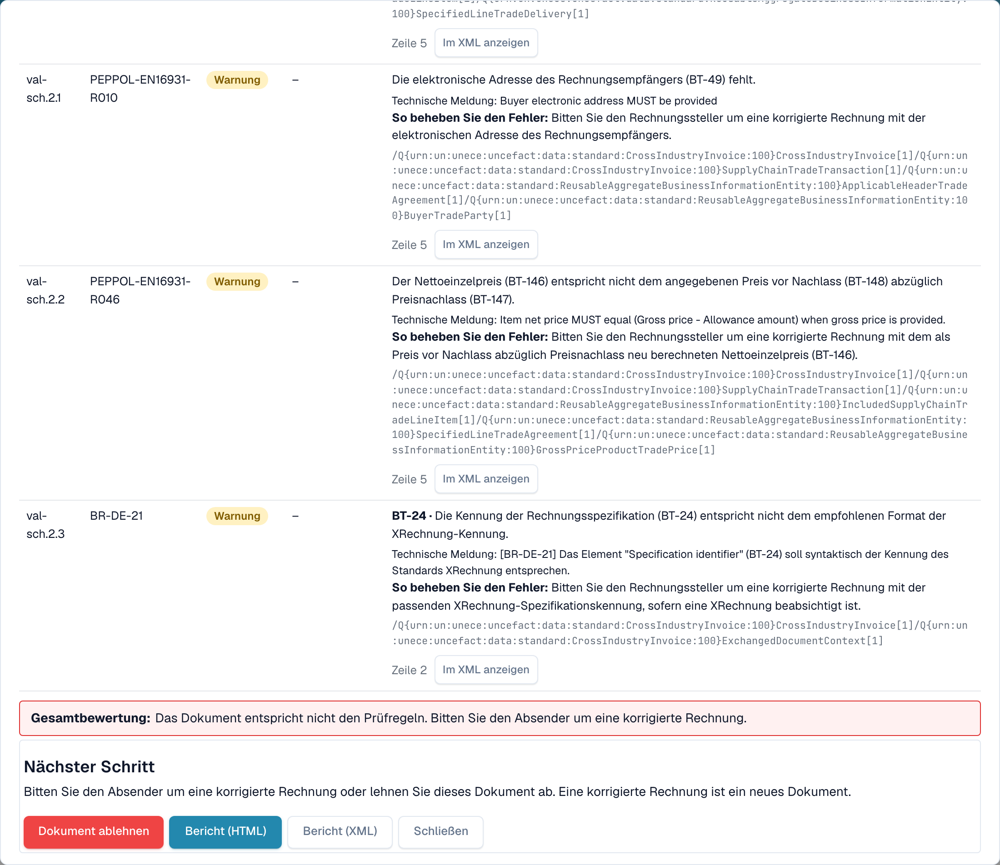
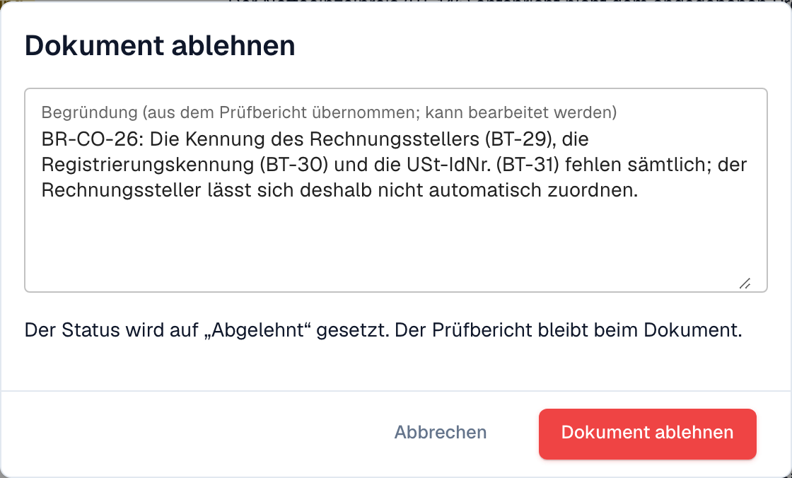

# Nächster Schritt und Dokument ablehnen

Nachdem Sie den [Prüfbericht](validation-report.md) gelesen haben, sagt Ihnen der Bericht, was zu tun ist. Sie können das Dokument auch ablehnen.

## Was als Nächstes zu tun ist

<figure><figcaption>
Die Gesamtbewertung, der nächste Schritt und die Schaltflächen am Ende des Berichts
</figcaption></figure>

Die **Gesamtbewertung** sagt in einem Satz, ob die Rechnung konform ist. Der Block **Nächster Schritt** sagt Ihnen, was zu tun ist:

| Ergebnis                  | Nächster Schritt                                                                                                                        |
| ------------------------- | --------------------------------------------------------------------------------------------------------------------------------------- |
| Mindestens ein **Fehler** | Bitten Sie den Absender um eine korrigierte Rechnung oder lehnen Sie das Dokument ab. Eine korrigierte Rechnung ist ein neues Dokument. |
| Nur **Warnungen**         | Sie können mit dem Dokument fortfahren.                                                                                                 |

Die Schaltflächen am Ende des Berichts:

* **Dokument ablehnen**: öffnet den Dialog zum Ablehnen (siehe unten).
* **Bericht (HTML)** und **Bericht (XML)**: laden den Bericht herunter, zum Beispiel um ihn an den Lieferanten zu senden.
* **Schließen**: zurück zum Dokument.

## Ein Dokument ablehnen

<figure><figcaption>
Die Begründung wird aus den Fehlern im Bericht übernommen. Sie können sie bearbeiten.
</figcaption></figure>

1. Wählen Sie im Bericht **Dokument ablehnen**.
2. Prüfen Sie die **Begründung**. DocBits übernimmt sie aus den Fehlern im Bericht. Sie können den Text bearbeiten.
3. Wählen Sie **Dokument ablehnen**, um zu bestätigen. Der Status wechselt zu **Abgelehnt**. Die Begründung wird als Notiz gespeichert, und der Prüfbericht bleibt beim Dokument.

Wählen Sie **Abbrechen**, um das Dokument unverändert zu lassen.

> **Dokument ablehnen** sehen nur Benutzer, die Dokumente bearbeiten dürfen. Die Schaltfläche ist ausgeblendet, wenn das Dokument bereits abgelehnt oder abgeschlossen ist.
