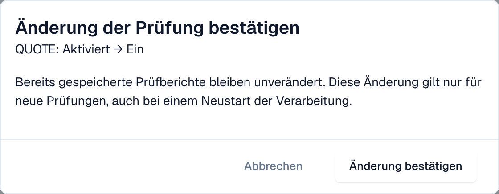

# Prüfung je Dokumenttyp

Administratoren legen für jeden Dokumenttyp fest, ob DocBits eingehende E-Rechnungen prüft und ob eine fehlgeschlagene Prüfung das Dokument blockiert. Jede Änderung wird bestätigt und im [Änderungsprotokoll](validation-change-log.md) festgehalten.

> Nur **Organisationsadministratoren** können diese Einstellungen ändern. Andere Benutzer sehen die Tabelle nur lesend oder gar nicht.

## Die Tabelle

Gehen Sie zu **Einstellungen → E-Dokumente → E-Rechnungs-Prüfung**. Der Tab **Regeln und Richtlinie** beginnt mit der Tabelle **Prüfung je Dokumenttyp**.

<figure><figcaption>
Eine Zeile je Dokumenttyp mit den Schaltern Aktiviert und Blockierend. Beispielorganisation.
</figcaption></figure>

| Schalter        | Was er bewirkt                                                                                                                                                                                                                                                   |
| --------------- | ---------------------------------------------------------------------------------------------------------------------------------------------------------------------------------------------------------------------------------------------------------------- |
| **Aktiviert**   | DocBits prüft jede eingehende E-Rechnung dieses Dokumenttyps und speichert einen [Prüfbericht](validation-report.md).                                                                                                                                            |
| **Blockierend** | Ein Finding mit dem Schweregrad Fehler stoppt das Dokument. Es erhält den Status **Fehler**. Ist Blockierend aus, speichert DocBits den Bericht und das Dokument läuft weiter. **Blockierend** können Sie nur einschalten, wenn **Aktiviert** eingeschaltet ist. |

Hat ein Dokumenttyp Überschreibungen für Untertypen, zeigt die Tabelle einen Hinweis dazu.

## Eine Einstellung ändern

1. Wählen Sie den Schalter, den Sie ändern möchten.
2. DocBits zeigt **Änderung der Prüfung bestätigen** mit dem Dokumenttyp und der Änderung, zum Beispiel _QUOTE: Aktiviert → Ein_.

<figure><figcaption>
Jede Änderung muss bestätigt werden
</figcaption></figure>

3. Lesen Sie den Hinweis: **Bereits gespeicherte Prüfberichte bleiben unverändert.** Die Änderung gilt nur für neue Prüfungen, auch bei einem Neustart der Verarbeitung eines Dokuments.
4. Wählen Sie **Änderung bestätigen** oder **Abbrechen**, um die alte Einstellung zu behalten.

Fehlt Ihnen die Berechtigung, zeigt DocBits eine Meldung, dass ein Organisationsadministrator erforderlich ist, und nichts ändert sich.

## Verwandte Seiten

* [E-Rechnungs-Prüfung](./)
* [Änderungsprotokoll](validation-change-log.md)
* [Validierungs-Setup und akzeptierte Versionen](validation-setup.md)
* [Prüfbericht](validation-report.md)
* [E-Rechnungs-Validierung aktivieren oder deaktivieren](../#e-rechnungs-validierung-aktivieren-oder-deaktivieren)
