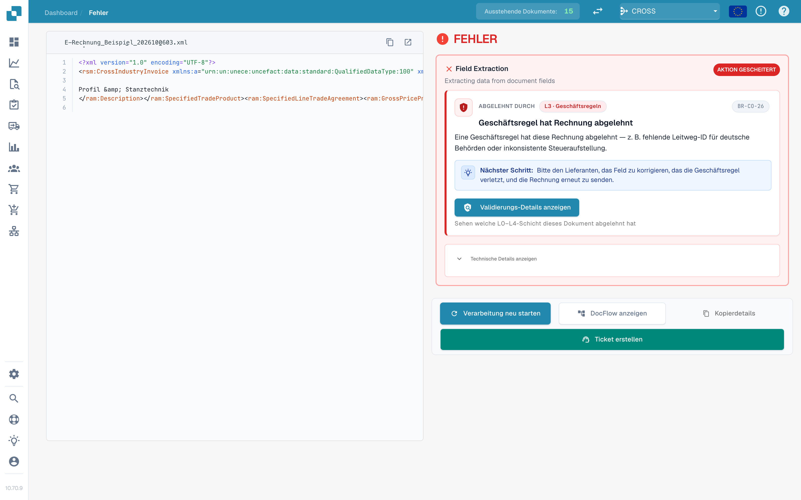
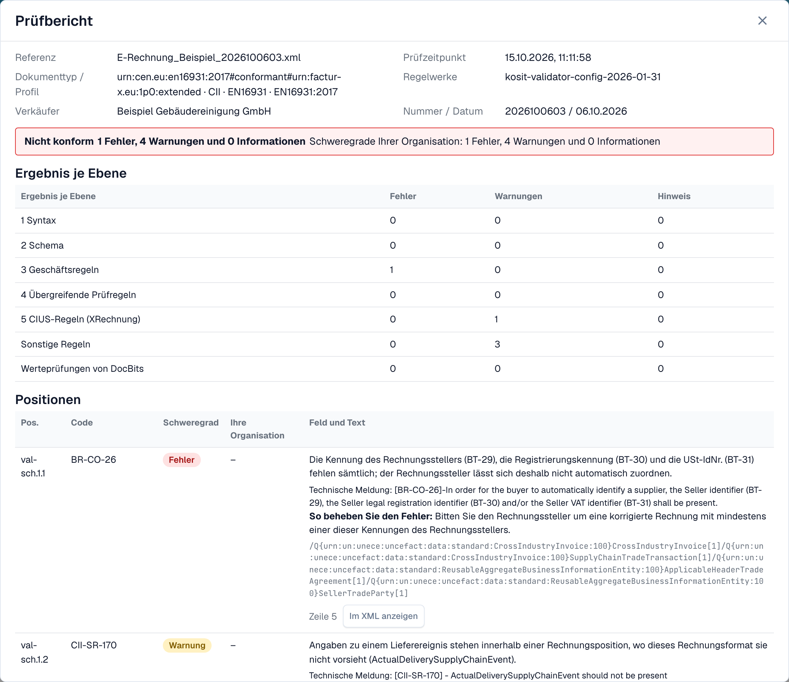
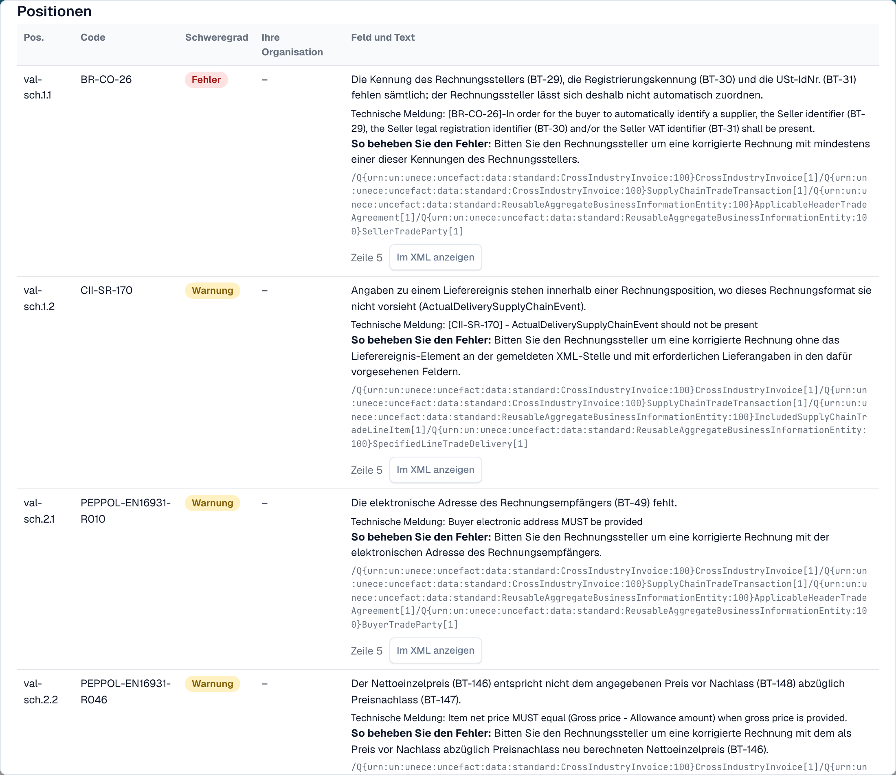

# Prüfbericht

Wenn DocBits eine E-Rechnung ablehnt, können Sie genau nachlesen, warum. Der **Prüfbericht** listet jedes Finding in verständlicher Sprache auf, sagt Ihnen, was zu korrigieren ist, und zeigt den nächsten Schritt. Sie öffnen ihn am Dokument, nicht in den Einstellungen. Die Ansicht, in der Sie ihn finden, ist beschrieben unter [Die Fehleransicht einer abgelehnten E-Rechnung](validation-error-screen.md).

Diese Seite richtet sich an Personen, die Rechnungen bearbeiten. Administratoren legen die Regeln auf der Seite [E-Rechnungs-Prüfung](./) fest und wählen je Dokumenttyp, ob eine fehlgeschlagene Prüfung die Rechnung blockiert, siehe [Prüfung je Dokumenttyp](validation-per-document-type.md).

## Wann ein Dokument den Status „Fehler" erhält

Ist die Prüfung für den Dokumenttyp **aktiviert** und **blockierend**, erhält eine Rechnung mit einem blockierenden Finding den Status **Fehler**. Öffnen Sie das Dokument über das Dashboard. Die Fehleransicht zeigt links das XML und rechts den Grund.

<figure><figcaption>
Die Fehleransicht: das XML der Rechnung und das erste blockierende Finding mit einem nächsten Schritt. Beispielrechnung mit fiktiven Namen.
</figcaption></figure>

Die Karte rechts nennt die Ebene, die die Rechnung abgelehnt hat (zum Beispiel **L3 · Geschäftsregeln**), den Regelcode (zum Beispiel `BR-CO-26`), eine kurze Erklärung und einen **Nächsten Schritt**. Wählen Sie **Validierungs-Details anzeigen**, um den vollständigen Bericht zu öffnen.

## Den Bericht lesen

<figure><figcaption>
Der Anfang des Berichts: Dateiangaben, das Ergebnis und das Ergebnis je Ebene
</figcaption></figure>

Der Bericht beginnt mit den Fakten zur Datei:

| Feld                     | Was es zeigt                                                                                 |
| ------------------------ | -------------------------------------------------------------------------------------------- |
| **Referenz**             | Der Dateiname der Rechnung.                                                                  |
| **Prüfzeitpunkt**        | Wann DocBits die Prüfung ausgeführt hat. Ein gespeicherter Bericht ändert sich später nicht. |
| **Dokumenttyp / Profil** | Das Format der Rechnung, zum Beispiel CII und EN 16931.                                      |
| **Regelwerke**           | Die Version der Regelwerke, die DocBits verwendet hat.                                       |
| **Verkäufer**            | Der Verkäufer, aus dem XML gelesen.                                                          |
| **Nummer / Datum**       | Die Rechnungsnummer und das Rechnungsdatum, aus dem XML gelesen.                             |

Unter den Dateiangaben sehen Sie das **Ergebnis**, zum Beispiel **Nicht konform**, mit der Anzahl der Fehler, Warnungen und Informationen. Hat Ihre Organisation den Schweregrad einer Regel geändert, zeigt eine zweite Angabe **Schweregrade Ihrer Organisation** die Anzahlen nach den Einstellungen Ihrer Organisation.

### Ergebnis je Ebene

Die Tabelle **Ergebnis je Ebene** zeigt, wie viele Fehler, Warnungen und Hinweise jede Prüfung gefunden hat. Die Prüfungen bauen aufeinander auf:

| Ebene                          | Was geprüft wird                                                |
| ------------------------------ | --------------------------------------------------------------- |
| **1 Syntax**                   | Das XML ist wohlgeformt.                                        |
| **2 Schema**                   | Die Struktur entspricht dem offiziellen XML-Schema.             |
| **3 Geschäftsregeln**          | Pflichtfelder sind vorhanden und korrekt (Regeln `BR-…`).       |
| **4 Übergreifende Prüfregeln** | Felder stimmen miteinander überein, zum Beispiel Summen.        |
| **5 CIUS-Regeln (XRechnung)**  | Die zusätzlichen deutschen XRechnung-Regeln.                    |
| **Sonstige Regeln**            | Weitere Regeln, zum Beispiel die PEPPOL-Regeln.                 |
| **Werteprüfungen von DocBits** | Prüfungen, die DocBits ergänzt, zum Beispiel IBAN und USt-IdNr. |

> Bei Rechnungen im Profil EN 16931 oder EXTENDED werden die XRechnung-spezifischen Regeln als **Warnungen** angezeigt, nicht als Fehler.

## Die Findings

<figure><figcaption>
Jedes Finding hat einen Code, einen Schweregrad, einen lesbaren Text und einen Hinweis zur Behebung
</figcaption></figure>

Jedes Finding ist eine Zeile im Abschnitt **Positionen**:

* **Pos.** und **Code**: die Position im Bericht und der Regelcode, zum Beispiel `BR-CO-26`.
* **Schweregrad**: **Fehler**, **Warnung** oder **Hinweis**.
* **Ihre Organisation**: der Schweregrad nach den Einstellungen Ihrer Organisation. Ein Strich bedeutet, dass Ihre Organisation den Schweregrad nicht geändert hat.
* **Feld und Text**: das Problem in verständlicher Sprache, das betroffene Feld (zum Beispiel _BT-29_), die **Technische Meldung** des Validators und **So beheben Sie den Fehler**.
* **Zeile** und **Im XML anzeigen**: Wählen Sie **Im XML anzeigen**, um den Bericht zu schließen und zur Zeile im XML-Viewer zu springen.

DocBits hat verständliche Texte für die häufigsten Regeln. Für eine Regel ohne einen solchen Text zeigt der Bericht die technische Meldung des Validators.

## Weiter

* [Nächster Schritt und Dokument ablehnen](validation-next-step-and-reject.md): was Sie nach dem Lesen des Berichts tun.

## Verwandte Seiten

* [E-Rechnungs-Prüfung](./): akzeptierte Versionen, Profile und der Schweregrad jeder Regel.
* [Prüfung je Dokumenttyp](validation-per-document-type.md): Prüfung aktivieren und Blockieren festlegen.
* [Benachrichtigungsrouting](../notification-routing.md): wer welches Finding bearbeitet.
