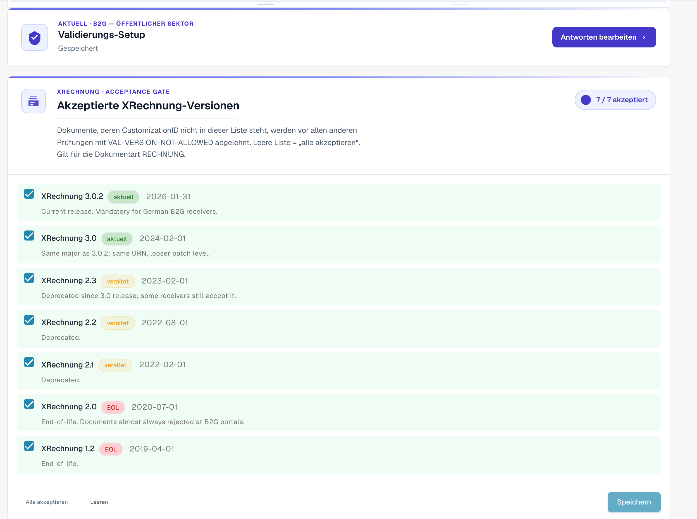
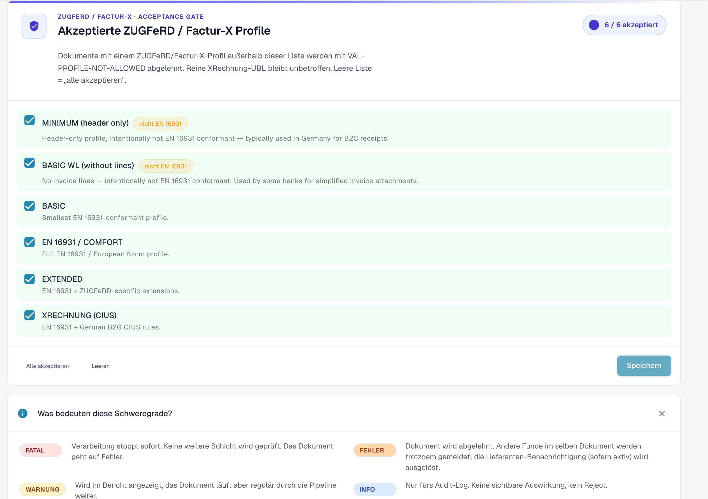

# Validierungs-Setup und akzeptierte Versionen

Diese Seite erklärt den Setup-Assistenten, die akzeptierten XRechnung-Versionen und die akzeptierten Profile der Seite [E-Rechnungs-Prüfung](validation-rules.md). Nur Organisationsadministratoren können diese Einstellungen ändern.

## Validierungs-Setup

<figure><figcaption>
Validierungs-Setup und akzeptierte XRechnung-Versionen
</figcaption></figure>

Die Karte **Validierungs-Setup** zeigt Ihr aktuelles Validierungsprofil (zum Beispiel *B2G – Public Sector Receiver*). Klicken Sie auf **Antworten bearbeiten**, um den Setup-Assistenten erneut auszuführen und den Standard zu ändern, gegen den validiert wird.

## Akzeptierte XRechnung-Versionen

Das Gate **Akzeptierte XRechnung-Versionen** listet jede XRechnung-Version auf. Markieren Sie die Versionen, die Sie akzeptieren – Dokumente, deren CustomizationID außerhalb dieser Liste liegt, werden bereits vor jeder weiteren Prüfung mit `VAL-VERSION-NOT-ALLOWED` abgelehnt. Eine leere Liste bedeutet „alles akzeptieren". Jede Version ist mit **current**, **deprecated** oder **EOL** sowie ihrem Veröffentlichungsdatum gekennzeichnet.

## Akzeptierte Profile und Schweregrad-Modell

<figure><figcaption>
Akzeptierte Profile und die Bedeutung der Schweregrade
</figcaption></figure>

Wählen Sie über **Alle akzeptieren** / **Leeren** und anschließend **Speichern**, welche **Profile** Sie akzeptieren (BASIC WL, BASIC, EN 16931 / COMFORT, EXTENDED, XRECHNUNG (CIUS)).

Jede Validierungsregel hat einen **Schweregrad**, der bestimmt, was beim Auslösen geschieht:

| Schweregrad | Auswirkung |
|-------------|------------|
| **FATAL** | Stoppt die Verarbeitung sofort. Keine weitere Ebene wird geprüft; das Dokument geht in den Fehlerstatus. |
| **ERROR** | Das Dokument wird abgelehnt. Andere Findings desselben Dokuments werden weiterhin angezeigt; die Lieferantenbenachrichtigung (falls aktiviert) wird ausgelöst. |
| **WARNING** | Erscheint im Validierungsbericht, das Dokument durchläuft die Pipeline jedoch normal. |
| **INFO** | Nur Audit-Log. Keine nutzerseitige Auswirkung und keine Ablehnung. |

### Was der Assistent ändert

Die Karte **Validierungs-Setup** weiter unten auf der Seite öffnet mit **Antworten bearbeiten** einen Assistenten. Der Assistent ersetzt alle Regel-Überschreibungen Ihrer Organisation. DocBits warnt Sie vor dem Speichern. Prüfen Sie den Schritt **Überprüfen und anwenden** sorgfältig.

Weiter: [Regel-Schweregrade](validation-rule-severities.md) und [Prüfung je Dokumenttyp](validation-per-document-type.md).
