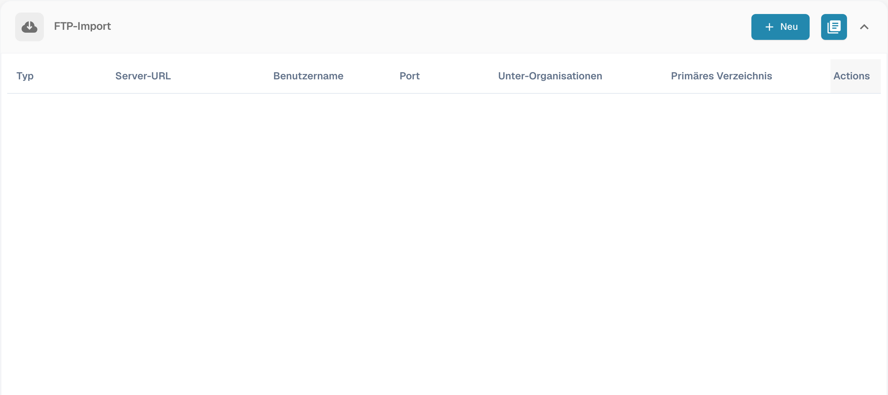

# Importieren

Die Importeinstellungen bestimmen, wie Dokumente verarbeitet werden, und ermöglichen den automatischen Empfang über FTP oder E-Mail. Öffnen Sie **Einstellungen → Dokumentverarbeitung → Importieren**.

## Dokumentoptionen

Prüfen Sie die maximale Seitenzahl, das standardmäßige Zahlungsziel in Tagen und das Datumsformat. Seiten oberhalb der eingestellten Grenze können verworfen werden. Für diese Funktion sind 60 Seiten als Standard dokumentiert; prüfen Sie vor dem Import die Einstellung Ihrer Organisation.

## FTP-Import

Sie benötigen einen kompatiblen FTP-Server, berechtigte Zugangsdaten und einen eigenen Importordner, auf den das Serverkonto zugreifen kann.

<figure><figcaption>
Deutsche Importübersicht für E-Mail- und FTP-Verbindungen.
</figcaption></figure>

### Verbindung einrichten

Erstellen Sie eine Verbindung. Der Assistent beginnt mit der Serverkonfiguration; anschließend folgen die Optionen und die Importkonfiguration.

<figure><figcaption>
Serverkonfiguration im deutschen FTP-Importassistenten.
</figcaption></figure>

| Einstellung | Bedeutung |
| --- | --- |
| Protokoll und Port | Wählen Sie FTP, FTPS oder SFTP und den vom Serveradministrator bestätigten Port. |
| Server und Zugangsdaten | Serveradresse und ein Konto mit Leseberechtigung für den Importordner. |
| Dateinamenmuster | Beschränken den Import auf passende Dateinamen. |
| Unterorganisation | Bestimmt die Zuordnung der importierten Dokumente. |
| API-Schlüssel | Falls die Konfiguration einen Schlüssel verlangt, muss er zur richtigen Organisation gehören. Veröffentlichen Sie seinen Wert nicht. |
| Hauptordner und Importordner | Legen den Speicherort der Dateien auf dem Server fest. |
| Archivierung nach dem Import | Verschiebt erfolgreich importierte Dateien in den angegebenen Archivordner. Das Konto benötigt die entsprechenden Berechtigungen. |
| Unterordner einbeziehen | Erweitert die Suche auf untergeordnete Ordner. |

Prüfen Sie alle Schritte vor dem Speichern. Kontrollieren Sie anschließend gesondert, ob die Verbindung aktiv ist. Die verfügbaren Aktionen umfassen Verbindungstest, Protokolle, Aktivieren, Deaktivieren, Bearbeiten und Löschen. Prüfen Sie Testergebnis und Protokolle, bevor Sie den regelmäßigen Import starten. Die Bilder zeigen die Liste und den ersten Schritt des ungespeicherten Assistenten; sie belegen keine geprüfte Serververbindung.

## E-Mail-Import {#email-import}

Eine E-Mail-Verbindung holt Dokumente über IMAP oder Microsoft365 OAuth aus einem eigenen Postfach ab. Die Weiterleitung an eine von DocBits bereitgestellte Adresse ist ein anderer Importweg; siehe [Eingehende E-Mails](../module/inbound-emails.md).

### Unterstützte Anhänge

Importiert werden unter anderem `.pdf`, `.tiff` / `.tif`, `.eml`, `.dat`, `.xml`, `.edi` und `.purchaseorder`.

Zusätzlich zum vom Mailserver gemeldeten Dateityp erkennt DocBits Dokumente anhand ihres tatsächlichen Inhalts. Das ist relevant, wenn ein weitergeleiteter Anhang den allgemeinen Typ `application/octet-stream` statt `application/pdf` oder `application/xml` erhält.

* Weitergeleitete `.eml`-Nachrichten und Outlook-Anhänge vom Typ `winmail.dat` (TNEF) werden entpackt, um die enthaltenen Dokumente zu importieren.
* XML mit einem allgemeinen Dateityp wird anhand der Deklaration `<?xml` erkannt; ein vorangestelltes UTF-8- oder UTF-16-BOM (LE/BE) wird berücksichtigt. Derzeit werden nur diese BOM-Kodierungen automatisch anhand des Inhalts erkannt. Mit der Dateiendung `.xml` ist der Import unabhängig von der Kodierung möglich.
* Eingebettete Bilder wie Signaturlogos und PNG-, JPG-, GIF- oder BMP-Grafiken werden ignoriert und zählen nicht als fehlgeschlagene Importe.
* Ist für die Eingangsadresse die Antwort bei Importfehlern aktiviert, geht die Benachrichtigung an die konfigurierte Antwortadresse.

### IMAP-Verbindung

Erstellen Sie im Bereich E-Mail-Import eine Verbindung und wählen Sie IMAP. Prüfen Sie SSL- oder TLS-Verschlüsselung, Server, Port, Konfigurations- beziehungsweise Benutzernamen, E-Mail-Adresse und Passwort. Wählen Sie die Unterorganisation und die Adresse für Fehlermeldungen. Falls ein API-Schlüssel angezeigt wird, prüfen Sie den Organisationskontext.

Nach dem Erstellen der Verbindung können Sie den Postfachordner und das Verschieben verarbeiteter Nachrichten in einen anderen Ordner festlegen. Falls diese Optionen noch fehlen, bearbeiten Sie die gespeicherte Verbindung. Je nach Konfiguration lassen sich auch Dokumentanhänge zusammenführen, Empfangsbestätigungen an den Absender senden und doppelte Dateinamen blockieren. Prüfen Sie Betreff und Nachricht einer Bestätigung vor deren Aktivierung.

Speichern und Aktivieren sind getrennte Aktionen. Das Menü kann Verbindungstest, Verbindungs- und Importprotokolle, Bearbeiten, Aktivieren, Deaktivieren und Löschen anbieten.

### OAuth Office365

Erstellen Sie eine E-Mail-Verbindung und wählen Sie OAuth Office365. Starten Sie die Microsoft-Authentifizierung. Falls ein Gerätecode angezeigt wird, übernehmen Sie den DocBits-Code auf die angegebene Microsoft-Seite und melden Sie sich mit dem richtigen Konto an. Kehren Sie anschließend zu DocBits zurück und schließen Sie die Authentifizierung ab.

Prüfen Sie Unterorganisation, Ordner, optionales freigegebenes Postfach, Zielordner für verarbeitete Nachrichten und die Adresse für Fehlermeldungen. Kontrollieren Sie gegebenenfalls auch die Übergabe an DocBits oder AI Workforce. Speichern Sie die Konfiguration und legen Sie fest, wann die Verbindung aktiviert beziehungsweise der Import gestartet wird. OAuth Office365 – Tenant benötigt die Daten der Anwendungsregistrierung Ihrer Organisation; stimmen Sie diese mit dem Administrator ab und beachten Sie [Eingehende E-Mails](../module/inbound-emails.md).

### Importprotokolle

Verbindungsprotokolle helfen bei Kommunikationsproblemen; Importprotokolle zeigen bisherige Ergebnisse. Das zusammengefasste Protokoll im E-Mail-Bereich umfasst die eingerichteten Verbindungen. Sie können nach Betreff oder Absender filtern, über Spaltenüberschriften sortieren und die Spaltenreihenfolge ändern. Prüfen Sie die Meldung, bevor Sie einen Import wiederholen.
