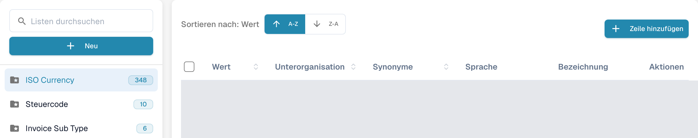
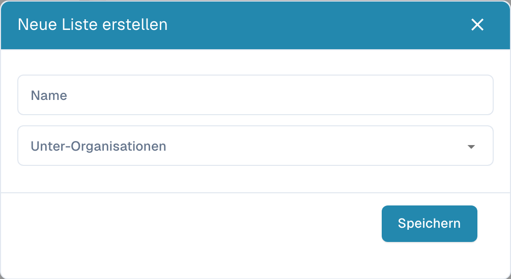
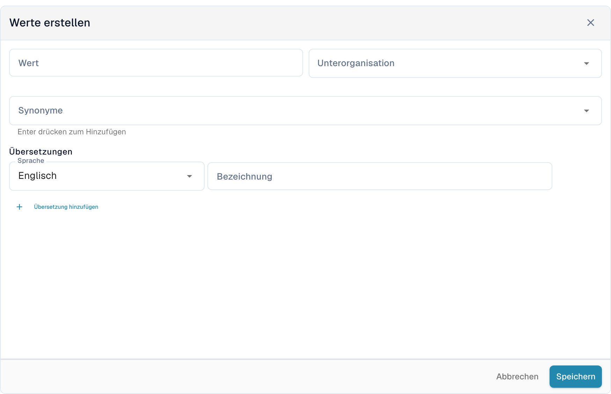

# Wertelisten

## Video-Tutorial: Stammdaten und Wertelisten


Stammdatenquellen, Wertelisten und Stammdaten-Einstellungen in DocBits


Das Video zeigt die Stammdatenquellen, die Wertelisten und die Stammdaten-Einstellungen eines Dokumenttyps.

Wertelisten enthalten vordefinierte Optionen für Dokumentfelder. Ein Feld kann bei der Validierung auf eine solche Liste zugreifen. Die angezeigten Bezeichnungen können übersetzt werden; der technische Wert bleibt in allen Sprachen gleich.

## Listen öffnen

Öffnen Sie in den Einstellungen den Bereich für Stammdatenabfragen und wählen Sie die Wertelisten. Mit **Listen durchsuchen** finden Sie eine Liste im linken Bereich. Wählen Sie ihren Namen, um rechts die Einträge zu öffnen. Das Ordnersymbol mit Stern kennzeichnet eine Systemliste; die Zahl daneben zeigt die geladene Anzahl ihrer Einträge.

<figure><figcaption>
Deutsche Wertelistenübersicht; konfigurierte Listennamen sind ausgeblendet.
</figcaption></figure>

<figure><figcaption>
Eine ausgewählte Systemliste öffnet die Eintragstabelle. A-Z und Z-A sortieren nach Wert; Zeile hinzufügen öffnet das Eingabeformular. Tabellenwerte und benutzerdefinierte Listennamen sind verdeckt; ISO Currency ist ein vorhandener Listenname.
</figcaption></figure>

## Liste erstellen

1. Wählen Sie **Neu** über den Listennamen.
2. Tragen Sie unter **Name** den Listennamen ein und wählen Sie bei Bedarf **Unter-Organisationen**, um den Geltungsbereich einzuschränken.
3. **Speichern** erstellt die Liste. Das **X** schließt den Dialog, ohne eine neue Liste anzulegen.

<figure><figcaption>
Neu öffnet den leeren Dialog Neue Liste erstellen mit Name, Unter-Organisationen, X und Speichern. In dieser Ansicht wurde keine Liste gespeichert.
</figcaption></figure>

Eigene Listen können über das Dreipunktmenü neben ihrem Namen und **Löschen** entfernt werden; bestätigen Sie nur die beabsichtigte Liste. Systemlisten besitzen kein Löschmenü und können nicht gelöscht werden.

## Einträge hinzufügen und bearbeiten

1. Wählen Sie die Liste links und anschließend **Zeile hinzufügen** über ihrer Tabelle.
2. Geben Sie den gespeicherten **Wert** und bei Bedarf eine **Unterorganisation** ein.
3. Ergänzen Sie bei Bedarf **Synonyme**. Bestätigen Sie jedes Synonym mit **Enter**, damit es als eigener Eintrag im Feld erscheint.
4. Wählen Sie unter **Übersetzungen** eine **Sprache** und geben Sie eine nicht leere **Bezeichnung** ein. Für einen neuen Eintrag ist mindestens eine vollständige Übersetzung erforderlich.
5. **Speichern** legt den Eintrag an. **Abbrechen** oder das **X** schließt das Formular ohne Speichern.

<figure><figcaption>
Zeile hinzufügen öffnet Werte erstellen unterhalb der Tabelle: Wert, Unterorganisation, Synonyme, Sprache, Bezeichnung und Übersetzung hinzufügen. Speichern legt den Eintrag an; Abbrechen verwirft den ungespeicherten Entwurf.
</figcaption></figure>

Zum Bearbeiten wählen Sie eine Zeile oder **Bearbeiten** im Menü **Aktionen**. Geschützte Felder bleiben schreibgeschützt; der gespeicherte Wert kann nach vorhandenen Übersetzungen gesperrt sein. **Abbrechen** verwirft die ungespeicherten Änderungen.

**Duplizieren** im Zeilenmenü erstellt einen weiteren Eintrag. Für mehrere Einträge wählen Sie deren Kontrollkästchen und das Kopiersymbol über der Tabelle. **Löschen** ist für eigene Einträge verfügbar und entfernt den ausgewählten Eintrag; Systemeinträge bieten diese Aktion nicht. Eine Systemliste kann sowohl geschützte als auch eigene Einträge enthalten.

## CSV-Datei importieren

Diese Oberfläche enthält den früheren Befehl **Aktionen → CSV hochladen** nicht. Die alten CSV-Schritte gelten hier nicht; verwenden Sie **Zeile hinzufügen**, um Werte in dieser Ansicht einzutragen.

## Übersetzungen hinzufügen

Wählen Sie im Eintragsformular **Sprache** und tragen Sie die **Bezeichnung** ein. Mit **Übersetzung hinzufügen** ergänzen Sie eine weitere Sprache und Bezeichnung. Vervollständigen oder entfernen Sie zusätzliche leere Übersetzungszeilen vor dem Speichern. Wenn eine Übersetzungszeile entfernt werden darf, entfernt ihr Papierkorbsymbol diese zunächst aus dem Formular; erst das Speichern übernimmt die Änderung.

Die Bezeichnung kann je Sprache abweichen, der technische Wert bleibt gleich. Fehlt die Bezeichnung für die aktive Sprache, wird der technische Wert angezeigt. Systemeinträge und geerbte Übersetzungen können geschützte Felder enthalten; ändern Sie nur die dafür freigegebenen eigenen Angaben.
