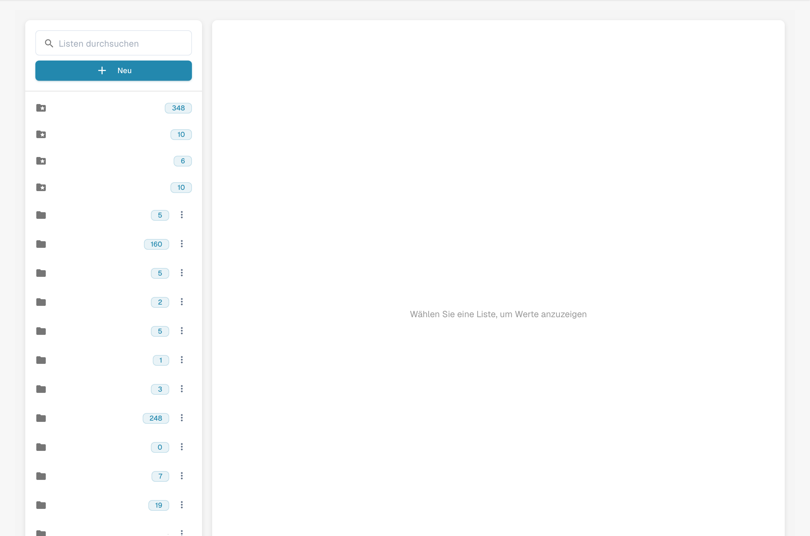

# Wertelisten

## Video-Tutorial: Stammdaten und Wertelisten


Stammdatenquellen, Wertelisten und Stammdaten-Einstellungen in DocBits


Das Video zeigt die Stammdatenquellen, die Wertelisten und die Stammdaten-Einstellungen eines Dokumenttyps.

Wertelisten enthalten vordefinierte Optionen für Dokumentfelder. Ein Feld kann bei der Validierung auf eine solche Liste zugreifen. Die angezeigten Bezeichnungen können übersetzt werden; der technische Wert bleibt in allen Sprachen gleich.

## Listen öffnen

Öffnen Sie in den Einstellungen die Stammdaten und anschließend die Wertelisten. Wählen Sie eine Liste, um ihre Einträge anzuzeigen. Konfigurierte Namen sind im Bild verdeckt.

<figure><figcaption>
Deutsche Wertelistenübersicht; konfigurierte Listennamen sind ausgeblendet.
</figcaption></figure>

## Liste erstellen

1. Wählen Sie die Aktion zum Erstellen einer neuen Liste.
2. Geben Sie einen Namen ein und schränken Sie die Liste bei Bedarf auf eine Unterorganisation ein.
3. Prüfen Sie die Angaben vor dem Speichern.

Standardlisten werden vom System bereitgestellt und können nicht gelöscht werden. Prüfen Sie vor dem Löschen einer eigenen Liste, welche Felder sie verwenden: Die Löschung kann sofort wirksam werden.

## Einträge hinzufügen und bearbeiten

Öffnen Sie die vorgesehene Liste und fügen Sie eine Zeile hinzu. Prüfen Sie die Eigenschaften des Eintrags:

| Eigenschaft | Bedeutung |
| --- | --- |
| Wert | Technischer Wert, den DocBits speichert; in allen Sprachen identisch. |
| Bezeichnung | Angezeigter Text in der ausgewählten Sprache. Fehlt eine Bezeichnung für die aktive Sprache, wird der technische Wert angezeigt. |
| Sprache | Sprache der Bezeichnung. |
| Unterorganisationen | Verfügbarkeitsbereich des Eintrags; ohne Einschränkung gilt er für alle Unterorganisationen. |
| Synonyme | Varianten, die dem Wert zugeordnet sind, etwa EURO und € für EUR. Bestätigen Sie jedes Synonym im entsprechenden Feld. |

Prüfen Sie alle Eigenschaften vor dem Speichern. Bearbeiten und Löschen hängen von Ihren Berechtigungen und dem ausgewählten Eintrag ab. Systemeinträge können nicht gelöscht werden.

## CSV-Datei importieren

Öffnen Sie bei der vorgesehenen Liste die Aktionen und den CSV-Import. Wählen Sie die Datei und das passende Trennzeichen, zum Beispiel `;` oder `,`. Prüfen Sie Aufbau und Inhalt vor dem Start des Imports.

## Übersetzungen hinzufügen

Fügen Sie bei einem Eintrag eine Sprache hinzu und geben Sie die gewünschte Bezeichnung ein. Wiederholen Sie dies für weitere benötigte Sprachen, prüfen Sie die Angaben und speichern Sie. Auch Systemeinträge können übersetzte Bezeichnungen erhalten, obwohl sie nicht gelöscht werden können.

Das Übersetzen der Bezeichnung ändert den technischen Wert nicht. Prüfen Sie das Feld nach den vorgesehenen Änderungen in der Validierung mit der gewünschten Sprache. Das Bild zeigt die Anzeige der Listen, keine gespeicherte Änderung oder ausgeführten Import.
