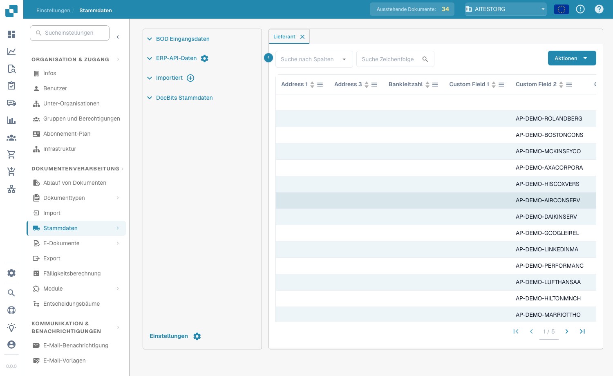
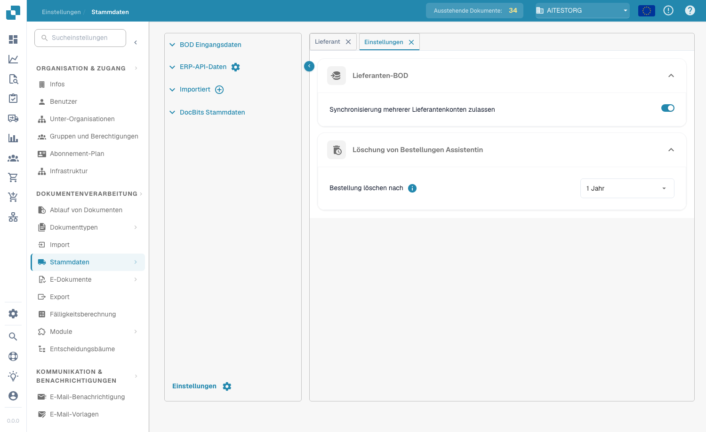

# Stammdaten-Lookup




Mit dem **Master Data Lookup** (Seitenleiste: **Lookup Master Data**) können Sie die Stammdaten einsehen und verwalten, mit denen DocBits extrahierte Dokumentdaten gegen Ihr ERP-System validiert. Er ist unverzichtbar für ein korrektes PO Matching, die Lieferantenvalidierung und die automatische Vervollständigung von Feldern. Sie öffnen ihn über **Settings → Document Processing → Lookup Master Data**.

<figure><figcaption>
Seite „Master Data Lookup“ – Datenquellen und Datentabelle
</figcaption></figure>

## Datenquellen

Das linke Panel listet vier Kategorien von Datenquellen auf:

| Quelle | Beschreibung |
|--------|-------------|
| **BOD Input Data** | Daten, die über Infor-BOD-Nachrichten (Business Object Document) empfangen werden. |
| **ERP API Data** | Daten, die per API direkt aus Ihrem ERP-System abgerufen werden. Klicken Sie auf das Zahnradsymbol, um die API-Verbindung zu konfigurieren. |
| **Imported** | Manuell importierte Daten (z. B. per CSV-Upload). Klicken Sie auf das Symbol **+**, um neue Daten hinzuzufügen. |
| **DocBits Master Data** | Interne Stammdaten, die in DocBits verwaltet werden. |

## Datentabelle

Wenn Sie eine Datenquelle auswählen, werden ihre Daten rechts in einer durchsuchbaren, sortierbaren Tabelle geöffnet:

* **Tabs** – jeder Tab ist ein Stammdatentyp (z. B. Supplier, Purchase Order, Item).
* **Search** – nach Spalte filtern (**Search by column**) oder per Text suchen (**Search String**).
* **Actions** – Spaltenbezeichnungen aktualisieren, leere Spalten ausblenden, Aliasse aktualisieren oder die Daten als CSV herunterladen.
* **Pagination** – mit den Seitensteuerelementen durch große Datenmengen navigieren.

Die Tabellen Supplier und Purchase Order enthalten Spalten wie Supplier ID, Supplier Name, Address, Bank Id, PO Number, Item ID, Description, Quantity, Unit Price, Total Amount, Currency und Status sowie alle benutzerdefinierten Felder.

## Einstellungen

Klicken Sie unten links im Datenquellen-Panel auf **Settings** (Zahnradsymbol), um die Stammdaten-Einstellungen zu öffnen.

<figure><figcaption>
Einstellungen für Supplier BOD und Purchase Order Deletion
</figcaption></figure>

### Supplier BOD

**Allow Multiple Supplier Accounts Sync**

* **Aktiviert**: Ein einzelner Lieferant kann im BOD mehrere `<FinancialParty>`-Elemente haben (oft wegen mehrerer IBANs oder Finanzkonten). Alle `<FinancialParty>`-Einträge werden extrahiert und in der Lieferantentabelle gespeichert, sodass mehrere finanzielle Attribute abgelegt werden können.
* **Deaktiviert**: Nur das zuletzt gefundene `<FinancialParty>`-Element des Lieferanten wird extrahiert. Frühere finanzielle Attribute (z. B. zusätzliche IBANs) werden ignoriert, und nur die Daten des letzten Vorkommens werden gespeichert.

### Purchase Order Deletion Assistant

**Delete Purchase Order After** – legen Sie fest, wann abgeschlossene Bestellungen entfernt werden sollen. Nach dem gewählten Zeitraum werden die Datensätze automatisch gelöscht.


Wie Sie Stammdaten in DocBits laden, erfahren Sie unter [Stammdaten importieren](../../../infor-integration-and-configuration/importing-customer-master-data/).

