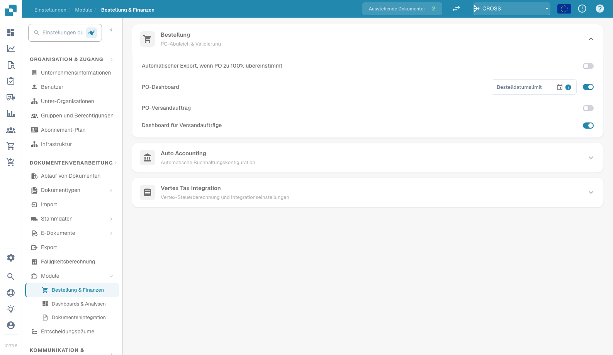

# Modul

<figure><figcaption>
Seite „Moduleinstellungen“
</figcaption></figure>

Auf der Seite „Module“ aktivieren oder deaktivieren Sie optionale Funktionen in DocBits. Jeder Abschnitt fasst zusammengehörige Module zusammen, die ein- oder ausgeschaltet werden können.

## Bestellung

Einstellungen für PO Matching und Validierung.

| Einstellung | Beschreibung |
|---------|-------------|
| **Auto Export if PO matched 100%** | Ermöglicht den automatischen Export des aktuellen Dokuments bei vollständig erfolgreichem Bestellabgleich, sofern auch die konfigurierten Validierungs-, Genehmigungs- und Exportvoraussetzungen erfüllt sind. |
| **PO Dashboard** | Aktiviert das Bestellungs-Dashboard. Enthält das Feld **PO Date Limit**, um die Bestelldaten nach Datum einzugrenzen. |
| **PO Shipment Order** | Aktiviert die Verarbeitung von Lieferaufträgen, die mit Bestellungen verknüpft sind. |
| **Shipment Order Dashboard** | Aktiviert ein eigenes Dashboard für Lieferaufträge. |

## Automatische Kontierung

| Einstellung | Beschreibung |
|---------|-------------|
| **Auto Accounting** | Aktiviert die automatische Kontierung für Dokumente. Wählen Sie den ERP-Typ (z. B. LN, M3). |

## Dashboards

| Einstellung | Beschreibung |
|---------|-------------|
| **Advance Shipment Dashboard** | Dashboard zur Überwachung von Aktivitäten rund um Lieferavise. |
| **Invoice Dashboard** | Dashboard zur Rechnungsüberwachung und -analyse. |
| **Full Text Search** | Aktiviert die Volltextsuche über Dokumente hinweg. |
| **Analytics Dashboard** | Aktiviert das Analytics-Übersichts-Dashboard. |

## Datenbankzugriff

| Einstellung | Beschreibung |
|---------|-------------|
| **DB Access** | Aktiviert den direkten Datenbankzugriff für die Organisation. |

## KI-Dashboard

| Einstellung | Beschreibung |
|---------|-------------|
| **AI Document Warehouse** | KI-gestützte Analysen des Dokumenten-Warehouse. |
| **Dashboard v2** | Aktualisiertes Dashboard mit erweiterten Funktionen. |
| **Clickhouse Direct Access** | Aktiviert den direkten Zugriff auf die Clickhouse-Datenbank. |
| **Supplier Statistics** | Aktiviert Statistiken und Berichte auf Lieferantenebene. |

## Versand und Lieferanten

| Einstellung | Beschreibung |
|---------|-------------|
| **Supplier Portal** | Aktiviert das Lieferantenportal für die Zusammenarbeit mit Lieferanten. |

## Dokumenttyp

| Einstellung | Beschreibung |
|---------|-------------|
| **Workflow Builder** | Dokumentenverarbeitungs-Workflows erstellen und anpassen. |
| **Annotation Mode** | Ermöglicht Benutzern, Dokumente in der Validierungsansicht zu annotieren. |
| **Show Report** | Aktiviert die Berichtserstellung für Dokumente. |
| **Inbound Emails** | Aktiviert die Verarbeitung eingehender E-Mails pro Dokumenttyp. |
| **Models & Labels** | KI-Modelle und Labels für die Dokumentenerkennung verwalten. |
| **Document Script** | Aktiviert benutzerdefinierte Skripte für die Dokumentenverarbeitung. |
| **Document Scan** | Aktiviert die Dokumentenscan-Funktion. |
| **Bar-Code/QR Code Extraction** | Extrahiert Barcode-/QR-Code-Daten aus Dokumenten. Wählen Sie die unterstützten Codetypen. |
| **Custom Master Data** | Aktiviert benutzerdefinierte Stammdatenfelder. |
| **Tasks & Notifications** | Aktiviert die Aufgabenverwaltung und Benachrichtigungsfunktionen. Enthält den Schalter **Dashboard Tasks Count**. |
| **DocBits Operator** | Aktiviert die Browser-Automatisierung DocBits Operator. |
| **DocNet** | Aktiviert die Dokumentenvernetzung DocNet. |
| **IDM ACL Updater** | Aktualisiert die Zugriffssteuerungslisten (ACLs) von Infor Document Management. Laden Sie eine ION-Mapping-Datei hoch und konfigurieren Sie die Zuordnungen von Infor-Doctype zu ACL. |
| **Barcode Assignment** | Aktiviert die Zuweisung von Barcodes zu Dokumenten. |
| **Set Negative Sign For Credit Notes** | Setzt bei Gutschriftsbeträgen automatisch ein negatives Vorzeichen. |

## BOD-Verbindungsstream

| Einstellung | Beschreibung |
|---------|-------------|
| **BOD Connection Stream** | Aktiviert die BOD-Integration (Business Object Document). Zeigt den für die Verbindung verwendeten **Stream Name** an. |

## Analysen

| Einstellung | Beschreibung |
|---------|-------------|
| **Use PostgreSQL for Quality Analytics** | Wechselt zwischen Prometheus (Echtzeit, wird bei Deployments zurückgesetzt) und PostgreSQL (dauerhaft 90 Tage, Trendanalyse, Felder mit der schlechtesten Leistung). |

## Integration von Vertex Tax

| Einstellung | Beschreibung |
|---------|-------------|
| **Vertex Tax Integration** | Aktiviert die Steuerberechnung mit Vertex. Konfigurieren Sie **Base URL**, **Client ID** und **Client Secret**. Prüfen Sie die Verbindung mit **Test Connection**. |
