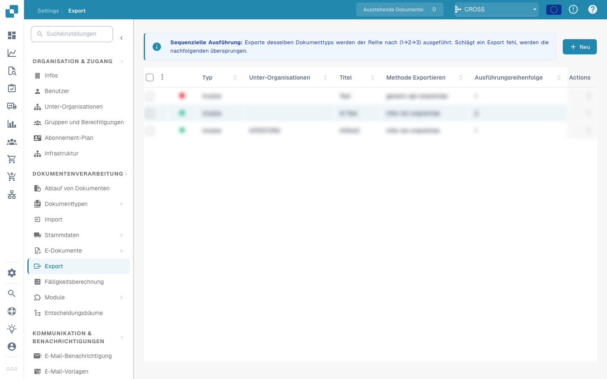

# Automatischer Export bei vollständiger Bestellübereinstimmung

### Überblick

Die Einstellung **Auto Export if PO matched 100%** steuert den automatischen Export des aktuellen Rechnungsdokuments nach dem Abgleich mit einer Bestellung (Purchase Order, PO). Exportiert wird das Dokument in DocBits; die referenzierte Bestellung dient als Vergleichsgrundlage.

### Voraussetzungen und Funktionsweise

Der Bestellabgleich des Dokuments muss vollständig erfolgreich sein. Zusätzlich müssen die konfigurierten Validierungs-, Genehmigungs- und Exportvoraussetzungen erfüllt sein. Eine vollständige Bestellübereinstimmung allein garantiert daher keinen sofortigen Export.

### Vorteile

* **Effizienz**: Weniger manuelle Schritte für Dokumente mit vollständig erfolgreichem Bestellabgleich.
* **Genauigkeit**: Der automatische Export berücksichtigt den Abgleichstatus und die weiteren konfigurierten Prüfungen.
* **Geschwindigkeit**: Geeignete Dokumente können nach Erfüllung aller Voraussetzungen automatisch exportiert werden.

### Verwendung

1. Öffnen Sie **Settings → Document Processing → Module → Purchase Order**.
2. Aktivieren Sie **Auto Export if PO matched 100%** mit dem zugehörigen Schalter.

<figure><figcaption></figcaption></figure>

3. Überwachen Sie die verarbeiteten Dokumente und den Exportstatus im zugehörigen Dashboard.
4. Prüfen Sie, ob die Bestellkriterien sowie Validierungs-, Genehmigungs- und Exportregeln korrekt konfiguriert sind.
5. Kontrollieren Sie regelmäßig, ob die Automatisierung wie erwartet arbeitet.

### Einsatzbereiche

Die Funktion eignet sich für hohe Dokumentmengen, wiederkehrende Bestellungen und zeitkritische Vorgänge, wenn der Bestellabgleich zuverlässig ist und die übrigen Exportvoraussetzungen erfüllt sind.

Wenn PO-Matching für den Dokumenttyp aktiv ist, lässt die separate Option `ALLOW_AUTO_EXPORT_FOR_NON_MATCHABLE_PO_LINES` zusätzlich den Status `NO_MATCHABLE_PO_LINES` zu. Sie gibt andere unvollständige Abgleiche nicht pauschal für den Export frei.
