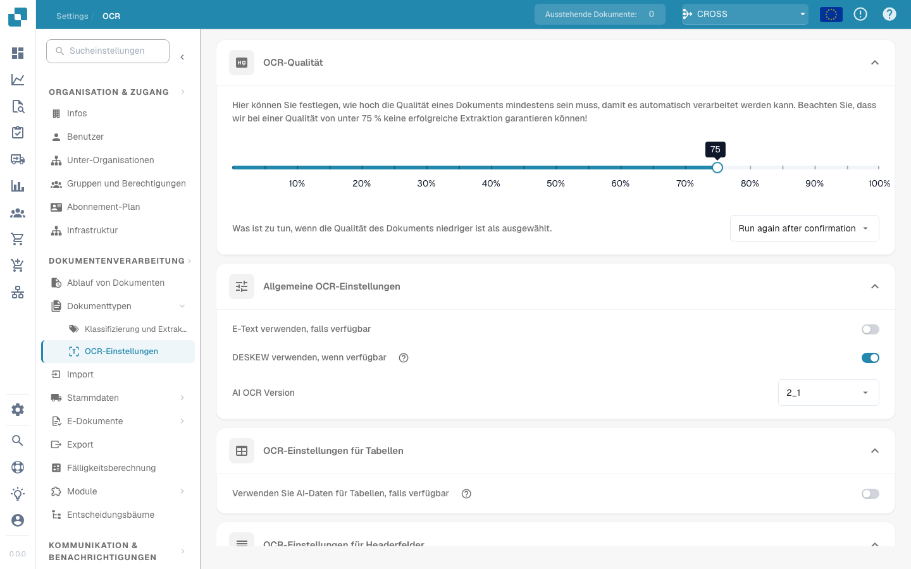

# OCR-Einstellungen

## Überblick

In den Einstellungen für **OCR (optische Zeichenerkennung)** legen Sie fest, wie OCR bei der Dokumentenverarbeitung eingesetzt wird. Dazu gehören die erforderliche Mindestqualität, die Verwendung eingebetteten Texts (E-Text), die OCR-Version und weitere Optionen. Diese Seite erläutert die verfügbaren Einstellungen.

## OCR-Einstellungen öffnen

So öffnen Sie die OCR-Einstellungen:

*   Navigieren Sie zu: **Settings** → **Document Processing** → **OCR Settings**.

    <figure><figcaption></figcaption></figure>

## OCR-Qualität

In diesem Bereich legen Sie mit dem Qualitätsregler die Mindestqualität für die OCR-Verarbeitung fest. Verschieben Sie den Regler nach links, um den Schwellenwert zu senken, oder nach rechts, um ihn zu erhöhen.

Wenn ein Dokument die festgelegte Qualität nicht erreicht, bietet DocBits drei Möglichkeiten:

* **Run Anyway**\
  Das Dokument wird unabhängig von seiner Qualität verarbeitet.
* **Run Again After Confirmation**\
  **DocBits** hält die Verarbeitung an und fragt nach Ihrer Bestätigung, bevor es fortfährt.
* **Throw Error**\
  Die Dokumentenverarbeitung wird abgebrochen. Eine Fehlermeldung weist darauf hin, dass das Dokument die erforderliche Qualität nicht erreicht.

<figure><figcaption></figcaption></figure>

## Allgemeine OCR-Einstellungen

* **Use E-Text if Available**\
  Wenn diese Option aktiviert ist, verwendet **DocBits** eingebetteten elektronischen Text, beispielsweise aus PDF-Dateien, anstatt eine OCR-Erkennung durchzuführen. Die direkte Textextraktion verbessert Geschwindigkeit und Genauigkeit.
* **Use DESKEW if Available**\
  Diese Option richtet schief eingescannte Dokumente automatisch aus. Das Begradigen der Bilder verbessert die OCR-Genauigkeit.
*   **AI OCR Version**\
    Hier wählen Sie eine bestimmte Version der KI-basierten OCR-Engine aus.\
    Das kann hilfreich sein, wenn:

    * die derzeit ausgewählte Version nicht die gewünschten Ergebnisse liefert;
    * Sie Probleme mit der OCR-Leistung oder -Genauigkeit untersuchen.

    <figure><figcaption></figcaption></figure>

## OCR-Einstellungen für Tabellen

* **Use AI Data for Tables if Available**\
  Wenn diese Option aktiviert ist, verwendet DocBits für Tabellen OCR-Daten anstelle des eingebetteten elektronischen Texts (E-Text) – auch wenn **Use E-Text if Available** eingeschaltet ist.

## OCR-Einstellungen für Kopffelder

* **Use Rules Extraction**\
  DocBits verwendet Ihre vordefinierten Extraktionsregeln, um Kopffelder zu erkennen.
* **Use AI Extraction**\
  DocBits erkennt und extrahiert Kopffelder automatisch mithilfe von KI.

**Ausführungsreihenfolge:**\
Wenn beide Optionen aktiviert sind, führt **DocBits** die Extraktion in dieser Reihenfolge aus:\
**Rules Extraction → AI Extraction**\
\
<mark style="color:red;">**Hinweis**</mark>: Aktivieren Sie beide Optionen, um optimale Ergebnisse und ein einheitliches Verhalten zu erzielen. So kombiniert **DocBits** regelbasierte und KI-basierte Verfahren bei der Extraktion von Kopffeldern.
