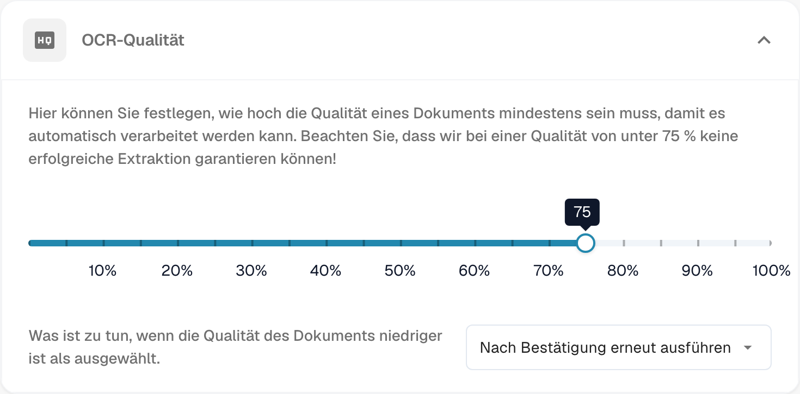
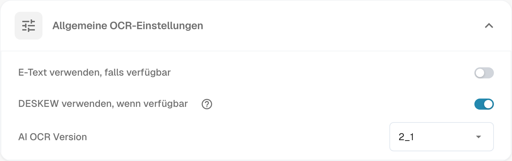
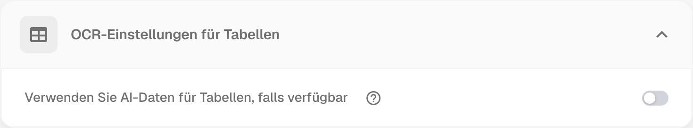
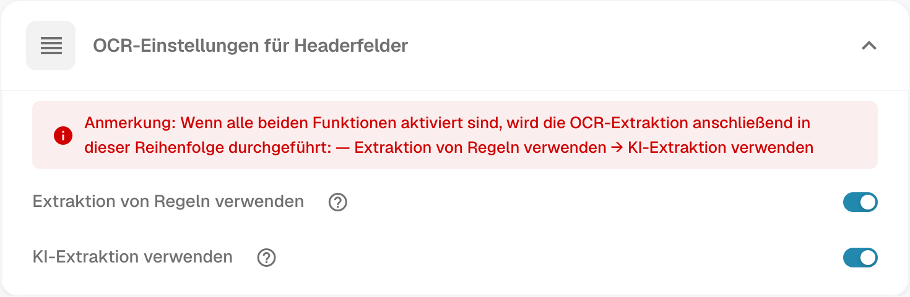

# OCR-Einstellungen

## Überblick

In den Einstellungen für **OCR (optische Zeichenerkennung)** legen Sie fest, wie OCR bei der Dokumentenverarbeitung eingesetzt wird. Dazu gehören die erforderliche Mindestqualität, die Verwendung eingebetteten Texts (E-Text), die OCR-Version und weitere Optionen. Diese Seite erläutert die verfügbaren Einstellungen.

## OCR-Einstellungen öffnen

Navigieren Sie zu **Einstellungen** → **Dokumentenverarbeitung** → **OCR-Einstellungen**.

Die abgebildeten Werte, Versionen und Schalterstellungen sind Beispiele und keine allgemeine Empfehlung.

## OCR-Qualität

<figure><figcaption>
OCR-Qualität mit dem eingestellten Mindestwert und der Auswahl, wie DocBits bei geringerer Dokumentqualität vorgeht.
</figcaption></figure>

In diesem Bereich legen Sie mit dem Qualitätsregler die Mindestqualität für die OCR-Verarbeitung fest. Verschieben Sie den Regler nach links, um den Schwellenwert zu senken, oder nach rechts, um ihn zu erhöhen.

Wenn ein Dokument die festgelegte Qualität nicht erreicht, bietet DocBits drei Möglichkeiten:

* **Trotz geringer Qualität verarbeiten:** Das Dokument wird unabhängig von seiner Qualität verarbeitet.
* **Nach Bestätigung erneut ausführen:** DocBits hält die Verarbeitung an und verlangt eine Bestätigung, bevor sie fortgesetzt wird.
* **Mit Fehlermeldung abbrechen:** Die Verarbeitung wird abgebrochen. Eine Fehlermeldung weist darauf hin, dass das Dokument die erforderliche Qualität nicht erreicht.

## Allgemeine OCR-Einstellungen

<figure><figcaption>
Allgemeine OCR-Einstellungen mit den Optionen für eingebetteten Text, die Ausrichtung gescannter Seiten und die OCR-Version.
</figcaption></figure>

* **E-Text verwenden, falls verfügbar:** Wenn diese Option aktiviert ist, verwendet DocBits eingebetteten elektronischen Text, beispielsweise aus PDF-Dateien, anstatt eine OCR-Erkennung durchzuführen. Das kann erneute OCR vermeiden. Eingebetteter Text kann jedoch fehlen, fehlerhaft sein oder eine ungeeignete Reihenfolge haben. Prüfen Sie die Ergebnisse für Felder und Tabellen mit Ihren Dokumenten; eine höhere Genauigkeit ist nicht garantiert.
* **DESKEW verwenden, wenn verfügbar:** Diese Option richtet schief eingescannte Dokumente aus. Das kann die OCR-Erkennung unterstützen.
* **AI OCR Version:** Hier wählen Sie eine bestimmte Version der KI-basierten OCR-Engine aus. Das kann hilfreich sein, wenn die ausgewählte Version nicht die gewünschten Ergebnisse liefert oder Sie Probleme mit der OCR-Leistung oder -Genauigkeit untersuchen.

## OCR-Einstellungen für Tabellen

<figure><figcaption>
OCR-Einstellungen für Tabellen mit der Option, verfügbare KI-Daten für die Tabellenverarbeitung zu verwenden.
</figcaption></figure>

* **Verfügbare KI-Daten für Tabellen verwenden:** Wenn diese Option aktiviert ist, verwendet DocBits für Tabellen OCR-Daten anstelle des eingebetteten elektronischen Texts (E-Text) – auch wenn **E-Text verwenden, falls verfügbar** eingeschaltet ist.

## OCR-Einstellungen für Kopffelder

<figure><figcaption>
OCR-Einstellungen für Kopffelder mit regelbasierter Extraktion, KI-Extraktion und dem Hinweis zu ihrer Ausführungsreihenfolge.
</figcaption></figure>

* **Regelbasierte Extraktion:** DocBits verwendet Ihre vordefinierten Extraktionsregeln, um Kopffelder zu erkennen.
* **KI-Extraktion:** DocBits erkennt und extrahiert Kopffelder mithilfe von KI.

**Ausführungsreihenfolge:** Wenn beide Optionen aktiviert sind, erfolgt zuerst die regelbasierte Extraktion und danach die KI-Extraktion.

**Hinweis:** Diese Reihenfolge gilt nur, wenn beide Optionen aktiviert sind. Ob Sie beide benötigen, hängt vom Dokumenttyp, den Regeln und den geprüften Extraktionsergebnissen ab. Die Reihenfolge ist keine Empfehlung, immer beide Optionen einzuschalten, und garantiert keine korrekte Extraktion.
