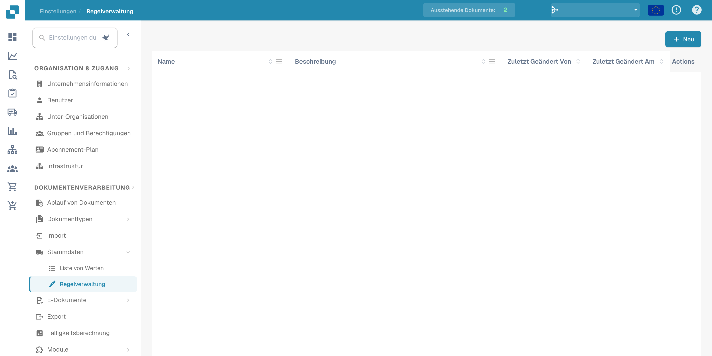
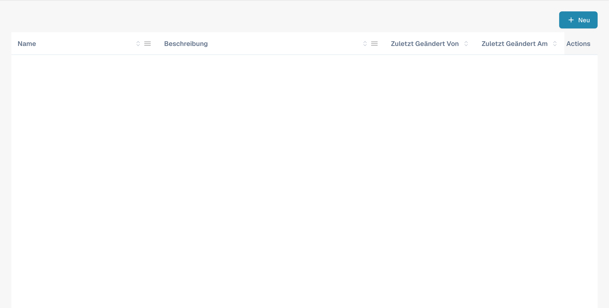
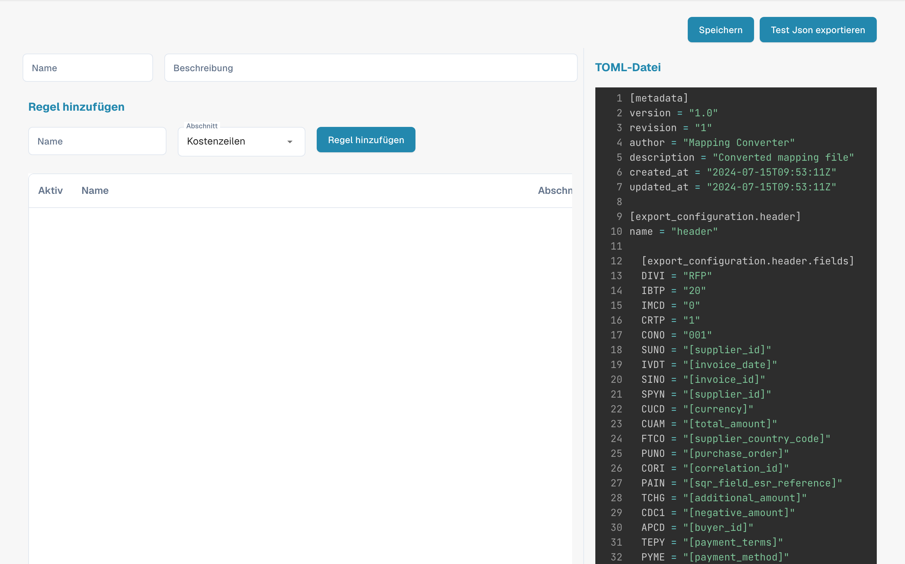

# Regelverwaltung

<figure><figcaption>
Deutsche Regelverwaltung für den Bestellabgleich und Export.
</figcaption></figure>

Mit der Regelverwaltung (Rule Management) erstellen und verwalten Sie TOML-basierte Regeln zur Konfliktlösung, die beim PO Matching und beim Dokumentenexport verwendet werden. Jedes Regelwerk legt fest, wie DocBits mit Abweichungen zwischen Rechnungsdaten und Bestelldaten umgeht.

## Regelliste

Die Haupttabelle zeigt alle Regelkonfigurationen:

| Spalte | Beschreibung |
|--------|-------------|
| **Name** | Der Name des Regelwerks. Einträge mit dem Tag **default** sind vom System bereitgestellte Vorlagen. |
| **Beschreibung** | Eine Zusammenfassung dessen, was das Regelwerk behandelt. |
| **Zuletzt geändert von** | Der Benutzer, der dieses Regelwerk zuletzt bearbeitet hat. |
| **Zuletzt geändert am** | Zeitstempel der letzten Änderung. |
| **Aktionen** | Drei-Punkte-Menü zum Bearbeiten, Kopieren oder Löschen. |

Klicken Sie auf **+ New**, um ein neues Regelwerk zu erstellen, oder klicken Sie auf einen vorhandenen Namen, um den Regeleditor zu öffnen.

---

## Referenz zur Regelstruktur

Dieser Abschnitt erklärt ausführlich die Regeln zur Konfliktlösung, die im DocBits-Rechnungssystem verwendet werden. Diese Regeln sind darauf ausgelegt, Abweichungen zwischen Rechnungsangaben und Bestelldaten (PO) automatisch zu behandeln und so einen korrekten finanziellen Abgleich sicherzustellen. Das System wendet diese Regeln an, um Rechnungspositionen, Kosten und Steuern zu verarbeiten, und erzeugt bei Bedarf passende Anpassungen oder Hinweise.

## Struktur der Regeln

### 1. Metadata

• version: Kennzeichnet die Version der Mapping-Datei.

• revision: Revisionsnummer zur Nachverfolgung von Änderungen.

• author: Gibt den Ersteller der Mapping-Datei an.

• description: Eine kurze Beschreibung des Zwecks der Datei.

• created_at & updated_at: Zeitstempel für die Erstellung und die letzte Aktualisierung der Datei.

### 2. Export Configuration

Der Abschnitt „Export Configuration“ definiert die Zuordnung zwischen den Datenfeldern im System und den entsprechenden Feldern in den Exportdateien.

• Header: Definiert die Kopffelder für die exportierten Rechnungsdaten.

• Tax Lines: Legt die Felder für Steuerpositionen im Export fest.

• Order Header Charges: Ordnet Felder für zusätzliche Kosten auf Bestellkopfebene zu.

• Receipt Lines: Ordnet Felder für einzelne Positionen eines Wareneingangs zu.

• Order Line Charges: Definiert die Felder für Kosten, die sich auf bestimmte Bestellpositionen beziehen.

• Cost Lines: Legt Felder für Kostenverteilungspositionen fest.

• Debit Note & Credit Note: Definiert Felder für die Erstellung von Belastungs- und Gutschriftsanzeigen bei Abweichungen.

### 3. Conflict Resolution Rules

Diese Regeln behandeln Abweichungen zwischen den Rechnungsdaten und den zugehörigen Bestelldaten. Jede Regel besteht aus mehreren Komponenten:

• Name: Der beschreibende Name der Regel, der die Art der behandelten Abweichung angibt.

• Section: Gibt an, auf welchen Teil der Rechnung (z. B. receipt_lines, line_charges) die Regel angewendet wird.

• Active: Boolescher Wert (true oder false), der angibt, ob die Regel derzeit aktiv ist.

• Match Criteria: Bedingungen, die die Regel auslösen, basierend auf Vergleichen zwischen den tatsächlichen Rechnungsdaten und den erwarteten Bestelldaten.

• Actions: Legt fest, was das System tun soll, wenn die Regel ausgelöst wird, einschließlich Anpassung von Werten, Anwendung von Kosten oder Erstellung von Gutschriften/Belastungsanzeigen.

## Allgemeine Elemente der Regeln

### Vergleichsoperatoren

Diese Operatoren legen fest, wie die tatsächlichen Rechnungswerte mit den erwarteten Bestellwerten verglichen werden:

• equal

• greater than

• greater than or equal to

• less than

• less than or equal to

• within tolerance

• outside tolerance

### Genehmigungsstatus

Gibt an, ob eine Abweichung genehmigt ist oder nicht:

• approved

• rejected

• any

### Aktionstypen

Legt fest, welche Aktionen bei einer erkannten Abweichung ausgeführt werden:

• receipt line

• cost line

• header charge

• line charge

• tax line

• debit note receipt line

• debit note cost line

• debit note header charge

• debit note line charge

• credit note receipt line

• credit note cost line

• credit note header charge

• credit note line charge

• credit note tax line

### Regelbeispiele

#### [Fall 1, 2, 3: Menge und Einzelpreis innerhalb der Toleranz](transactionconfig-pro-template/case-1-2-3-quantity-and-unit-price-within-tolerance.md)

• Zweck: Behandelt Szenarien, in denen sowohl die Menge als auch der Einzelpreis auf der Rechnung im Vergleich zur Bestellung innerhalb der zulässigen Toleranzgrenzen liegen.

• Aktion: Das System übernimmt die Rechnungswerte und berechnet den Gesamtbetrag.

#### [Fall 4, 5: Menge innerhalb der Toleranz, Einzelpreis außerhalb der Toleranz (genehmigt)](./#fall-4-5-menge-innerhalb-der-toleranz-einzelpreis-ausserhalb-der-toleranz-genehmigt)

• Zweck: Gilt, wenn die Menge innerhalb der Toleranz liegt, der Einzelpreis aber außerhalb der Toleranz liegt und genehmigt wurde.

• Aktion: Das System passt den Einzelpreis an die Bestellung an und wendet alle erforderlichen Positionskosten an.

#### [Fall 6: Menge innerhalb der Toleranz, Einzelpreis außerhalb der negativen Toleranz (abgelehnt)](transactionconfig-pro-template/case-6-quantity-within-tolerance-unit-price-outside-negative-tolerance-rejected.md)

• Zweck: Behandelt Fälle, in denen der Einzelpreis niedriger als erwartet ist und außerhalb des Toleranzbereichs liegt, was zur Ablehnung führt.

• Aktion: Das System passt den Einzelpreis an die Bestellung an, erstellt eine Gutschrift über die Differenz und wendet bei Bedarf Kopfkosten an.

### Umgang mit Kosten und Steuern

### Toleranz bei Kosten pro Einheit

• Regeln dieser Kategorie behandeln Abweichungen bei Kosten pro Einheit, mit bestimmten Aktionen je nachdem, ob die Kosten innerhalb oder außerhalb der Toleranz liegen und ob sie genehmigt oder abgelehnt sind.

### Anpassungen von Steuerpositionen

• Diese Regeln behandeln Steuerabweichungen, indem sie die Steuerpositionen anpassen oder entsprechende Gutschriften bzw. Belastungsanzeigen erzeugen, basierend auf den Unterschieden zwischen den Steuerdaten der Rechnung und der Bestellung.

### Enums und Optionen

• Enums: Vordefinierte Wertelisten, die Konsistenz über alle Regeln hinweg sicherstellen (z. B. Vergleichsoperatoren, Genehmigungstypen).

• Options: Vordefinierte Auswahlmöglichkeiten für den Umgang mit Mengen oder Einzelpreisen, die Flexibilität bei der Regeldefinition bieten.

## Erläuterung der Screenshots

### Screenshot 1: Oberfläche der Regelverwaltung

<figure><figcaption>
Übersicht der Regelwerke und ihrer Aktionen.
</figcaption></figure>

Dieser Screenshot zeigt die Oberfläche der Regelverwaltung, in der Administratoren alle Regeln zur Konfliktlösung einsehen und verwalten können. Zu den wichtigsten Elementen gehören:

• Add Rule Button: Ermöglicht das Hinzufügen neuer Regeln.

• List of Rules: Zeigt alle aktiven Regeln mit Details wie Name, Section und Active-Status an.

• Section Dropdown: Filtert die Regeln nach dem Bereich, auf den sie angewendet werden (z. B. Receipt Lines, Line Charges).

### Screenshot 2: Detaillierte Regelbearbeitung

<figure><figcaption>
Deutscher Editor eines TOML-basierten Regelwerks.
</figcaption></figure>

Dieser Screenshot zeigt die Detailansicht einer Regel, die gerade bearbeitet wird. Zu den wichtigsten Elementen gehören:

• Criteria Section: Definiert die Bedingungen, unter denen die Regel ausgelöst wird. Die Kriterien könnten z. B. festlegen, dass die Regel angewendet werden soll, wenn Menge und Einzelpreis von der Bestellung abweichen, aber innerhalb der Toleranz liegen.

• Actions Section: Legt fest, welche Aktionen ausgeführt werden, wenn die Kriterien erfüllt sind. Dazu können die Anpassung der Rechnungspositionen, die Erstellung von Gutschriften oder Belastungsanzeigen oder die Anwendung zusätzlicher Kosten gehören.

• Document Type and Costing Elements: Ermöglicht dem Administrator, bestimmte Aktionen Dokumenttypen und Kostenelementen zuzuordnen, was Flexibilität im Umgang mit verschiedenen Szenarien bietet.
