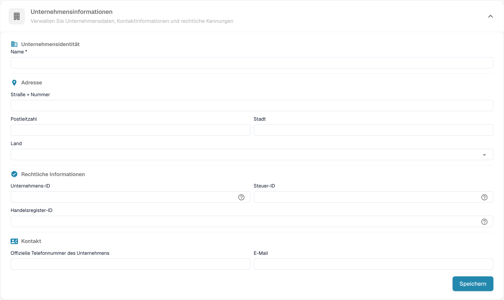
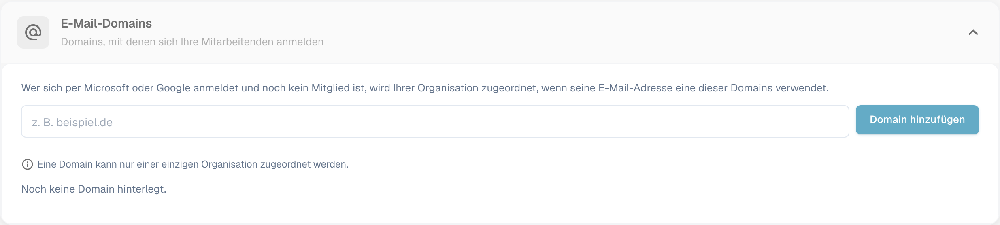

# Firmeninformationen

<figure><figcaption>
Firmeninformationen: Bearbeiten Sie den Namen der Organisation, die Adresse, die rechtlichen Kennungen und die Kontaktdaten und wählen Sie anschließend Speichern. Die Feldwerte sind aus Datenschutzgründen ausgeblendet.
</figcaption></figure>

Auf der Seite „Unternehmensinformationen“ verwalten Sie Ihr Firmenprofil, Ihre Voreinstellungen und die Details Ihres Abonnements. Sie ist in die folgenden Abschnitte gegliedert:

## Firmeninformationen

Dieser Abschnitt enthält Ihre zentralen Firmendaten, gruppiert in vier Bereiche:

### Firmenidentität

* **Name** *(Pflichtfeld)*: Der rechtliche Name Ihres Unternehmens.

### Adresse

* **Straße + Nummer**: Die Straßenadresse Ihres Unternehmens.
* **Postleitzahl**: Postleitzahl.
* **Stadt**: Name der Stadt.
* **Land**: Wählen Sie Ihr Land aus dem Dropdown-Menü.

### Rechtliche Informationen

* **Unternehmens-ID**: Eine eindeutige Kennung Ihres Unternehmens, die für Integrationen und als interne Referenz verwendet wird.
* **Steuer-ID**: Ihre Steueridentifikationsnummer für die Finanzberichterstattung.
* **Handelsregister-ID**: Ihre Handelsregisternummer für rechtliche Dokumentationen.

### Kontakt

* **Offizielle Telefonnummer des Unternehmens**: Die primäre Telefonnummer Ihres Unternehmens.
* **E-Mail**: Die Haupt-E-Mail-Adresse für die offizielle Kommunikation.

Klicken Sie nach der Eingabe oder Aktualisierung von Feldern auf **Speichern**, um Ihre Änderungen zu übernehmen. Die Symbole **?** neben den rechtlichen Kennungen zeigen zusätzliche Hinweise zum jeweiligen Feld. Wählen Sie die Abschnittsüberschrift, um das Formular ein- oder auszuklappen.

## E-Mail-Domänen

Organisationsadministratoren können unter **Einstellungen → Unternehmensinformationen → E-Mail-Domains** die Domänen verwalten, die für die automatische Zuordnung zu einer Organisation verwendet werden. Wenn sich jemand mit Microsoft oder Google anmeldet und noch nicht Mitglied einer Organisation ist, kann DocBits die Person dieser Organisation zuordnen, sofern ihre E-Mail-Adresse eine der aufgeführten Domänen verwendet. Eine Domäne kann nur zu einer Organisation gehören.

<figure><figcaption>
Der Abschnitt „E-Mail-Domains“, bevor eine Domäne hinzugefügt wurde. Geben Sie eine Firmendomäne ein und wählen Sie dann Domain hinzufügen.
</figcaption></figure>

Geben Sie im Eingabefeld nur die Domäne ein, z. B. `example.com`, und wählen Sie **Domain hinzufügen** oder drücken Sie die Eingabetaste. Die erste Domäne wird zur primären Domäne. Wenn mehrere Domänen aufgeführt sind, legen Sie eine andere Domäne als primär fest oder entfernen Sie eine Domäne mit dem Papierkorb-Symbol. Fehler wie eine ungültige Domäne, ein privater E-Mail-Anbieter oder eine bereits anderweitig zugeordnete Domäne erscheinen unter dem Eingabefeld. **Noch keine Domain hinterlegt.** bedeutet, dass für diese Organisation keine Domänenregel existiert.

Prüfen Sie vor dem Hinzufügen einer Domäne, welche Organisation neue Anmeldungen erhalten soll. Informationen zur Verwaltung bestehender Mitgliedschaften finden Sie unter [Benutzer](../groups-users-and-permissions/users/README.md).

## Unternehmenseinstellungen

Konfigurieren Sie unternehmensweite Standardeinstellungen:

* **Datum Muster**: Legen Sie fest, wie Datumsangaben in DocBits angezeigt werden (z. B. `%m/%d/%Y`, `%d.%m.%Y`).
* **Betragsformatierung**: Wählen Sie das Zahlenformat für Beträge (z. B. Deutsch für `1.000,00`, das englische Format für `1,000.00`).

Informationen zu neuen Versionen finden Sie unter [Release-Lebenszyklus](../../../../overview-and-basics/docbits-release-lifecycle-strategy.md). Die gezeigte Oberfläche enthält in den Unternehmenspräferenzen die Datums- und Betragsformatierung.

Klicken Sie nach Änderungen auf **Speichern**.

## App-Farbe

Passen Sie die Primärfarbe der DocBits-Oberfläche an. Das ist nützlich, um verschiedene Umgebungen (z. B. Dev und Produktion) optisch voneinander zu unterscheiden.

* **Farbe**: Geben Sie einen Hex-Farbcode ein (z. B. `#2388AE`) oder verwenden Sie die Farbauswahl.
* Klicken Sie auf **Speichern**, um die Farbe zu übernehmen, oder auf **Zurücksetzen**, um die Standardfarbe wiederherzustellen.

## Abonnementplan

Sehen Sie Ihre aktiven Abonnementpläne und deren Details ein:

* **Tarifname**: Der Name jedes aktiven Plans (z. B. DocBits, DocFlow Users, DocSearch).
* **verbleibende Tage**: Wie viele Tage bis zum Ablauf des Plans verbleiben.
* **Start Date / End Date**: Der Abonnementzeitraum.
* **Benutzeranzahl**: Gesamtzahl der Benutzer in Ihrer Organisation.
* **Anzahl der Unterorganisationen**: Anzahl der konfigurierten Unterorganisationen.
* **Lieferantenanzahl**: Anzahl der registrierten Lieferanten.

## Abonnementnutzung

Überwachen Sie Ihren monatlichen Token- und Workflow-Verbrauch:

| Spalte | Beschreibung |
|--------|-------------|
| **Typ** | Die Nutzungsart (Document oder Workflow). |
| **From / To** | Die Daten des Abrechnungszeitraums. |
| **Verbrauchte Tokens** | Anzahl der im aktuellen Zeitraum verbrauchten Tokens. |
| **Verbleibende Tokens** | Im aktuellen Zeitraum noch verfügbare Tokens. |

Mit der Schaltfläche **Wählen Sie** filtern Sie nach bestimmten Zeiträumen.
