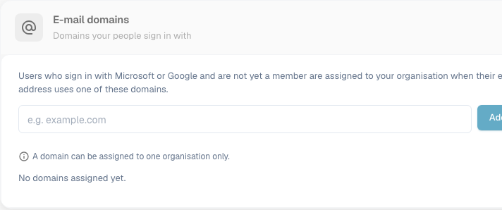

# Firmeninformationen

<figure><figcaption>
Firmeninformationen: Bearbeiten Sie den Namen der Organisation, die Adresse, die rechtlichen Kennungen und die Kontaktdaten und wählen Sie anschließend Save.
</figcaption></figure>

Auf der Seite „Company Information“ verwalten Sie Ihr Firmenprofil, Ihre Voreinstellungen und die Details Ihres Abonnements. Sie ist in die folgenden Abschnitte gegliedert:

## Firmeninformationen

Dieser Abschnitt enthält Ihre zentralen Firmendaten, gruppiert in vier Bereiche:

### Firmenidentität

* **Name** *(Pflichtfeld)*: Der rechtliche Name Ihres Unternehmens.

### Adresse

* **Street + Number**: Die Straßenadresse Ihres Unternehmens.
* **Postal Code**: Postleitzahl.
* **City**: Name der Stadt.
* **Country**: Wählen Sie Ihr Land aus dem Dropdown-Menü.

### Rechtliche Informationen

* **Company ID**: Eine eindeutige Kennung Ihres Unternehmens, die für Integrationen und als interne Referenz verwendet wird.
* **Tax ID**: Ihre Steueridentifikationsnummer für die Finanzberichterstattung.
* **Commercial Register ID**: Ihre Handelsregisternummer für rechtliche Dokumentationen.

### Kontakt

* **Official Company Phone Number**: Die primäre Telefonnummer Ihres Unternehmens.
* **E-Mail**: Die Haupt-E-Mail-Adresse für die offizielle Kommunikation.

Klicken Sie nach der Eingabe oder Aktualisierung von Feldern auf **Save**, um Ihre Änderungen zu übernehmen. Die Symbole **?** neben den rechtlichen Kennungen zeigen zusätzliche Hinweise zum jeweiligen Feld. Wählen Sie die Abschnittsüberschrift, um das Formular ein- oder auszuklappen.

## E-Mail-Domänen

Organisationsadministratoren können unter **Settings → Company Information → E-mail domains** die Domänen verwalten, die für die automatische Zuordnung zu einer Organisation verwendet werden. Wenn sich jemand mit Microsoft oder Google anmeldet und noch nicht Mitglied einer Organisation ist, kann DocBits die Person dieser Organisation zuordnen, sofern ihre E-Mail-Adresse eine der aufgeführten Domänen verwendet. Eine Domäne kann nur zu einer Organisation gehören.

<figure><figcaption>
Der Abschnitt „E-mail domains“, bevor eine Domäne hinzugefügt wurde. Geben Sie eine Firmendomäne ein und wählen Sie dann Add domain.
</figcaption></figure>

Geben Sie im Eingabefeld nur die Domäne ein, z. B. `example.com`, und wählen Sie **Add domain** oder drücken Sie die Eingabetaste. Die erste Domäne wird zur primären Domäne. Wenn mehrere Domänen aufgeführt sind, ändern Sie die primäre Domäne mit **Make primary** in einer anderen Zeile oder entfernen Sie eine Domäne mit dem Papierkorb-Symbol. Fehler wie eine ungültige Domäne, ein privater E-Mail-Anbieter oder eine bereits anderweitig zugeordnete Domäne erscheinen unter dem Eingabefeld. **No domains assigned yet** bedeutet, dass für diese Organisation keine Domänenregel existiert.

Prüfen Sie vor dem Hinzufügen einer Domäne, welche Organisation neue Anmeldungen erhalten soll. Informationen zur Verwaltung bestehender Mitgliedschaften finden Sie unter [Benutzer](../groups-users-and-permissions/users/README.md).

## Unternehmenseinstellungen

Konfigurieren Sie unternehmensweite Standardeinstellungen:

* **Date Pattern**: Legen Sie fest, wie Datumsangaben in DocBits angezeigt werden (z. B. `%m/%d/%Y`, `%d.%m.%Y`).
* **Amount Formatting**: Wählen Sie das Zahlenformat für Beträge (z. B. Deutsch für `1.000,00`, English für `1,000.00`).
* **New Version Info Dialog**: Legen Sie fest, ob Benutzer eine Benachrichtigung sehen, wenn eine neue DocBits-Version veröffentlicht wird.

Klicken Sie nach Änderungen auf **Save**.

## App-Farbe

Passen Sie die Primärfarbe der DocBits-Oberfläche an. Das ist nützlich, um verschiedene Umgebungen (z. B. Dev und Produktion) optisch voneinander zu unterscheiden.

* **Color**: Geben Sie einen Hex-Farbcode ein (z. B. `#2388AE`) oder verwenden Sie die Farbauswahl.
* Klicken Sie auf **Save**, um die Farbe zu übernehmen, oder auf **Reset**, um die Standardfarbe wiederherzustellen.

## Abonnementplan

Sehen Sie Ihre aktiven Abonnementpläne und deren Details ein:

* **Plan Name**: Der Name jedes aktiven Plans (z. B. DocBits, DocFlow Users, DocSearch).
* **Days Left**: Wie viele Tage bis zum Ablauf des Plans verbleiben.
* **Start Date / End Date**: Der Abonnementzeitraum.
* **Users Count**: Gesamtzahl der Benutzer in Ihrer Organisation.
* **Sub Organizations Count**: Anzahl der konfigurierten Unterorganisationen.
* **Suppliers Count**: Anzahl der registrierten Lieferanten.

## Abonnementnutzung

Überwachen Sie Ihren monatlichen Token- und Workflow-Verbrauch:

| Spalte | Beschreibung |
|--------|-------------|
| **Type** | Die Nutzungsart (Document oder Workflow). |
| **From / To** | Die Daten des Abrechnungszeitraums. |
| **Tokens Used** | Anzahl der im aktuellen Zeitraum verbrauchten Tokens. |
| **Remaining Tokens** | Im aktuellen Zeitraum noch verfügbare Tokens. |

Mit der Schaltfläche **Select** filtern Sie nach bestimmten Zeiträumen.
