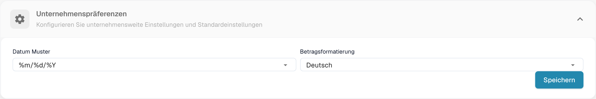
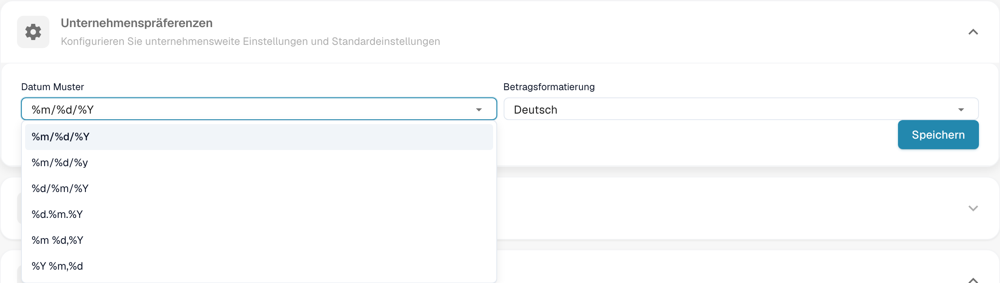

# Unternehmenspräferenzen

## Video-Tutorial: Unternehmen, Abonnement und Audit


Unternehmensinformationen, Abonnement-Plan und Audit-Protokoll in DocBits


Das Video zeigt die Unternehmensinformationen und -präferenzen, den Abonnement-Plan, die Anmeldeaktivität und das Audit-Protokoll.



## Übersicht

Unter **Einstellungen → Unternehmensinformationen** öffnen Sie den Abschnitt **Unternehmenspräferenzen**. Hier legen Sie das Datumsformat und die Betragsformatierung für Ihre Organisation fest.

<figure><figcaption>
Die Unternehmenspräferenzen in der deutschen DocBits-Oberfläche.
</figcaption></figure>

## Datum Muster

Öffnen Sie die Auswahl **Datum Muster** und wählen Sie das gewünschte Datumsformat.

<figure><figcaption>
Die Auswahl zeigt die unterstützten Datumsformate.
</figcaption></figure>

Die Platzhalter bedeuten:

| Platzhalter | Bedeutung | Beispiel |
|---|---|---|
| `%d` | Tag | `07` |
| `%m` | Monat | `07` |
| `%Y` | Jahr mit vier Stellen | `2025` |
| `%y` | Jahr mit zwei Stellen | `25` |

Beispielsweise ergibt `%d.%m.%Y` die Anzeige `07.07.2025`; `%m/%d/%y` ergibt `07/07/25`.

## Betragsformatierung

Öffnen Sie die Auswahl **Betragsformatierung**. Sie bestimmt unter anderem Dezimaltrennzeichen und Zifferngruppierung für die Anzeige von Beträgen, beispielsweise `1.000,00` im deutschen und `1,000.00` im englischen Format.

> **Hinweis:** Die Betragsformatierung im Validierungsbildschirm wird durch die Herkunftseinstellung des Dokuments bestimmt.

## Änderungen speichern

Wählen Sie nach Ihren Änderungen **Speichern** im Abschnitt **Unternehmenspräferenzen**. Wenn Sie keine Änderung übernehmen möchten, verlassen Sie die Seite ohne zu speichern.

## Neuer Versionsinfo-Dialog

Die gezeigte Oberfläche enthält in diesem Abschnitt die Datums- und Betragsformatierung. Informationen zu verfügbaren Versionen und Release-Kanälen finden Sie unter [Release-Lebenszyklus](../../../../overview-and-basics/docbits-release-lifecycle-strategy.md).
