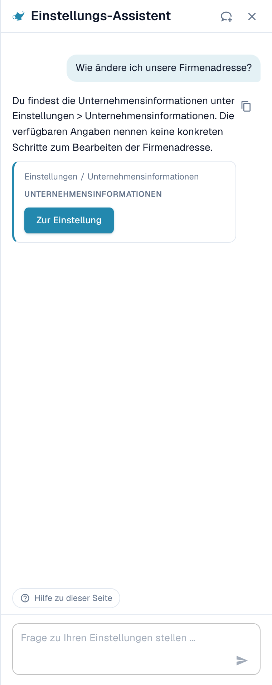
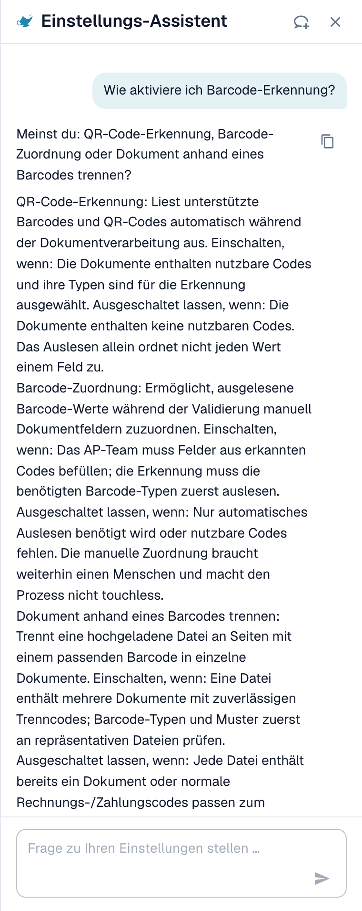
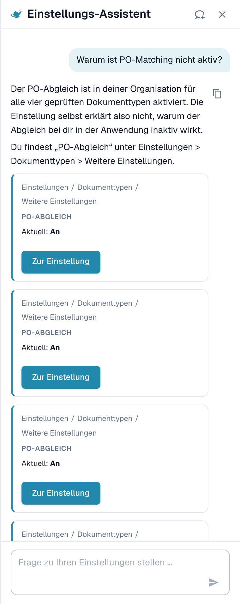
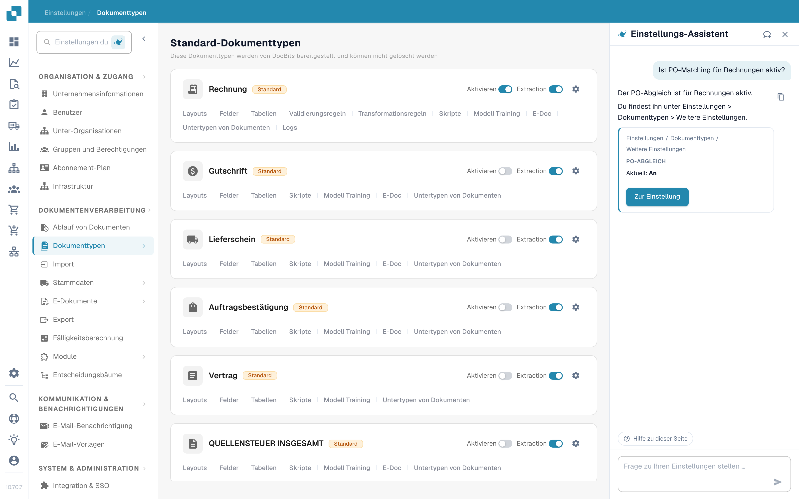
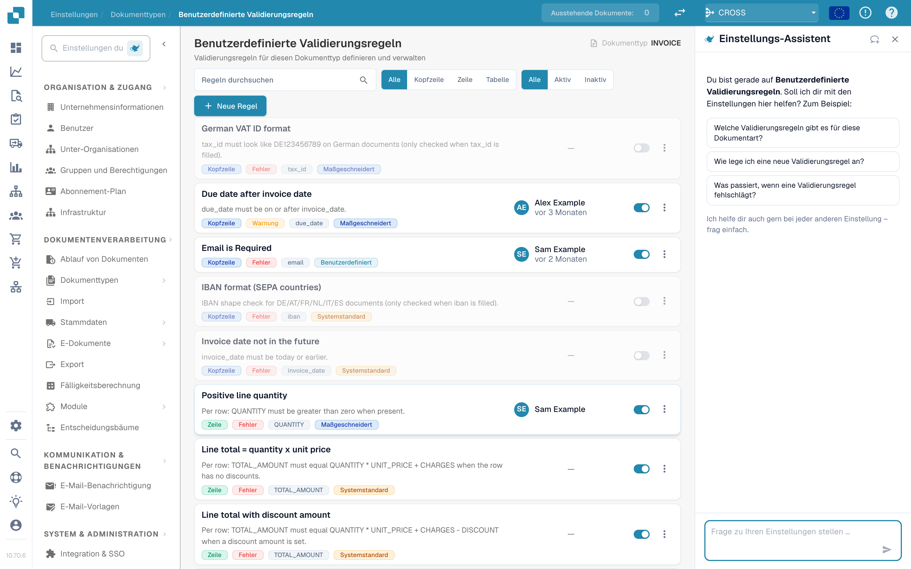
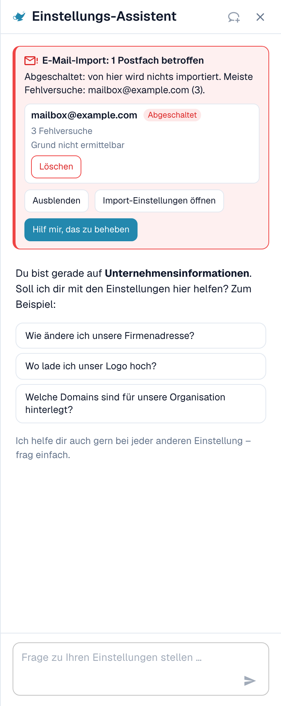

# Einstellungs-Assistent: Was der Chat kann

## Übersicht

Der Chat des **Einstellungs-Assistenten** beantwortet Fragen zu Ihren Einstellungen, warnt Sie, wenn ein Import nicht mehr funktioniert, und ändert mit Ihrer Bestätigung eine Einstellung für Sie. Bevor Sie ihn nutzen, muss ein Administrator [den Assistenten einschalten](settings-assistant.md).

### Was er kann

| Sie möchten … | Beispiel | Was Sie erhalten |
| --- | --- | --- |
| Eine Einstellung finden | „Wo finde ich die Einstellungen für den E-Mail-Import?“ | Den Pfad (zum Beispiel Einstellungen / Import) und eine Schaltfläche **Zur Einstellung** (Open setting), die zur Einstellung springt und sie hervorhebt |
| Eine Einstellung verstehen | „Wie aktiviere ich die Barcode-Erkennung?“ | Eine kurze Erklärung zu jeder passenden Einstellung: wann Sie sie einschalten, wann Sie sie ausgeschaltet lassen |
| Ihre Konfiguration prüfen | „Warum ist der Bestellabgleich nicht aktiv?“ | Den aktuellen Wert jeder zugehörigen Einstellung in Ihrer Organisation (**Aktuell: An** oder **Aktuell: Aus**) und welche Einstellung Sie blockiert |
| Einen defekten Import erkennen | Eine rote Karte oben im Panel | Welches Postfach oder welche FTP-Verbindung fehlschlägt, wie oft und einen wahrscheinlichen Grund |
| Eine Einstellung sicher ändern | **Ausschalten** (Switch off) bei einem fehlerhaften Postfach in einer Befund-Karte | Eine Vorschau der Änderung. Nichts wird gespeichert, bevor Sie bestätigen. Jede Änderung lässt sich rückgängig machen. |
| Eine Seite kennenlernen | **Videoerklärung ansehen** (Watch video explanation) | Ein kurzes Video zur aktuellen Seite (für ausgewählte Seiten verfügbar) |


Der Assistent läuft auf der KI-Stufe **Fast**. Es gibt keine Organisationseinstellung, um ein anderes Modell zu wählen.


## Fragen stellen

Geben Sie eine Frage in das Feld unten ein („Frage zu deinen Einstellungen stellen …“) und drücken Sie **Enter**. Der Assistent zeigt, was er gerade tut („Konfiguration wird gelesen …“, „Dokumentation wird durchsucht …“, „Antwort wird geschrieben …“), und Sie können ihn jederzeit mit **Stoppen** (Stop) anhalten.

### Das Panel weiß, auf welcher Seite Sie sind

Wenn Sie das Panel auf einer Einstellungsseite öffnen, begrüßt es Sie **für diese Seite** und bietet drei passende Fragen an. Das sind echte Beispiele:

| Seite | Beispielfragen |
| --- | --- |
| Unternehmensinformationen | „Wie ändere ich unsere Firmenadresse?“, „Wo lade ich unser Logo hoch?“, „Welche Domains sind für unsere Organisation registriert?“ |
| Import | „Ist der E-Mail-Import für uns aktiv?“, „An welche E-Mail-Adresse senden wir Dokumente?“, „Wie richte ich einen FTP- oder SFTP-Import ein?“ |
| Klassifizieren & Extrahieren | „Welches KI-Modell wird für die Extraktion verwendet?“, „Ist das Aufteilen von Dokumenten nach Barcodes für uns aktiv?“, „Kann ich für einen Lieferanten ein anderes KI-Modell verwenden?“ |
| Benutzer | „Wie lade ich einen neuen Benutzer ein?“, „Wie mache ich einen Benutzer zum Administrator?“, „Wie deaktiviere ich einen Benutzer?“ |
| Einstellungsübersicht | „Wie aktiviere ich die Barcode-Erkennung?“, „Warum ist der Bestellabgleich nicht aktiv?“, „Wo finde ich die Einstellungen für den E-Mail-Import?“ |

Klicken Sie auf eine Frage, und sie wird sofort gesendet. Unter den drei Fragen steht *Ich helfe auch bei jeder anderen Einstellung — fragen Sie einfach.* Während einer Unterhaltung bleibt der Chip **Hilfe zu dieser Seite** (Help with this page) unten stehen und fragt „Was kann ich auf dieser Seite konfigurieren?“.

### Beispiel 1: Eine Einstellung finden

Sie fragen **„Wie ändere ich unsere Firmenadresse?“**

<figure><figcaption>
Die Antwort nennt den Ort, und die Karte gibt Ihnen den genauen Pfad und eine Schaltfläche <strong>Zur Einstellung</strong>.
</figcaption></figure>

Die Antwort sagt, wo die Adresse liegt. Die Karte darunter zeigt den Pfad (**Einstellungen / Unternehmenseinstellungen**) und die Schaltfläche **Zur Einstellung**. Klicken Sie darauf: DocBits öffnet die Seite, scrollt zur Einstellung und hebt sie einige Sekunden lang hervor.

### Beispiel 2: Eine Einstellung mit mehreren Namen verstehen

Sie fragen **„Wie aktiviere ich die Barcode-Erkennung?“**

<figure><figcaption>
Passt ein Begriff auf mehrere Einstellungen, listet der Assistent jede auf, mit <strong>Aktivieren, wenn</strong> (Enable when) und <strong>Ausgeschaltet lassen, wenn</strong> (Leave off when).
</figcaption></figure>

„Barcode-Erkennung“ kann drei verschiedene Einstellungen meinen, daher fragt der Assistent *Meinten Sie: QR Code Extraction, Barcode Assignment oder Split Document on Barcode?* und erklärt jede:

* **QR Code Extraction**: liest unterstützte Barcodes und QR-Codes automatisch während der Verarbeitung. Aktivieren Sie sie, wenn Ihre Dokumente nützliche Codes tragen.
* **Barcode Assignment**: lässt einen Prüfer decodierte Barcode-Werte während der Validierung von Hand Feldern zuordnen. Sie braucht die Extraktion, die den Code zuerst erkennt, und macht die Verarbeitung nicht touchless.
* **Split Document on Barcode**: teilt eine hochgeladene Datei an Trennseiten in einzelne Dokumente auf. Verwenden Sie sie nur, wenn die Trenncodes zuverlässig sind.

### Beispiel 3: Herausfinden, warum etwas nicht passiert

Sie fragen **„Warum ist der Bestellabgleich nicht aktiv?“**

<figure><figcaption>
Bei einer „Warum“-Frage liest der Assistent Ihre Konfiguration und zeigt jede Einstellung mit ihrem <strong>aktuellen</strong> Wert.
</figcaption></figure>

Der Assistent liest die Einstellungen Ihrer Organisation und berichtet, was er gefunden hat. In diesem Beispiel ist der Bestellabgleich für alle vier Dokumenttypen **An**, und die Einstellung **Auto export if PO matched 100%** ist **Aus**, daher laufen der automatische Abgleich und Export nicht. Jede Karte zeigt **Aktuell: An / Aus** und eine Schaltfläche **Zur Einstellung**, sodass Sie es gleich beheben können.

### Beispiel 4: Bestellabgleich

Sie öffnen **Einstellungen → Dokumenttypen** und fragen **„Ist der Bestellabgleich für Rechnungen aktiv?“** (diese Frage gehört auch zu den drei Vorschlägen auf dieser Seite).

<figure><figcaption>
Die Seite <strong>Dokumenttypen</strong> mit dem Assistenten rechts. Die Antwort sagt, dass der <strong>Bestellabgleich für Rechnungen in Ihrer Organisation aktiv ist</strong>, und zeigt drei zugehörige Einstellungen: <strong>PO Matching</strong> (Aktuell: An), die <strong>PO match rules</strong> und <strong>Auto export if PO matched 100%</strong> (Aktuell: Aus).
</figcaption></figure>

Der Assistent liest die Einstellung für den Dokumenttyp und ergänzt die Einstellungen, die dazugehören. In diesem Beispiel ist der Abgleich an, aber der automatische Export nach einem 100-%-Treffer ist aus, daher warten abgeglichene Rechnungen weiter auf eine Person. Jede Karte hat eine Schaltfläche **Zur Einstellung**.

* Für die **Abgleichregeln und Toleranzen** nutzen Sie die Seite [Purchase Order Matching Rules](../document-types/more-settings/purchase-order/purchase-order-matching-rules.md).
* Um zu sehen, **warum Dokumente eines Lieferanten nicht abgeglichen werden**, öffnen Sie [Touchless Intelligence: Bestellabgleich-Diagnose](../../../touchless-po-matching-diagnosis.md). Sie zeigt den Grund, die betroffenen Dokumente und den Entscheidungsablauf.

### Beispiel 5: Feldvalidierung (benutzerdefinierte Validierungsregeln)

Auf der Seite **Einstellungen → Dokumenttypen → Benutzerdefinierte Validierungsregeln** begrüßt Sie das Panel für diese Seite und schlägt drei Fragen vor.

<figure><figcaption>
Die Seite <strong>Benutzerdefinierte Validierungsregeln</strong> mit dem Assistenten rechts. Die Regelliste steht in der Mitte, die drei Vorschläge des Panels lauten: <strong>Welche Validierungsregeln gibt es für diesen Dokumenttyp?</strong>, <strong>Wie lege ich eine neue Validierungsregel an?</strong> und <strong>Was passiert, wenn eine Validierungsregel fehlschlägt?</strong>
</figcaption></figure>

Nutzen Sie den Assistenten hier, um die richtige Einstellung zu **finden** und zu erfahren, was eine Regel tut. Um eine Regel zu **erstellen oder zu ändern**, arbeiten Sie auf der Seite selbst: siehe [Custom Validation Rules](../document-types/custom-validation-rules.md) und [Duplicate a Custom Validation Rule](../document-types/duplicate-a-custom-validation-rule.md). Legt der Assistent eine Regel für Sie an, wird die Regel immer **inaktiv** angelegt, und Sie schalten sie selbst ein.


Verwechseln Sie **Benutzerdefinierte Validierungsregeln** (Regeln für die Felder eines Dokumenttyps) nicht mit der **E-Rechnungs-Validierung** (E-Invoice Validation, die Prüfung von XRechnung-, ZUGFeRD- und Factur-X-Dateien). Das sind zwei verschiedene Seiten.


### Beispiel 6: Weitere Fragen zum Ausprobieren

* „Welches KI-Modell wird für die Extraktion verwendet?“
* „Ist das Aufteilen von Dokumenten nach Barcodes für uns aktiv?“
* „Wie deaktiviere ich einen Benutzer?“
* „Wo stelle ich ein, wie lange Dokumente aufbewahrt werden?“
* „Welche Einstellungen beeinflussen die Touchless-Quote?“
* „Zeig mir einen Screenshot der Einstellungen des Lieferantenportals.“


Liegt eine Frage außerhalb des Einstellungsbereichs, oder findet der Assistent in den DocBits-Informationen, die ihm vorliegen, nichts dazu, sagt er das. Eine Frage zu etwas, das keine Einstellung ist, liefert zum Beispiel *Ich finde nichts zu … in den hier verfügbaren DocBits-Informationen* zusammen mit einem Link zur nächstliegenden Seite. Er rät nicht.


### Links und Screenshots in Antworten

* Antworten können **Dokumentation ansehen**-Links enthalten. Sie verweisen nur auf docs.docbits.com und öffnen sich in einem neuen Tab. Links zur Dokumentation erscheinen, wenn die Dokumentationssuche in Ihrer Umgebung verfügbar ist.
* Antworten können **Screenshots** aus der Dokumentation zeigen. Klicken Sie auf eine Vorschau, um sie zu vergrößern.
* **Antwort kopieren** (das kleine Kopier-Symbol neben einer Antwort) kopiert den Text.

## Befunde: Der Assistent warnt Sie

Wenn etwas in Ihrer Konfiguration nicht mehr funktioniert, erscheint oben im Panel eine **rote Karte**. Sie müssen nicht fragen. Der Assistent prüft erneut, sobald Sie das Panel öffnen und sobald Sie zum Browser-Tab zurückkehren.

<figure><figcaption>
Ein aufgeklappter Befund: das Postfach, sein Zustand (<strong>Ausgeschaltet</strong>), die Anzahl der fehlgeschlagenen Versuche und der Grund.
</figcaption></figure>

Derzeit gibt es zwei Prüfungen:

| Prüfung | Titel der Karte | Was gezählt wird |
| --- | --- | --- |
| E-Mail-Import | „E-Mail-Import: 1 Postfach betroffen“ / „E-Mail-Import: 3 Postfächer betroffen“ | Postfächer mit fehlgeschlagenen Anmeldungen |
| FTP-Import | „FTP-Import: 1 Verbindung betroffen“ / „FTP-Import: 2 Verbindungen betroffen“ | Verbindungen mit fehlgeschlagenen Verbindungs- oder Anmeldeversuchen |

Jede Karte hat drei Schaltflächen:

* **Fehler anzeigen** (Show errors, danach **Ausblenden**): listet die betroffenen Postfächer oder Verbindungen auf, bis zu zehn, mit dem Zustand (**Ausgeschaltet** oder **Neuer Versuch**), der Anzahl der fehlgeschlagenen Versuche und dem Grund.
* **Importeinstellungen öffnen**: öffnet **Einstellungen → Import**.
* **Hilf mir bei der Behebung**: startet einen Chat. Der Assistent stellt sich selbst die Frage „Mein E-Mail-Import funktioniert nicht mehr. Kannst du mir bei der Behebung helfen?“ und führt Sie durch den Grund.

Die Zusammenfassungszeile sagt Ihnen, wie schlimm es ist:

| Zusammenfassungszeile | Bedeutung |
| --- | --- |
| *Ausgeschaltet: Von hier wird nichts importiert.* | Alle betroffenen Postfächer sind ausgeschaltet. Es kommt nichts an. |
| *Wird weiter versucht, aber Importe schlagen wahrscheinlich fehl.* | DocBits versucht es weiter, aber die Anmeldung funktioniert nicht. |
| *1 ausgeschaltet, 2 werden weiter versucht.* | Eine Mischung aus beidem. |

### Gründe, die Sie sehen können

Der Assistent übersetzt den technischen Fehler in einen dieser Gründe:

| Angezeigter Grund | Was zu tun ist |
| --- | --- |
| Anmeldung durch Richtlinie blockiert (z. B. Basisauthentifizierung deaktiviert oder App-Passwort/MFA erforderlich) | Bitten Sie Ihren Mail-Administrator um ein App-Passwort oder stellen Sie das Postfach auf moderne Authentifizierung um |
| Anmeldung abgelehnt (Benutzername und Passwort prüfen) | Das Passwort hat sich geändert. Geben Sie das neue in den Importeinstellungen ein |
| Postfach oder Pfad nicht gefunden | Das Postfach wurde umbenannt oder gelöscht. Prüfen Sie die Adresse oder den Ordner |
| Server nicht erreichbar | Prüfen Sie den Servernamen und Ihre Firewall |
| Zeitüberschreitung beim Verbinden | Der Server ist langsam oder blockiert. Versuchen Sie es später erneut |
| Zertifikat- oder TLS-Verbindung fehlgeschlagen | Prüfen Sie die Verschlüsselungseinstellung und das Serverzertifikat |
| Grund konnte nicht ermittelt werden | Öffnen Sie die Importeinstellungen und testen Sie die Verbindung |

### Eine fehlerhafte Verbindung ausschalten oder löschen

In einer aufgeklappten Zeile können Sie **Ausschalten** (wird nur angezeigt, wenn sie noch an ist) oder **Löschen** verwenden. Beide folgen demselben sicheren Ablauf:

1. Sie klicken auf die Schaltfläche. Der Assistent fragt *(Name) ausschalten? Aus diesem Postfach wird nichts importiert, bis es wieder eingeschaltet wird.* oder *(Name) löschen? Es wird dauerhaft entfernt und kann nicht wiederhergestellt werden.*
2. Sie bestätigen mit **Ja, ausschalten** oder **Ja, löschen**, oder Sie klicken auf **Abbrechen**.
3. Die Ergebniszeile erscheint: *(Name) wurde ausgeschaltet.* mit einer Schaltfläche **Rückgängig**. Eine gelöschte Verbindung hat kein **Rückgängig**, weil Löschen dauerhaft ist.

Hat zwischenzeitlich jemand anderes das Postfach geändert, sehen Sie *Dieses Postfach wurde zwischenzeitlich geändert. Bitte prüfen Sie es und versuchen Sie es erneut.* Es wird nichts geändert.

## Einstellungen sicher ändern

Der Assistent ändert nie von sich aus etwas. Jede Änderung folgt denselben vier Schritten:

1. **Vorschau**: Sie sehen die Einstellung, ihren Geltungsbereich (**Organisation**) und den Wert **aktuell → vorgeschlagen**. Es ist noch nichts gespeichert.
2. **Ihre Bestätigung**: Sie klicken auf **Bestätigen** (oder **Ja**). Das kann nur ein Organisations-Administrator.
3. **Ergebniszeile**: Der Chat zeigt **Geändert: (Einstellung) → (Wert)**.
4. **Rückgängig**: Eine Schaltfläche mit Countdown („Noch 14 Min. verfügbar“) lässt Sie die Änderung zurücknehmen. Die Änderung wird außerdem im Protokoll festgehalten.

**Beispiel (zur Veranschaulichung).** Eine Empfehlungskarte zu einer Einstellung, die der Assistent schreiben darf, zeigt neben **Zur Einstellung** eine Schaltfläche **Übernehmen** (Apply). Angenommen, die Karte betrifft **Auto export if PO matched 100%**. Sie klicken auf **Übernehmen**. Der Dialog **Diese Änderung übernehmen?** zeigt *Aktuell: Aus → Vorgeschlagen: An*. Sie klicken auf **Bestätigen**. Eine Meldung **Einstellung aktualisiert.** erscheint mit einer Schaltfläche **Rückgängig**. Bemerken Sie innerhalb von etwa 15 Minuten einen Fehler, klicken Sie auf **Rückgängig**, und der alte Wert ist wieder da. Karten ohne Schaltfläche **Übernehmen** dienen nur der Navigation: Nutzen Sie **Zur Einstellung** und ändern Sie den Wert selbst.

Hat sich der Wert geändert, seit Sie den Dialog geöffnet haben, sehen Sie *Diese Einstellung hat sich geändert, seit Sie diesen Dialog geöffnet haben. Bitte erneut prüfen.* und es wird nichts angewendet.

### Was der Assistent ändern kann

| Änderung | Beispielanfrage (zur Veranschaulichung) |
| --- | --- |
| Eine einzelne Organisationseinstellung (**Übernehmen** bei einer Empfehlung) | „Automatischen Bestellabgleich und Export einschalten“ |
| Dokumenttypen ein- oder ausschalten | „Dokumenttyp Lieferschein deaktivieren“ |
| Eine Zugriffsgruppe umbenennen | „Die Gruppe Einkäufer in Einkauf umbenennen“ |
| Suchmodus eines Nachschlagefelds (Auto oder Manuell) | „Lieferanten manuell statt automatisch suchen“ |
| Ein Feld löschen | „Das Feld Kostenstelle löschen“ |
| Eine inaktive Validierungsregel aus einem Katalog anlegen | Öffnen Sie die Seite **Benutzerdefinierte Validierungsregeln** und beschreiben Sie die Prüfung |
| Eine inaktive Transformationsregel anlegen | „Eine Regel anlegen, die Bindestriche aus der USt-IdNr. des Lieferanten entfernt“ |
| Eine Importverbindung ausschalten oder löschen | Nutzen Sie die Schaltflächen in der Befund-Karte |

### Regelentwürfe

Bitten Sie um eine **Transformationsregel**, zeigt der Assistent zuerst eine **Regelvorschau** (Rule preview):

* den Regelnamen und einen einfachen Satz („Bindestriche aus der USt-IdNr. des Lieferanten entfernen“),
* das Ziel (Kopffeld, Spalte einer Tabelle, Zeilen einer Tabelle, Dokumentattribut),
* einen Test an Beispieldokumenten: **Trifft auf 4 von 5 Beispielen zu**, wobei jedes Dokument mit **Trifft zu**, **Trifft nicht zu** oder **Trifft zu, keine Änderung** markiert ist.

Mit **Regel anlegen** (Create rule) speichern Sie sie. Die Regel wird **inaktiv** angelegt: Sie aktivieren sie selbst, nachdem Sie sie geprüft haben. Das Anlegen können Sie **15 Minuten** lang rückgängig machen. Danach löschen Sie die Regel in der Regelliste. Über den Assistenten können höchstens **10 Regeln pro Stunde** angelegt werden.

## Videoerklärungen

Auf ausgewählten Seiten (derzeit **Layouts**, **Benutzer** und **Unterorganisationen**) bietet der Assistent **Videoerklärung ansehen** an. Das Video wird im Panel abgespielt, hat Untertitel und ein Transkript (**Transkript anzeigen**) und verwendet Ihre Sprache, wenn eine Version dafür existiert.

## Grenzen und Meldungen

| Meldung | Bedeutung |
| --- | --- |
| Zu viele Anfragen. Bitte kurz warten. | Sie haben schnell viele Fragen gesendet. **Erneut versuchen** wird nach kurzer Wartezeit aktiv. |
| Nur für Administratoren verfügbar. | Ihr Konto ist kein Organisations-Administrator. |
| Der Assistent ist vorübergehend nicht erreichbar. | Versuchen Sie es in einigen Minuten erneut. |
| Der Assistent antwortet nicht rechtzeitig. | Die Antwort hat nicht rechtzeitig begonnen. Klicken Sie auf **Erneut versuchen**. |
| Etwas ist schiefgelaufen. Bitte versuchen Sie es erneut. | Ein allgemeiner Fehler. Die **Fehler-ID** (Error ID) kann für den Support kopiert werden. |
| Der Assistent wird gerade eingerichtet | Die Funktion ist in Ihrer Umgebung noch nicht verfügbar. |
| Sie haben die Organisation gewechselt — diese Antwort gilt hier nicht mehr. | Sie haben die Organisation gewechselt, während eine Antwort oder eine Änderung geöffnet war. |

Eine Unterhaltung behält die letzten 50 Beiträge in Ihrem Browser. Eine Frage kann bis zu 4000 Zeichen lang sein.

## Tipps

* Fragen Sie nach **einer Sache auf einmal**. „Wo ist der E-Mail-Import und ist er an?“ funktioniert besser als zwei Fragen.
* Nutzen Sie die **Seitenbegrüßung**. Die drei Fragen sind für die Seite geschrieben, auf der Sie sind, und sie sind der schnellste Einstieg.
* Sagen Sie, **was Sie erreichen möchten**, nicht den Namen einer Einstellung. „Ich möchte, dass Rechnungen exportiert werden, ohne dass jemand sie ansieht“ findet die richtigen Einstellungen.
* Prüfen Sie die **Vorschau**, bevor Sie bestätigen, besonders die Werte **aktuell → vorgeschlagen**.
* Sie sind unsicher? Nutzen Sie **Zur Einstellung** und sehen Sie sich die Seite an. Der Assistent verbirgt nie, wo eine Einstellung liegt.

## Weiterführende Seiten

* [Einstellungs-Assistent: Einschalten](settings-assistant.md)
* [Analyse-Dashboard](../../../analytics-dashboard.md)
* [DocBits MCP](../../../../advanced-functions-and-tools/docbits-mcp/README.md)

<!-- Source notes (not shown): the assistant answers for custom validation rules and for PO tolerance / "why not matched" questions are weak on dev (tracked in the CORE project, CORE-6433), so this page shows only the greeting for validation and the PO matching status answer. Re-test and add answer screenshots after the fix. facts read from the doc2app code on dev (SettingsAssistant, AssistantChat components) and checked in the dev UI on 14 Oct 2026. "Fast tier, no organisation switch" and "documentation search not configured on Sandbox yet" come from the feature team (CORE-6379). Strings for the apply/action cards not verified in the UI are described, not quoted. -->
