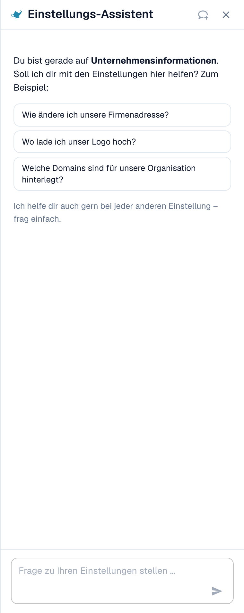
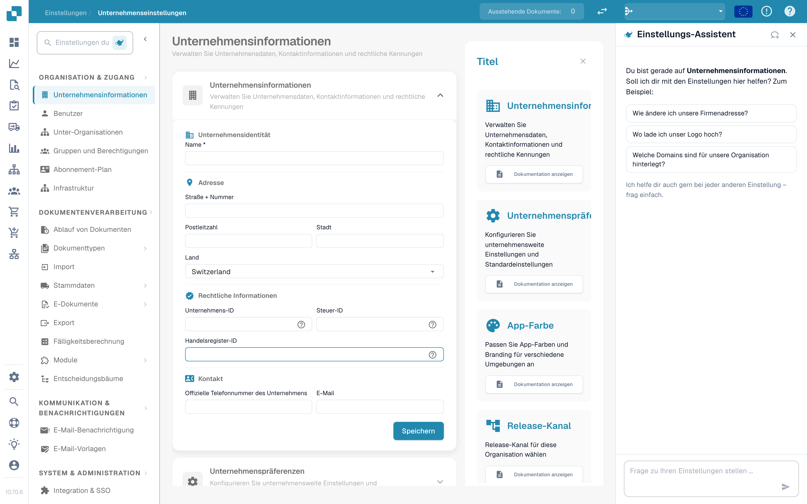

# Einstellungs-Assistent: Einschalten

Der **Einstellungs-Assistent** (Settings Assistant) ist ein Chat-Panel im Bereich „Einstellungen“. Sie stellen eine Frage in einfacher Sprache, und er liest die Konfiguration Ihrer Organisation, antwortet und führt Sie direkt zur richtigen Einstellung. Er kann Sie auch warnen, wenn etwas in Ihrer Konfiguration nicht mehr funktioniert, und mit Ihrer Bestätigung eine Einstellung für Sie ändern.

Am meisten hilft er, wenn Sie wissen, **was** Sie möchten („Dokumente nicht mehr an Barcodes aufteilen“), aber nicht, **wo** die Einstellung liegt, oder wenn Sie sich fragen, **warum** etwas nicht passiert („Warum ist der Bestellabgleich nicht aktiv?“).

<figure><figcaption>
Der Einstellungs-Assistent auf der Seite „Unternehmensinformationen“: eine Begrüßung für die aktuelle Seite, drei Beispielfragen und das Fragefeld. Eine Warnkarte erscheint über der Begrüßung, wenn ein Import nicht mehr funktioniert (siehe <a href="settings-assistant-chat.md#befunde-der-assistent-warnt-sie">Befunde</a>).
</figcaption></figure>

Der Assistent ist **standardmäßig aus**. Diese Seite zeigt, wo Sie ihn einschalten und wie Sie ihn öffnen. Was Sie ihn fragen können und was er ändern kann, beschreibt die Seite [Einstellungs-Assistent: Was der Chat kann](settings-assistant-chat.md).

## Wer ihn nutzen kann

* Der **Organisations-Administrator** schaltet den Assistenten für die gesamte Organisation ein oder aus.
* Ist er eingeschaltet, kann jeder Administrator, der die **Einstellungen** öffnen kann, das Panel für sich selbst ein- oder ausblenden.
* Änderungen (eine Empfehlung anwenden, eine Importverbindung ausschalten oder löschen, eine Regel anlegen) sind auf **Organisations-Administratoren** beschränkt. Andere Benutzer erhalten die Meldung _Nur für Administratoren verfügbar._

## Einschalten

1. Gehen Sie zu **Einstellungen → Globale Einstellungen → Unternehmensinformationen** (Company Information). Die Seitenüberschrift zeigt **Unternehmenseinstellungen** (Company Settings).
2. Öffnen Sie den Abschnitt **Assistenten** (Assistants).
3. Schalten Sie **Einstellungs-Assistent aktivieren** (Enable the settings assistant) ein.

<figure><figcaption>
Der Abschnitt „Assistenten“. Der Einstellungs-Assistent hat einen eigenen Schalter. Der Validierungsassistent und die Erklär-Sprachausgabe sind eigene Funktionen.
</figcaption></figure>

Eine kurze Meldung bestätigt **Einstellungs-Assistent aktiviert** (Settings assistant enabled). Die Einstellung ist standardmäßig aus. Solange sie aus ist, erscheinen das Panel und seine Schaltfläche nirgendwo.


Der **Validierungsassistent** (Validation assistant) im selben Abschnitt ist eine andere Funktion. Er erklärt blockierende Felder innerhalb eines Dokuments und kann keine Einstellung ändern. Das Umschalten des einen wirkt sich nicht auf den anderen aus.


## Das Panel öffnen und schließen

Auf jeder Seite im Bereich „Einstellungen“ finden Sie neben dem Suchfeld für Einstellungen eine kleine **Wunderlampen-Schaltfläche**. Ein Klick darauf **zeigt** den Assistenten **an** oder **blendet** ihn **aus**.

<figure><figcaption>
Der Assistent sitzt auf der <strong>rechten Seite</strong> jeder Einstellungsseite: Navigation links, die Seite in der Mitte, der Assistent daneben. Hier auf <strong>Unternehmenseinstellungen → Unternehmensinformationen</strong>. Die Schaltfläche zum Ein- und Ausblenden ist das Lampen-Symbol neben <strong>Sucheinstellungen</strong> (Search Settings) oben in der Navigation.
</figcaption></figure>

* Das Panel merkt sich Ihre Wahl pro Benutzer, sodass es beim nächsten Besuch geöffnet bleibt.
* Auf einem breiten Bildschirm (ab 1280 Pixeln) sitzt es neben der Seite. Sie können an seinem Rand ziehen, um die Breite zu ändern.
* Auf einem schmalen Bildschirm öffnet es sich als Overlay. **Esc** oder ein Klick außerhalb schließt es.
* **Neuer Chat** (New chat, das Sprechblasen-Symbol in der Kopfzeile) leert die Unterhaltung. Die Unterhaltung übersteht auch ein Neuladen der Seite, aber kein geschlossenes Browser-Tab.

## Wie es weitergeht

* Stellen Sie Ihre erste Frage: siehe [Einstellungs-Assistent: Was der Chat kann](settings-assistant-chat.md).
* Der Assistent läuft auf der KI-Stufe **Fast**. Es gibt keine Organisationseinstellung, um ein anderes Modell zu wählen.

## Fehlerbehebung

| Problem                                                                          | Ursache und Lösung                                                                                                                        |
| -------------------------------------------------------------------------------- | ----------------------------------------------------------------------------------------------------------------------------------------- |
| Im Bereich „Einstellungen“ gibt es keine Wunderlampen-Schaltfläche               | Der Schalter der Organisation ist aus. Ein Organisations-Administrator schaltet ihn unter **Unternehmensinformationen → Assistenten** ein |
| Der Abschnitt **Assistenten** fehlt in den Unternehmensinformationen             | Nur Organisations-Administratoren sehen ihn                                                                                               |
| Das Panel sagt **Der Assistent wird gerade eingerichtet**                        | Die Funktion ist in Ihrer Umgebung noch nicht verfügbar                                                                                   |
| Das Panel ist da, aber die Antworten lauten _Nur für Administratoren verfügbar._ | Ihr Konto ist kein Organisations-Administrator                                                                                            |

## Weiterführende Seiten

* [Einstellungs-Assistent: Was der Chat kann](settings-assistant-chat.md)
* [Unternehmenspräferenzen](../company-preferences.md)
