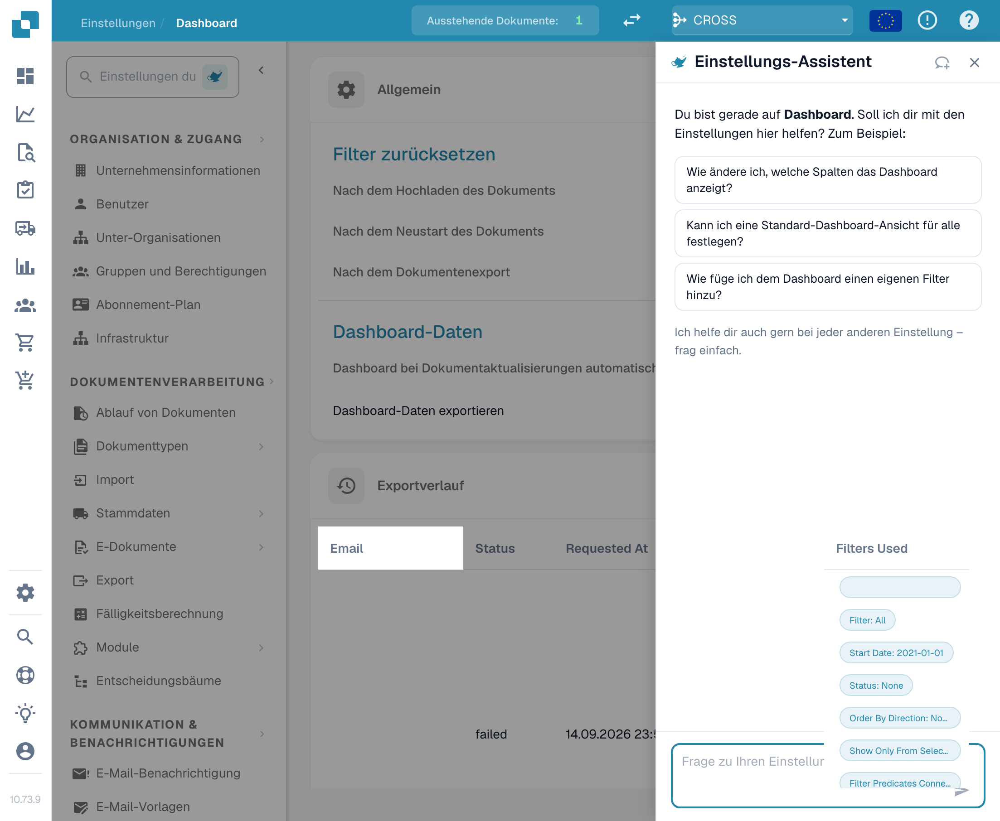
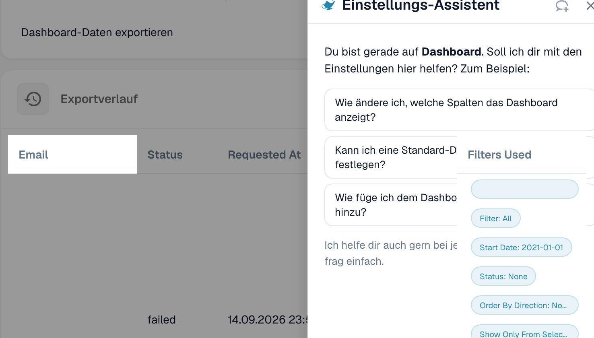
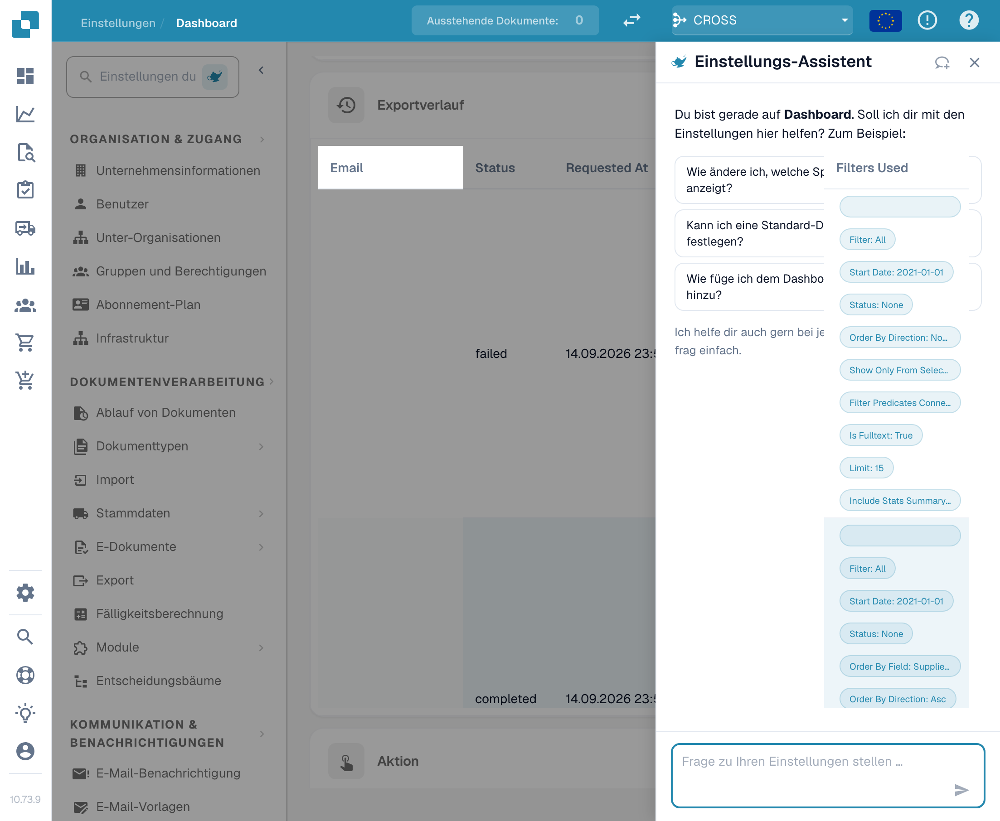
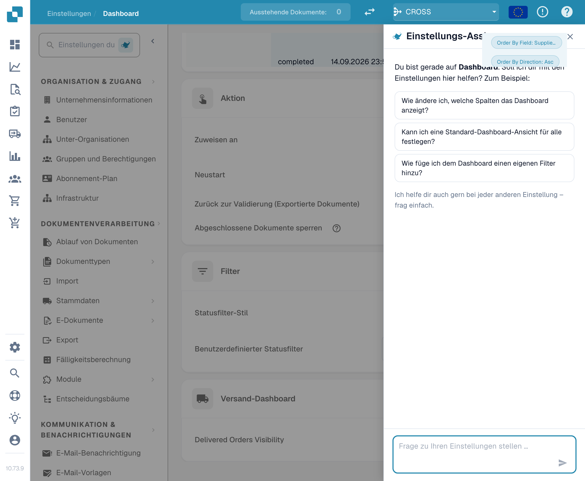

# Dashboard

## Übersicht

Die Dashboard-Einstellungen sind darauf ausgelegt, Administratoren dabei zu helfen, die Datenpräsentation und Interaktion innerhalb des DocBits-Dashboards zu steuern. Diese Einstellungen bestimmen, welche Informationen sofort nach dem Einloggen verfügbar sind, sodass die Benutzer schnellen Zugriff auf die relevantesten Daten für ihre Aufgaben haben.

<figure><figcaption>
Die Dashboard-Einstellungen unter Globale Einstellungen → Dashboard.
</figcaption></figure>

## Zugriff auf die Dashboard-Einstellungen

Um auf die Dashboard-Einstellungen zuzugreifen, navigieren Sie zu:\
**Einstellungen → Globale Einstellungen → Dashboard**

<figure><figcaption>
Der Bereich Dashboard in den globalen Einstellungen.
</figcaption></figure>

## **Allgemein**

* **Filter zurücksetzen**: Ermöglicht die Konfiguration, wann die Dashboard-Filter zurückgesetzt werden sollen, z. B. nach dem Hochladen von Dokumenten, dem Neustart von Dokumenten oder dem Export von Dokumenten. Dies hilft, eine saubere Grundlage für die Datenansicht gemäß spezifischer Arbeitsabläufe zu erhalten.
* **Dashboard-Daten**:
  * **Automatisches Hochladen des Dashboards**: Steuert, ob das Dashboard Daten automatisch beim Zugriff des Benutzers laden soll, was helfen kann, die Ladezeiten zu reduzieren und die Benutzererfahrung zu verbessern, indem Daten nur bei Bedarf geladen werden.
  *   **Dashboard-Daten exportieren**: Diese Funktion fügt der Dashboard-Toolbar einen neuen **Export**-Button hinzu, mit dem Sie die aktuelle Dashboard-Ansicht als **.csv** oder **.xlsx**-Datei exportieren können.

      <figure><figcaption>
Die Option Dashboard-Daten exportieren fügt der Dashboard-Toolbar einen Export-Button hinzu.
</figcaption></figure>

## **Exportverlauf**

Im **Exportverlauf** sehen Sie eine Tabelle, die alle vergangenen Exporte zusammen mit wichtigen Informationen zu jeder Anfrage auflistet.

<figure><figcaption>
Der Exportverlauf listet alle vergangenen Exporte auf.
</figcaption></figure>

Die folgenden Details sind enthalten:

* **E-Mail**: Die E-Mail-Adresse, von der der Export angefordert wurde.
* **Status**: Der aktuelle Status des Exports (Ausstehend, Abgeschlossen).
* **Angefordert am**: Das Datum und die Uhrzeit, zu der der Export initiiert wurde.
* **Abgeschlossen am**: Das Datum und die Uhrzeit, zu der der Export abgeschlossen wurde.
* **Format**: Das für den Export verwendete Dateiformat (CSV, XLSX).
* **Verwendete Filter**: Alle Filter, die zum Zeitpunkt des Exports auf das Dashboard angewendet wurden.

<mark style="color:red;">**Hinweis**</mark>: Um Tabellen zu exportieren, muss die Option Dashboard-Daten exportieren im [Allgemein](./#allgemein) Abschnitt aktiviert sein.

## **Aktion**

* **Zuweisen an**: Diese Funktion ermöglicht es Benutzern, Berechtigungen für die Dokumentenzuweisung festzulegen.
  * **Nur für Admin**: Nur Admin-Benutzer können Dokumente zuweisen, unabhängig von den Berechtigungen, die nicht-Admin-Benutzern gewährt wurden.
  * **Alle Benutzer**: Alle Benutzer, die die erforderlichen [Berechtigungen](../groups-users-and-permissions/groups-and-permissions/activating-permissions.md) erhalten haben, können Dokumente zuweisen.
* **Neustart**: Diese Funktion ermöglicht es Benutzern, Berechtigungen für den Neustart von Dokumenten festzulegen.
  * **Nur für Admin**: Nur Benutzer mit Administratorrechten können Dokumente neu starten, unabhängig von den Berechtigungen, die nicht-Admin-Benutzern gewährt wurden.
  * **Nur Admin und Zuweisung**: Nur Benutzer mit Administratorrechten und der zugewiesene Benutzer können das Dokument neu starten.
  * **Alle Benutzer**: Alle Benutzer, die die erforderlichen [Berechtigungen](../groups-users-and-permissions/groups-and-permissions/activating-permissions.md) erhalten haben, können Dokumente neu starten.

* **Ausstehender Eingabezugriff (Tage)**: Legt fest, wie viele Tage eine Person, die im Aktivitätsprotokoll um eine Eingabe gebeten wurde, das Dokument schreibgeschützt öffnen kann; danach funktioniert der Link nicht mehr. Standard sind 14 Tage, und der Zugriff endet auch, sobald das Dokument weitergeht. Siehe [Pending Input](../../../../end-user-and-partner-section/end-user-section/pending-input.md).

<figure><figcaption>
Der Abschnitt Aktion steuert, wer Dokumente zuweisen und neu starten darf.
</figcaption></figure>

## **Filter**

* **Statusfilter-Stil**: Bestimmt den Präsentationsstil der Statusfilter, der auf Standard oder benutzerdefiniert gemäß dem operativen Fokus der Benutzer eingestellt werden kann.
* **Benutzerdefinierter Statusfilter**: Ermöglicht die Erstellung und Anwendung von benutzerdefinierten Filtern, die auf spezifische Dokumentstatus wie "Neu", "Validierung" oder "Export" abzielen. Dies ermöglicht es Benutzern, schnell auf Dokumente in bestimmten Verarbeitungsstufen zuzugreifen.

<figure><figcaption>
Der Abschnitt Filter steuert Statusfilter-Stil und benutzerdefinierte Statusfilter.
</figcaption></figure>

## Versand-Dashboard

* **Sichtbarkeit gelieferter Bestellungen**: Diese Funktion ermöglicht es dem Benutzer, die Dauer anzugeben, für die gelieferte Bestellungen sichtbar sind.

<figure><figcaption>
Der Abschnitt Versand-Dashboard steuert die Sichtbarkeit gelieferter Bestellungen.
</figcaption></figure>

Diese Dashboard-Einstellungen sind entscheidend, um sicherzustellen, dass die DocBits-Plattform so reaktionsschnell und nützlich wie möglich ist, und den Benutzern ein leistungsstarkes Werkzeug zur Verfügung zu stellen, um Dokumentenverarbeitungsaktivitäten direkt vom Dashboard aus zu überwachen und zu verwalten.
