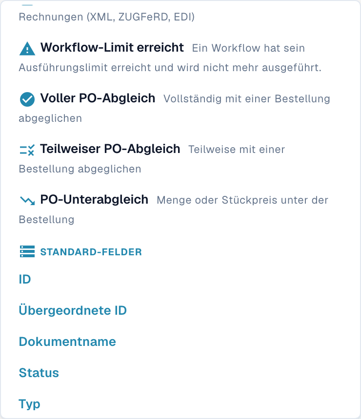
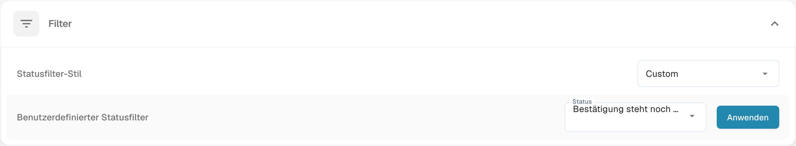

# Filter anpassen

Mit Dashboardfiltern grenzen Sie die sichtbare Dokumentenliste ein. Suchkriterien für die Liste und die organisationsweite Konfiguration der Statusfilter sind getrennte Funktionen.

## Dokumentenliste filtern

Öffnen Sie die Suchleiste im Dashboard. Mit der Pfeiltaste nach unten öffnen Sie bei geschlossenem Menü die verfügbaren Vorschläge. Das Schnellfiltermenü bietet unter anderem **Überfällig**, **Bald fällig**, **Mir zugewiesen**, **Wartet auf Validierung**, **Voller PO-Abgleich** und **Teilweiser PO-Abgleich**. Scrollen Sie bei Bedarf im Menü, um weitere Einträge zu sehen.

<figure><figcaption>
Unterer Bereich des deutschen Schnellfiltermenüs nach tatsächlichem Scrollen: voller, teilweiser und unter dem Bestellwert liegender PO-Abgleich sowie Standardfelder. Es wurde kein Filter ausgewählt und keine Suche ausgeführt.
</figcaption></figure>

Wählen Sie ein passendes Kriterium und prüfen Sie die Ergebnisliste. Kombinieren Sie Kriterien mit den in Ihrer Version angebotenen Funktionen und kontrollieren Sie, ob das Ergebnis der beabsichtigten Suche entspricht. Ein Suchfilter ändert keine extrahierten Dokumentwerte, Freigaben oder Exportstatus.

Zum Entfernen eines Kriteriums verwenden Sie dessen sichtbare X-Schaltfläche oder die angebotene Funktion zum Leeren der Filter. Prüfen Sie anschließend die Liste mit den verbleibenden Kriterien.

## Statusfilter konfigurieren

Öffnen Sie **Einstellungen → Dashboard → Filter**. Wählen Sie den **Statusfilter-Stil**. Bei der derzeit englisch beschrifteten Option **Custom** legen Sie über **Benutzerdefinierter Statusfilter** die angebotenen Status fest. Mit **Anwenden** speichern Sie diese Konfiguration. Dies ist eine andere Aktion als das Filtern der Liste für eine einzelne Suche.

<figure><figcaption>
Aktuelle deutsche Statusfilter-Einstellungen. Die Auswahl „Custom“ ist noch englisch und bedeutet „Benutzerdefiniert“. Es wurde keine Auswahl geändert und „Anwenden“ nicht betätigt.
</figcaption></figure>

Die Abbildungen zeigen nur die vorgefundenen Steuerelemente. Es wurde keine Filterkonfiguration gespeichert und kein Dokument geändert.
