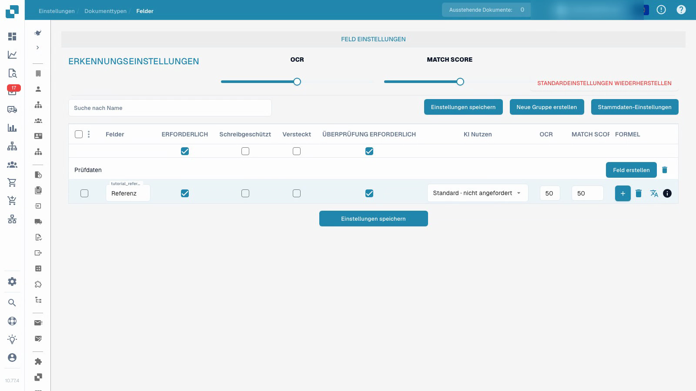

# Dokumenttypen

Das Referenzfeld eines eigenen Testtyps konfigurieren, Beschriftung und Prüfmerkmale speichern und nach dem Neuladen kontrollieren.


Dokumenttypen


[Mit Untertiteln ansehen](https://docbits-videos.fra1.cdn.digitaloceanspaces.com/settings-assistant/document-types-fields-admin/v1/de.html)

Die Aufnahme zeigt die echte Oberfläche. Einzelne Produktbeschriftungen können noch unübersetzt sein.

## Übersicht

Dokumenttypen legen fest, welche Felder und Verarbeitungseinstellungen für eine Belegart gelten. DocBits stellt Standardtypen wie Rechnung und Gutschrift bereit. Für weitere Belegarten können Administratoren eigene Typen konfigurieren. Standardtypen lassen sich nicht löschen; eigene Typen verwalten Sie mit den entsprechenden Organisationsberechtigungen.

## Steuerelemente einer Dokumenttyp-Karte

| Steuerelement | Bedeutung |
| --- | --- |
| Aktivieren | Schaltet den Dokumenttyp für die Verarbeitung ein oder aus. |
| Extraction | Wählt den angezeigten Extraktionsmodus Flex oder Fix. Dieser Schalter ist von der Aktivierung des Dokumenttyps getrennt. |
| Zahnrad | Öffnet weitere Einstellungen des Dokumenttyps. |

Welche Verknüpfungen erscheinen, hängt vom Dokumenttyp, den Berechtigungen und den aktivierten Modulen ab. Dazu gehören Layouts, Felder, Tabellen, Skripte, Modelltraining und Dokument-Untertypen. Transformationsregeln, Validierungsregeln und E-Doc-Einstellungen werden bei den entsprechenden Funktionen angeboten. Weitere Optionen können innerhalb der Dokumenttyp-Einstellungen liegen.

## Felder und Pflichtangaben konfigurieren

Das Video verwendet einen bereits angelegten eigenen Testtyp. Die gezeigten Änderungen betreffen dessen Referenzfeld.

1. Öffnen Sie den Dokumenttyp und wählen Sie **Felder**.
2. Prüfen Sie Feldgruppe und technischen Feldnamen. Die sichtbare Beschriftung lässt sich ändern; die technische Feld-ID bleibt dabei erhalten.
3. Aktivieren Sie **Erforderlich** für das Referenzfeld. Das Feld bleibt sichtbar und bearbeitbar. Die Pflichtangabe muss ausgefüllt werden; die Einstellung ergänzt keinen fehlenden Wert und garantiert keine korrekte Erkennung.
4. Legen Sie mit **Überprüfung erforderlich** die ausdrückliche Feldprüfung gesondert fest. Schreibschutz, Sichtbarkeit sowie OCR- und Match-Score-Schwellenwerte haben jeweils eine eigene Bedeutung.
5. Wählen Sie **Einstellungen speichern**, öffnen Sie die Seite erneut und kontrollieren Sie die gespeicherte Beschriftung und die gesetzten Merkmale.

<figure><figcaption>
Gespeicherte Feldmerkmale eines eigenen Testtyps.
</figcaption></figure>

Das Video zeigt das Speichern und erneute Laden der Konfiguration. Prüfen Sie vor dem produktiven Einsatz zusätzlich repräsentative Dokumente und den vorgesehenen Ablauf mit einem normalen Benutzerkonto. Modelltraining, Rechnungsfreigabe und Export haben eigene Abläufe.

## Benutzerdefinierte Validierungsregeln

Falls die Funktion verfügbar ist, öffnen Sie die Validierungsregeln des Dokumenttyps. Eine vorhandene Regel können Sie nach der Anleitung [Benutzerdefinierte Validierungsregel duplizieren](duplicate-a-custom-validation-rule.md) wiederverwenden. Diese Regeln werden getrennt von den einzelnen Feldmerkmalen im Video verwaltet.

## Eigenen Dokumenttyp anlegen

Öffnen Sie den Bereich für benutzerdefinierte Dokumenttypen, wählen Sie **Neu** und vergeben Sie einen verständlichen Namen. Durchlaufen Sie die angebotenen Schritte für Extraktionsmodus, Felder, Gruppen und gegebenenfalls Tabellen. Die Einrichtung und ein erforderliches Modelltraining gehen über das Speichern eines Pflichtfeldmerkmals hinaus.


Die Einrichtung beschreibt [Dokumenttyp einrichten](../../../setup/document-types/).


## Weiteres Video


Dokumenttypen

