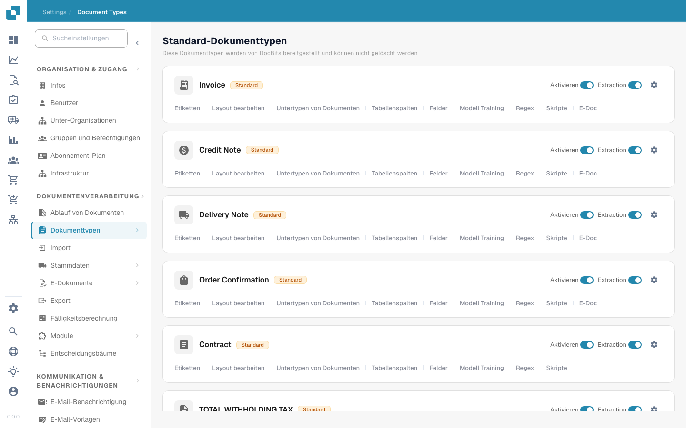

# Dokumenttypen


DocBits Document Types Explained: Create, Configure & Assign Processing Settings


<figure><figcaption>
Seite „Dokumenttypen“
</figcaption></figure>

## Übersicht

Die Seite „Document Types“ listet alle Dokumenttypen auf, die DocBits erkennt und verarbeitet. Sie ist in zwei Bereiche unterteilt:

* **Default Document Types**: Vorkonfigurierte Typen von DocBits (Rechnung, Gutschrift, Lieferschein, Auftragsbestätigung, Vertrag, ZUGFeRD usw.). Diese können nicht gelöscht werden.
* **Custom Document Types**: Typen, die Sie für Ihre spezifischen geschäftlichen Anforderungen erstellen. Diese können bearbeitet und gelöscht werden.

## Steuerelemente pro Dokumenttyp

Jede Dokumenttyp-Karte zeigt:

| Steuerelement | Beschreibung |
|---------|-------------|
| **Activate** | Schalter, um diesen Dokumenttyp für die Verarbeitung zu aktivieren oder zu deaktivieren. |
| **Extraction** | Schalter, um die KI-basierte Datenextraktion für diesen Typ zu aktivieren oder zu deaktivieren. |
| **Settings** (Zahnradsymbol) | Öffnet weitere Konfigurationsoptionen für den Dokumenttyp. |

## Konfigurations-Tabs

Unterhalb jedes Dokumenttyps erreichen Sie die folgenden Konfigurations-Tabs:

| Tab | Beschreibung |
|-----|-------------|
| **Labels** | Anzeigebezeichnungen und Übersetzungen für den Dokumenttyp verwalten. |
| **Edit layout** | Anpassen, wie das Dokument in der Validierungsansicht erscheint, einschließlich der Feldpositionen. |
| **Document Sub Types** | Unterkategorien für diesen Dokumenttyp konfigurieren (z. B. verschiedene Rechnungsformate). |
| **Table columns** | Festlegen, welche Datenspalten in der Tabelle der Positionen erscheinen. |
| **Fields** | Die aus dem Dokument extrahierten Datenfelder verwalten (Felder hinzufügen, bearbeiten oder entfernen). |
| **Model Training** | Das KI-Modell zur Erkennung und Extraktion von Daten konfigurieren und trainieren. |
| **Regex** | Reguläre Ausdrücke für die musterbasierte Datenextraktion einrichten. |
| **Scripts** | Eigene Verarbeitungsskripte schreiben, die während der Dokumentenverarbeitung ausgeführt werden. |
| **E-Doc** | Standards für elektronische Dokumente konfigurieren (XRechnung, ZUGFeRD, EDI, FatturaPA). |

## Benutzerdefinierte Validierungsregeln

Öffnen Sie einen Dokumenttyp und wählen Sie **Custom Validation Rules**, um seine eigenen Validierungsregeln zu verwalten. Um eine vorhandene Regel wiederzuverwenden, ohne sie neu aufzubauen, folgen Sie der Anleitung [Benutzerdefinierte Validierungsregel duplizieren](duplicate-a-custom-validation-rule.md). Die Anleitung erklärt den Regelnamen, den Regelschlüssel und die Bestätigungssteuerelemente.

## Einen benutzerdefinierten Dokumenttyp erstellen

1. Scrollen Sie nach unten zum Abschnitt **Custom Document Types**.
2. Klicken Sie auf **+ New**.
3. Geben Sie einen Namen für den neuen Dokumenttyp ein.
4. Konfigurieren Sie Felder, Layout und Extraktionseinstellungen nach Bedarf.


Detaillierte Anleitungen zur Einrichtung finden Sie unter [Dokumenttyp einrichten](../../../setup/document-types/).

