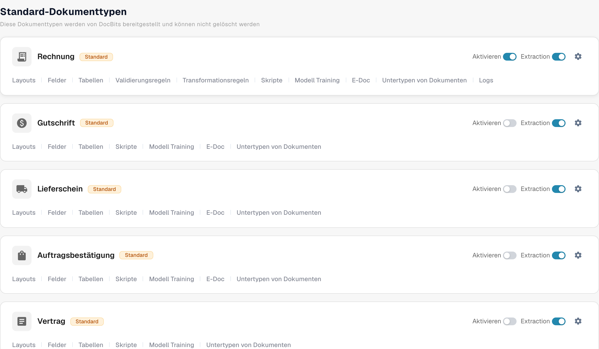

# Einen Dokumenttyp aktivieren oder deaktivieren

Administratoren können festlegen, welche Dokumenttypen ihrer Organisation zur Verfügung stehen. Das ändern Sie auf der Seite **Dokumenttypen**, ohne den Typ oder seine Konfiguration zu löschen.

1. Öffnen Sie **Einstellungen → Dokumenttypen**.
2. Suchen Sie den Dokumenttyp, z. B. **Rechnung**, unter **Standard-Dokumenttypen** oder **Benutzerdefinierte Dokumenttypen**.
3. Verwenden Sie den Schalter **Aktivieren** auf der Karte dieses Typs. Ein farbiger Schalter bedeutet, dass der Typ aktiv ist; ein grauer Schalter bedeutet, dass er inaktiv ist. Warten Sie auf die Bestätigungsmeldung, bevor Sie die Seite verlassen. Für diesen Schalter gibt es keine separate Schaltfläche „Speichern“.

<figure><figcaption>
Jeder Dokumenttyp hat auf der rechten Seite seiner Karte einen eigenen Schalter „Aktivieren“.
</figcaption></figure>

Der Schalter **Extraction** neben **Aktivieren** ist eine andere Einstellung. Er wählt den Extraktionsmodus (Flex oder Fix); er aktiviert oder deaktiviert den Dokumenttyp nicht. Das Zahnradsymbol öffnet weitere Einstellungen für diesen Typ. Die Links unter dem Typnamen öffnen die Layouts, Felder, Tabellen, Skripte und weitere verfügbare Konfigurationsbereiche.

DocBits stellt die Standard-Dokumenttypen bereit, die nicht gelöscht werden können. Sie können außerdem eigene Typen erstellen und verwalten. Die nächsten Einrichtungsschritte finden Sie unter [Dokumenttypen hinzufügen und bearbeiten](adding-editing-document-types.md); wie Sie extrahierte Positionen konfigurieren, erfahren Sie unter [Tabellenspalten](table-columns/README.md).
