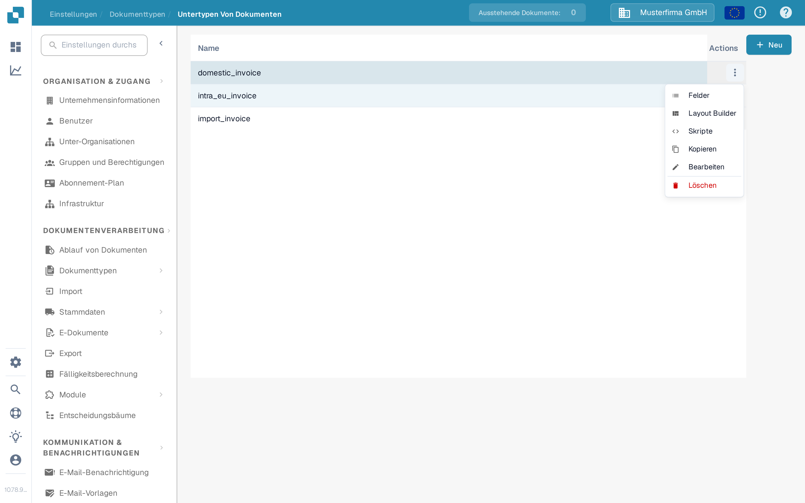
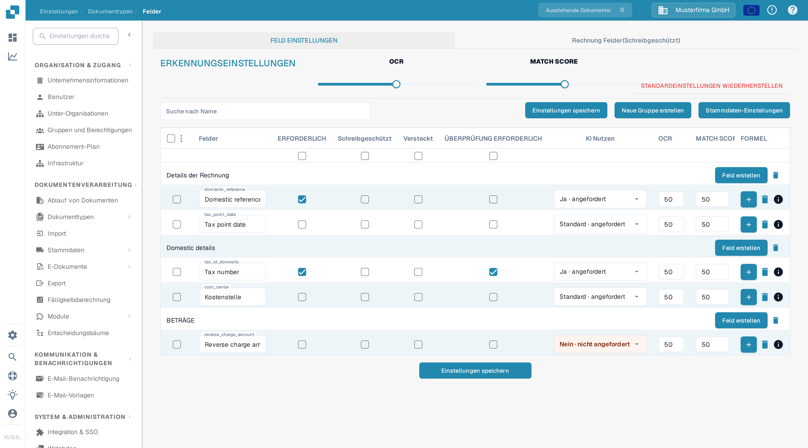
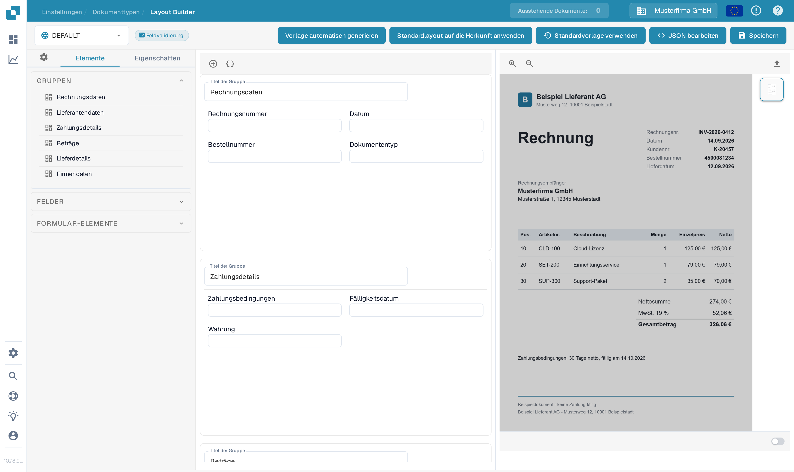
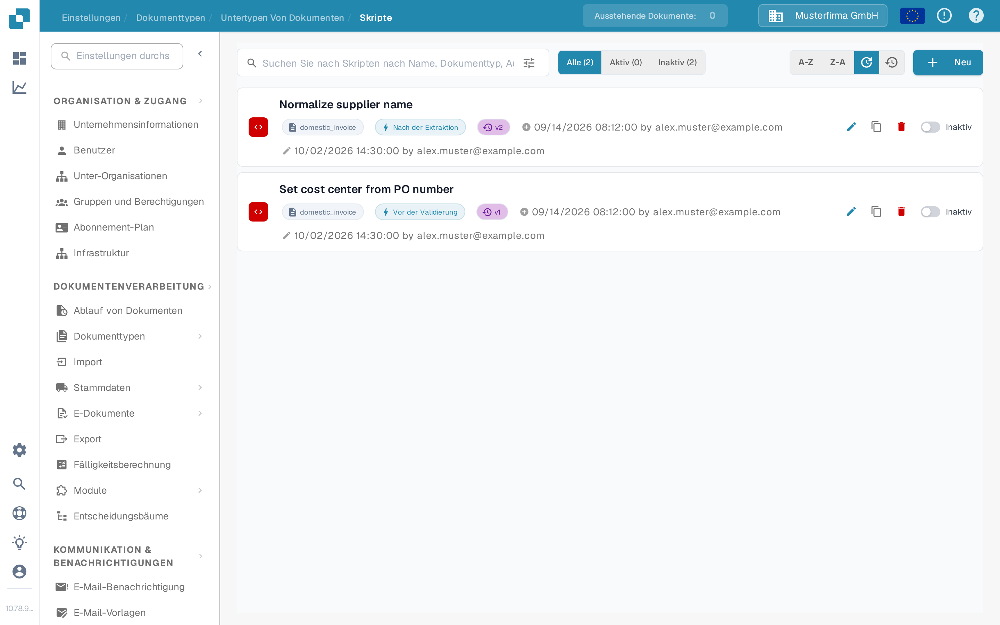

# Untertypen konfigurieren

Verwenden Sie einen Untertyp, wenn Rechnungen desselben Dokumenttyps unterschiedliche Felder, ein anderes Validierungslayout oder eigene Verarbeitungsskripte benötigen. Erstellen Sie zuerst einen [Untertyp](creating-a-new-sub-type.md), öffnen Sie dann **Einstellungen → Dokumenttypen**, wählen Sie den Dokumenttyp und öffnen Sie **Untertypen Von Dokumenten**. Öffnen Sie in der Zeile des Untertyps **Aktionen** (die drei Punkte). Das Menü bietet **Felder**, **Layout Builder** und **Skripte**; es enthält außerdem [Kopieren, Bearbeiten und Löschen](using-actions.md).

<figure><figcaption>
Wählen Sie den Teil des Untertyps, den Sie konfigurieren möchten.
</figcaption></figure>

## Felder

Wählen Sie **Felder**, um festzulegen, welche Informationen Benutzer für diesen Untertyp sehen und eingeben. Sie können ein Feld in einer Gruppe erstellen, ein vorhandenes Feld als erforderlich, schreibgeschützt oder ausgeblendet markieren und die Erkennungsoptionen anpassen. Wählen Sie nach Änderungen **Einstellungen speichern**. Die Schritte finden Sie unter [Hinzufügen und Bearbeiten von Feldern](fields/adding-and-editing-fields.md), die Spaltenoptionen unter [Konfigurieren von Feldeigenschaften](fields/configuring-field-properties-1.md) und die Stammdaten-Zuordnung unter [Stammdaten-Einstellungen](fields/master-data-settings.md).

<figure><figcaption>
Feldeinstellungen in der Dokumentations-Testorganisation. Es werden keine Kundendaten angezeigt.
</figcaption></figure>

## Layout Builder

Wählen Sie **Layout Builder**, um Gruppen und Felder auf dem Dokument-Validierungsbildschirm anzuordnen. Links werden die Elemente aufgelistet; rechts fügen Sie ein Beispieldokument für die Vorschau ein. Prüfen Sie das Ergebnis und wählen Sie **Speichern**, wenn das Layout fertig ist. Die [Layout-Builder-Anleitung](../../../setup/document-types/layout-builder.md) erklärt Elemente, die Dokumentvorschau und das Speichern eines Layouts.

<figure><figcaption>
Untertyp-Layout, bevor ein Beispieldokument hinzugefügt wurde.
</figcaption></figure>

## Skripte

Wählen Sie **Skripte**, um die Skripte dieses Untertyps anzuzeigen. Wählen Sie in einer leeren Liste **Neu**, um zu beginnen. Die Suche und die Filter **Alle**, **Aktiv** und **Inaktiv** helfen, vorhandene Skripte zu finden. Folgen Sie [Erstellen und Bearbeiten von Skripten](script/creating-and-editing-scripts.md), um eines zu erstellen, und [Skriptaktivierung und -verwaltung](script/script-activation-and-management.md), bevor Sie es für die Verarbeitung aktivieren.

<figure><figcaption>
Skriptliste in der Dokumentations-Testorganisation; die gezeigten Skripte sind erfundene Beispiele.
</figcaption></figure>
