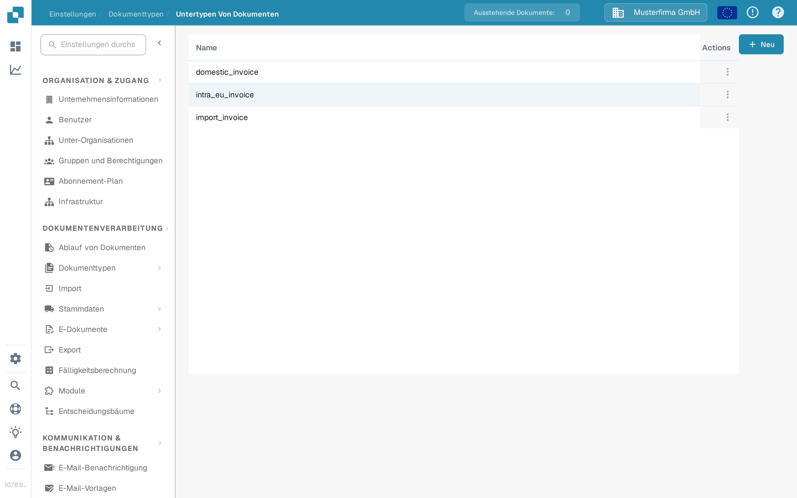
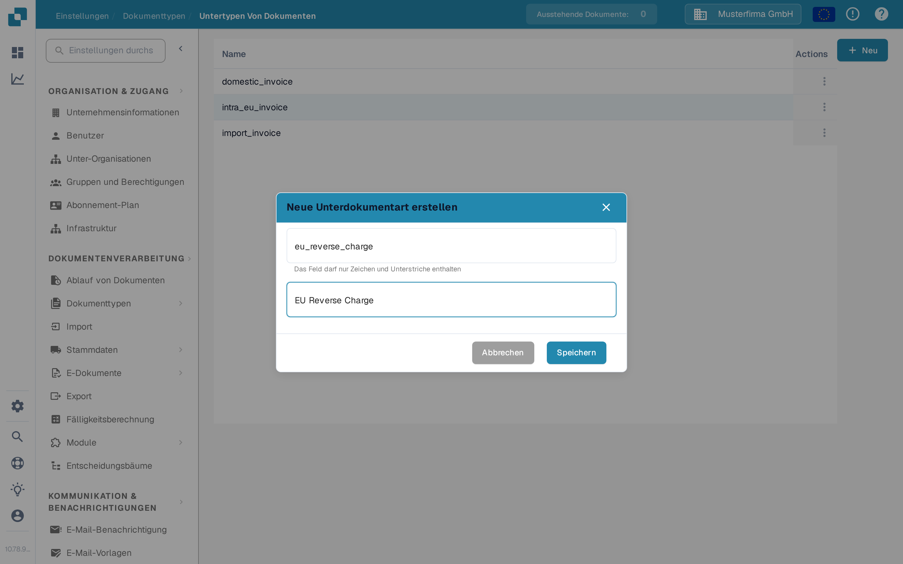

# Erstellen eines neuen Untertyps

Erstellen Sie einen Dokument-Untertyp, wenn eine Art von Dokument eigene Feldeinstellungen, ein eigenes Validierungslayout oder eigene Skripte benötigt. Sie benötigen Zugriff auf **Einstellungen → Dokumenttypen**.

## 1. Dokumenttyp öffnen

Öffnen Sie **Einstellungen → Dokumenttypen**. Wählen Sie in der Karte des betreffenden Dokumenttyps **Untertypen Von Dokumenten**. Das folgende Beispiel verwendet **Rechnung**; wählen Sie den Typ, der zu Ihren Dokumenten passt. Andere Links in der Karte führen zu den Einstellungen des gesamten Dokumenttyps.

<figure><figcaption>
Öffnen Sie die Untertypen des Dokumenttyps, den Sie konfigurieren möchten.
</figcaption></figure>

## 2. Neuen Untertyp starten

Wählen Sie auf **Untertypen Von Dokumenten** die Schaltfläche **+ Neu**. Vorhandene Untertypen erscheinen in der Liste; das Drei-Punkte-Menü **Aktionen** dient einer vorhandenen Zeile. Wenn **+ Neu** auf einen Mausklick nicht reagiert, fokussieren Sie die Schaltfläche mit der Tastatur und drücken Sie die Eingabetaste.

<figure><figcaption>
Die Dokumentations-Testorganisation enthält nur einen synthetischen Beispiel-Untertyp.
</figcaption></figure>

## 3. Benennen und speichern

Geben Sie einen **Name** aus Buchstaben und Unterstrichen ein und tragen Sie anschließend einen aussagekräftigen **Titel** ein. Beide Felder sind Pflichtfelder. Die Namen in diesem Screenshot sind nur Beispiele. Wählen Sie **Speichern**, um den Untertyp zu erstellen, oder **Abbrechen**, um ohne Erstellen zu verlassen.

<figure><figcaption>
Nur Name und Titel werden beim Erstellen eingegeben.
</figcaption></figure>

Nach dem Speichern erscheint der neue Untertyp in der Liste. Um seine Felder, sein Layout oder seine Skripte festzulegen, öffnen Sie das Menü **Aktionen** und folgen Sie [Untertypen konfigurieren](configure-subtypes.md). Diese Einstellungen werden nach dem Erstellen vorgenommen, nicht im Dialog **+ Neu**.
