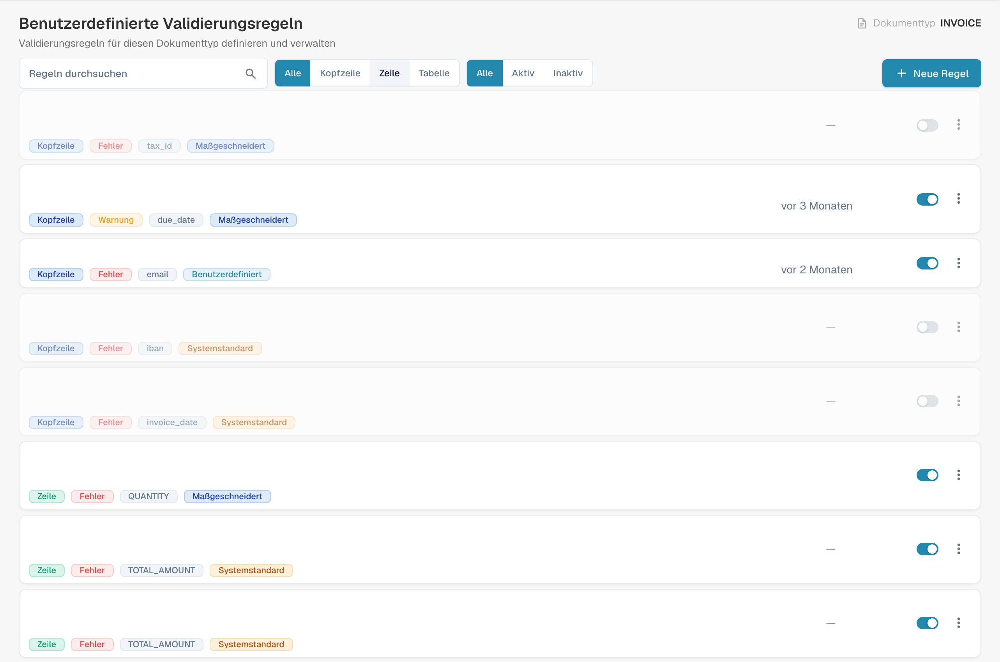

# Eine benutzerdefinierte Validierungsregel duplizieren

Verwenden Sie **Duplizieren**, wenn eine Regel ein guter Ausgangspunkt ist und Sie eine eigene Kopie davon möchten. DocBits kopiert die Definition der Regel; Name und Schlüssel der neuen Regel wählen Sie selbst. Die ursprüngliche Regel bleibt in der Liste erhalten.

1. Gehen Sie zu **Einstellungen → Dokumenttypen**, öffnen Sie den Dokumenttyp, den Sie konfigurieren möchten, und wählen Sie **Benutzerdefinierte Validierungsregeln**. Die Seite zeigt den ausgewählten Dokumenttyp oberhalb seiner Regelkarten. Weitere dort verfügbare Einstellungen finden Sie unter [Dokumenttypen](README.md).
2. Suchen Sie die Quellregel. Verwenden Sie bei einer langen Liste das Suchfeld oder die Filter für Geltungsbereich und Status. Öffnen Sie das Drei-Punkte-Aktionsmenü der Regel und wählen Sie **Duplizieren**. Sie können eine System-Standardregel oder eine benutzerdefinierte Regel kopieren.
3. Behalten Sie unter **Regelname** den vorgeschlagenen Namen mit der Endung „Copy“ bei oder geben Sie einen aussagekräftigeren Namen ein. Der **Regelschlüssel** wird aus diesem Namen erzeugt. Wählen Sie das Stiftsymbol, wenn Sie den Schlüssel selbst bearbeiten möchten.
4. Wählen Sie **Duplizieren**, um die separate Regel zu erstellen. DocBits aktualisiert die Liste nach dem Speichern. Wählen Sie **Abbrechen**, um den Dialog zu schließen, ohne eine Kopie zu erstellen.

<figure><figcaption>
Öffnen Sie das Drei-Punkte-Menü der Quellregel. Die Abbildung zeigt die Regelliste; der Duplizieren-Dialog ist hier nicht geöffnet.
</figcaption></figure>

Die Schaltfläche **Duplizieren** benötigt sowohl einen Namen als auch einen Schlüssel. Schlägt das Speichern fehl, zeigt DocBits einen Fehler an; korrigieren Sie Namen oder Schlüssel und versuchen Sie es erneut. Prüfen Sie die neue Regel, bevor Sie sie aktivieren oder ändern, da eine Kopie mit der Definition der Quellregel beginnt.
