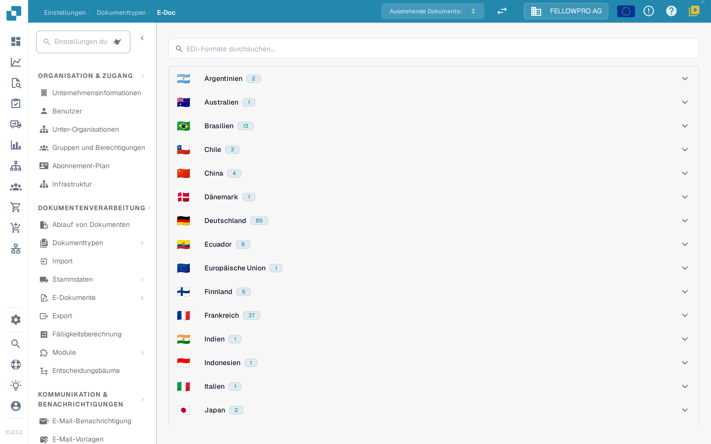
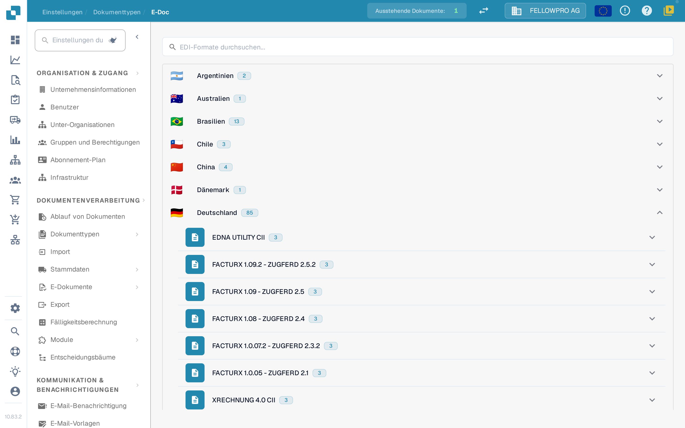
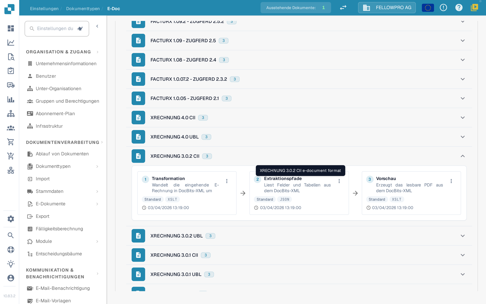
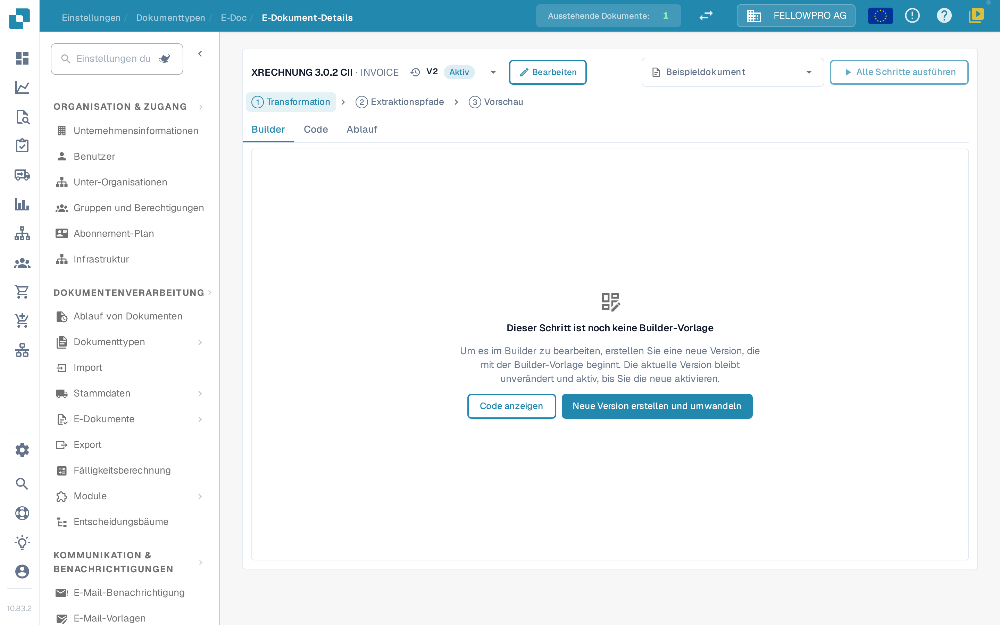
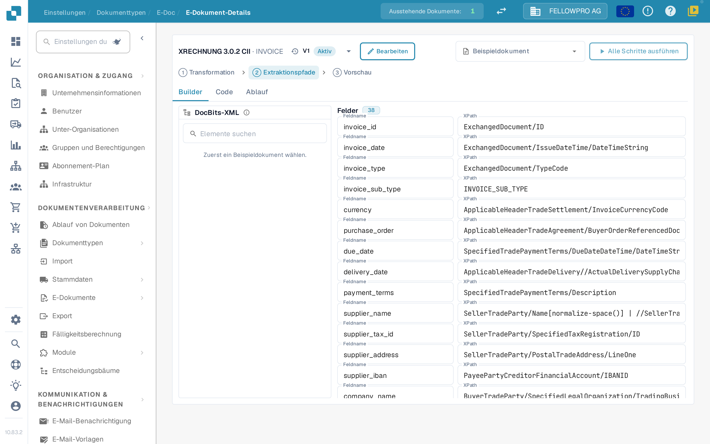

# Elektronische Dokumente und EDI-Konfiguration


DocBits-Anleitung für E-Rechnungen: XRechnung und ZUGFeRD (Factur-X) verarbeiten, Daten validieren und Workflows automatisieren


Elektronische Dokumente wie XRechnung, ZUGFeRD/Factur-X, CFDI oder FatturaPA kommen als XML oder als hybrides PDF. DocBits liest die Datei, extrahiert die Rechnungsdaten und erzeugt daraus ein lesbares PDF. In den **E-Doc**-Einstellungen liegen die Regeln für jedes Format, das Ihre Organisation verwendet.

## Die E-Doc-Verwaltung öffnen

1. Öffnen Sie **Einstellungen → Dokumenttypen**.
2. Wählen Sie den Dokumenttyp, zum Beispiel **Rechnung**, und öffnen Sie **E-Doc**.

Die Formate sind nach Ländern gruppiert. Jedes Land zeigt seine Flagge, seinen Namen und wie viele Formate es enthält.

<figure><figcaption>
Die Formate sind nach Ländern gruppiert und anfangs eingeklappt.
</figcaption></figure>

Wählen Sie ein Land, um seine Formate zu öffnen. Innerhalb eines Landes steht die neueste Version zuerst. Kombinierte Formate wie Factur-X / ZUGFeRD liegen unter Deutschland. Das Suchfeld durchsucht Format- und Ländernamen gleichzeitig.

<figure><figcaption>
Öffnen Sie ein Land, um seine Formate zu sehen.
</figcaption></figure>

## Formate und ihre Schritte

Jedes Format zeigt seine Schritte als drei Karten mit Pfeilen, in der Reihenfolge, in der DocBits sie ausführt:

| Schritt | Was er tut |
| --- | --- |
| **Transformation** | Bildet das eingehende XML auf das DocBits-XML ab. |
| **Extraktionspfade** | Legt fest, welche Werte DocBits aus dem transformierten XML übernimmt. |
| **Vorschau** | Legt das Layout des lesbaren PDFs fest, das DocBits erzeugt. |

Weitere Attribute des Formats stehen unter den Karten.

<figure><figcaption>
Die drei Schritte eines Formats: Transformation, Extraktionspfade und Vorschau.
</figcaption></figure>

Wählen Sie eine Karte, um diesen Schritt zu öffnen.

## Einen Schritt bearbeiten

Die Detailseite hat für alle drei Schritte den gleichen Aufbau:

* Die Kopfzeile zeigt das Format und ein Dropdown mit seinen Versionen, inklusive des Status jeder Version. Aus dem Dropdown heraus können Sie eine Version aktivieren, bearbeiten oder löschen.
* **Builder**, **Code** und **Ablauf** wechseln zwischen dem visuellen Editor, dem zugrunde liegenden Stylesheet bzw. JSON und dem Pipeline-Ergebnis.
* **Beispieldokument** bietet die neuesten Dokumente dieses Formats an; Sie können auch eine Dokument-ID oder URL einfügen.
* **Alle Schritte ausführen** führt Transformation, Extraktion und Vorschau für das Beispieldokument in einem Durchlauf aus.
* **Strg + S** speichert einen Entwurf.

Das Bearbeiten einer aktiven oder bereits verwendeten Version ändert diese nicht: DocBits erstellt eine Entwurfskopie und öffnet diese. Ein unbenutzter Entwurf wird direkt bearbeitet. Ein von Hand geschriebener Schritt bleibt im **Code**, bis der Builder ihn unverändert übernehmen kann.

<figure><figcaption>
Die Detailseite: Versions-Dropdown in der Kopfzeile, Tabs Builder, Code und Ablauf, Beispieldokument und der Schritt selbst.
</figcaption></figure>

### Transformation

Der **Builder** zeigt das Quell-XML links, das Mapping in der Mitte und das resultierende XML rechts. Wählen Sie ein Element im Quellbaum und ziehen Sie es auf ein Feld, oder fügen Sie einen festen Textwert hinzu.

Ein Feld kann aus mehreren Teilen bestehen, und jeder Teil kann eine Bedingung haben: **existiert**, **fehlt**, **ist gleich**, **ist nicht gleich** oder ein freier XPath-Ausdruck, verknüpft mit **alle** oder **eine**. Die drei Bereiche lassen sich in der Größe ändern, und der Ergebnisbereich hat eine **Felder**-Liste und die **XML**-Ansicht.

### Extraktionspfade

Der Extraktionspfade-Builder zeigt das DocBits-XML links, die Felder in der Mitte und den Pfad, den jedes Feld verwendet, rechts. Wählen Sie ein Feld und legen Sie seinen Pfad fest; bestehende Einträge, auch ältere flache Einträge, funktionieren weiter.

<figure><figcaption>
Der Extraktionspfade-Builder: DocBits-XML, Felder und ihre Pfade.
</figcaption></figure>

### Vorschau

Der Vorschau-Builder ordnet das PDF mit Drag-and-drop-Blöcken an und zeigt das Ergebnis daneben. Seitengröße, Ränder, Schriftgröße, Farben und Blockabstände werden für das ganze Dokument festgelegt und gelten für jeden Block.

### Ablauf

**Ablauf** zeigt die gesamte Pipeline für das gewählte Beispieldokument: was die Transformation erzeugt hat, welche Werte die Extraktionspfade gefunden haben und wie die Vorschau sie darstellt. So prüfen Sie eine Änderung von Anfang bis Ende, ohne die Seite zu verlassen.

## Verwandte Seiten

* [eDocs-Formate, Versionen und Länderanleitungen](supported-electronic-documents/README.md)

Die Screenshots auf dieser Seite zeigen die deutsche Benutzeroberfläche.
