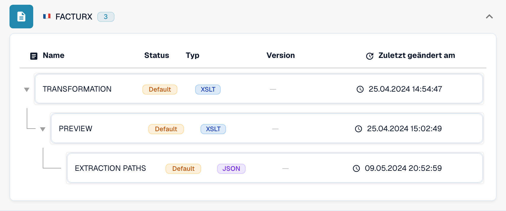
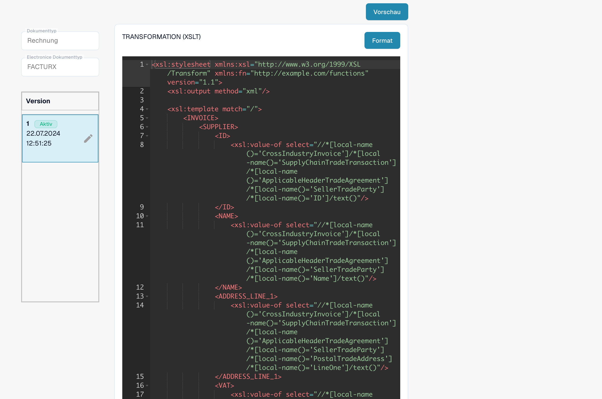

# Elektronische Gutschrift wird als Rechnung erkannt

Eine elektronische Gutschrift kann als **Invoice** erscheinen, obwohl die ursprüngliche XML-Datei einen Gutschriftcode enthält. Prüfen Sie die tatsächlich verwendete Konfiguration, bevor Sie von einem Produktfehler ausgehen. Eine organisationsspezifische **TRANSFORMATION** hat Vorrang vor der Standardtransformation für das betreffende eDoc-Format. Ein konstanter Wert wie `<INVOICE_TYPE>Invoice</INVOICE_TYPE>` kann deshalb die Standardklassifizierung überschreiben.

## Klassifizierung elektronischer Gutschriften prüfen

Das Video zeigt eine lesende Prüfung in DocBits am Beispiel FACTURX 1.0.05 / ZUGFeRD 2.1. Zuordnungen und Versionen können in Ihrer Organisation abweichen. Prüfen Sie immer die aktive Transformation des erkannten Formats.

Das gezeigte ältere XSLT-Beispiel enthält Zweige für 381 und 389. Prüfen Sie an der tatsächlichen Transformation, welche Codes diese konkrete Version erhält; die allgemeine Codeliste belegt keine Abdeckung in jeder historischen Zuordnung.



[Klassifizierung elektronischer Gutschriften prüfen](https://docbits-videos.fra1.cdn.digitaloceanspaces.com/settings-assistant/edocs_credit_note/v2/de.mp4)

[WebVTT](https://docbits-videos.fra1.cdn.digitaloceanspaces.com/settings-assistant/edocs_credit_note/v2/de.vtt)

## Dokumentcode prüfen

Lesen Sie den Typcode in der ursprünglichen XML-Datei ab, nicht nur im PDF oder im Dokumenttitel. Die Position hängt von der XML-Syntax ab. CII verwendet `ExchangedDocument/TypeCode`, UBL verwendet `InvoiceTypeCode` oder `CreditNoteTypeCode`. Berücksichtigen Sie beim Prüfen eines XPath die XML-Namespaces.

| Code | Bedeutung | Erwartete Klassifizierung prüfen |
| --- | --- | --- |
| `380` | Handelsrechnung | Invoice |
| `381` | Gutschrift | Credit Note |
| `261` | Gutschrift im Selbstfakturierungsverfahren | Credit Note in der Standardzuordnung (FACTURX/ZUGFeRD) |
| `383` | Belastungsanzeige | Nicht allein deshalb als Credit Note zuordnen, weil das Dokument eine Rechnung anpasst |
| `384` | Korrigierte Rechnung | Nicht allein deshalb als Credit Note zuordnen, weil das Dokument eine Rechnung korrigiert |

Die Standardzuordnung für Gutschriften in FACTURX/ZUGFeRD umfasst **381 und 261**. Eine fachliche Anforderung, die nur 381 nennt, macht 383 oder 384 nicht zu Gutschriftcodes. Stimmen Sie beabsichtigte Abweichungen mit der für Ihre Buchhaltungsintegration verantwortlichen Person ab.

## Die Stelle finden, an der sich der Wert ändert

1. **Das tatsächliche Format ermitteln.** Öffnen Sie **Einstellungen → Dokumenttypen → Invoice → E-Doc**. Wählen Sie das für das betroffene Dokument erkannte Format aus, beispielsweise **FACTURX**. Ein ZUGFeRD-PDF kann Factur-X-XML enthalten. Die Regeln eines anderen Formats erklären das Verhalten dieses Dokuments daher nicht.
2. **Die verwendete Quelle und Version prüfen.** Prüfen Sie **TRANSFORMATION**. Die Liste unterscheidet zwischen **Default** und **Custom**. Öffnen Sie die Regel und notieren Sie die aktive Version und ihren Quelltext. Ein neuerer Entwurf ist nicht zwangsläufig aktiv. Ermitteln Sie bei einem historischen Dokument die Quelle und Version des damaligen Verarbeitungslaufs; die heute aktive Version kann davon abweichen. Vergleichen Sie den angepassten Quelltext der Organisation mit dem Standard; setzen Sie nicht voraus, dass der Standard verwendet wird.

<figure><figcaption>Der Status zeigt die Quelle jeder Regel. Dieses Beispiel verwendet die Standardregeln.</figcaption></figure>

3. **Das transformierte XML prüfen.** Suchen Sie bei FACTURX/ZUGFeRD in der tatsächlich verwendeten XSLT nach `INVOICE_TYPE`. Bei einem ursprünglichen Code von 381 ist eine feste Ausgabe von `<INVOICE_TYPE>Invoice</INVOICE_TYPE>` ein Konfigurationsproblem. Testen Sie die vorgeschlagene Transformation und prüfen Sie ihre Ausgabe. Das beabsichtigte Ergebnis für eine Gutschrift ist `Credit Note`. Erhalten Sie alle anderen erforderlichen organisationsspezifischen Zuordnungen.
4. **Extraction Paths prüfen.** Stellen Sie sicher, dass die DocBits-Feld-ID `invoice_type` den vorgesehenen Klassifizierungsknoten aus dem **transformierten XML** liest. FACTURX/ZUGFeRD verwendet häufig `INVOICE_TYPE`; XRechnung kann `TypeCode` (CII), `InvoiceTypeCode` oder `CreditNoteTypeCode` (UBL) beibehalten. Prüfen Sie die tatsächlich verwendete Quelle und ihre Ausgabe, bevor Sie einen Pfad wählen. Nach einer Umstrukturierung des XML sind Pfade in die ursprüngliche Datei möglicherweise nicht mehr gültig. Lesen Sie die [Anleitung zu Extraction Paths](edi/edi-extraction-paths-file-guide.md).
5. **Die nachgelagerte Verarbeitung prüfen.** Prüfen Sie Skripte, die `invoice_type` setzen können. Vergleichen Sie anschließend das gespeicherte Feld, das Dashboard und die Exportdaten. Eine korrekte Transformation allein beweist nicht, dass ein späteres Skript den Wert beibehält. Eine gerenderte **Preview** zeigt die Darstellung; sie belegt nicht die gespeicherte Klassifizierung.

<figure><figcaption>Prüfen Sie die ausgewählte Quelle und Version, bevor Sie eine Änderung erstellen oder aktivieren.</figcaption></figure>

Den vollständigen MCP-Ablauf beschreibt [DocBits mit Claude oder Codex konfigurieren](../../../../../advanced-functions-and-tools/docbits-mcp/configuration-with-claude-or-codex.md). `list_edoc_custom_attributes`, `get_edoc_attribute_source` und `list_edoc_attribute_versions` ermitteln Quelle und aktiven Wert. `preview_edoc_custom_xslt` prüft einen Transformationsvorschlag. `compare_edoc_extraction` vergleicht nur Extraction Paths und benötigt ein angepasstes Extraction-Paths-Attribut. `test_electronic_document` testet die aktuell aktive Konfiguration, keinen inaktiven Entwurf.

## Sicher korrigieren und aktivieren

1. Notieren Sie die aktuell aktive Version und bewahren Sie ihren Quelltext für eine Rückkehr zur vorherigen Version auf.
2. Erstellen Sie über das Stiftsymbol einen **Entwurf**. Ändern Sie die Klassifizierungsbedingung oder den Extraktionspfad, den Sie bei der Diagnose als Ursache ermittelt haben. Ersetzen Sie nicht die gesamte Transformation, nur um ein einzelnes Feld zu korrigieren.
3. Wählen Sie den Entwurf aus und **speichern** Sie ihn. Das Speichern eines Entwurfs aktiviert ihn **nicht**.
4. Testen Sie den Entwurf in einer Entwicklungs- oder Testorganisation mit repräsentativen Dokumenten: mit den Codes 380 und 381. Nehmen Sie 261, 383 und 384 hinzu, soweit das erkannte Format und Ihr Ablauf diese akzeptieren. Prüfen Sie die Klassifizierung, die Beträge und andere angepasste Felder. Vergleichen Sie die Ergebnisse mit der aktiven Version.
5. Wenn alle Prüfungen erfolgreich sind, aktivieren Sie den Entwurf über sein **Häkchen**. Bestätigen Sie, dass die gewünschte Version jetzt als **Aktiv** angezeigt wird. Bei MCP erfolgt die Aktivierung mit `activate_edoc_attribute_version`; sie ist eine separate Änderung und nicht Teil des Testlaufs.
6. Verarbeiten Sie ein neues Testdokument. Prüfen Sie das gespeicherte Feld `invoice_type`, das Dashboard, die Beträge und den Export nach **Infor ERP / SAP** oder in Ihr Zielsystem. Halten Sie die vorherige Version für eine Rückkehr verfügbar.


Setzen Sie die Regeln einer Organisation nicht auf den Standard zurück, ohne zuvor die erforderlichen Anpassungen zu vergleichen und zu sichern. Starten Sie historische Dokumente nicht gesammelt neu. Ein Neustart löscht extrahierte Daten und Exportprotokolle und kann Freigabe- oder Exportvorgänge erneut auslösen. Prüfen Sie für jedes Dokument den Exportstatus, die Freigaben und die manuellen Änderungen, bevor Sie über eine erneute Verarbeitung entscheiden.


## Das Vorzeichen der Beträge separat prüfen

Klassifizierung und Vorzeichen der Beträge müssen im Zusammenhang geprüft werden. [Negatives Vorzeichen für Gutschriften setzen](../../../document-processing/module/set-negative-sign-for-credit-notes.md) ist standardmäßig aktiviert, kann aber deaktiviert werden. Wenn die Einstellung aktiviert ist, werden Gutschriftbeträge als negative Werte gespeichert. Prüfen Sie die tatsächliche Einstellung der Organisation und die Vorzeichenkonvention des empfangenden Systems. Leiten Sie den Dokumenttyp nicht allein aus dem Vorzeichen ab.

Wenn das Ergebnis trotz überprüfter aktiver Quelle weiterhin falsch ist, bewahren Sie die ursprüngliche XML-Datei, das erkannte Format, die Versions-IDs, die transformierte Ausgabe, die Extraktionszuordnung und alle späteren Skriptänderungen für den Support auf. Anhand dieser Angaben lässt sich prüfen, ob die Abweichung durch die Konfiguration entsteht oder eine weitere Produktuntersuchung erfordert.

<!-- Internal evidence: TRL-72. The organization-specific constant is a likely cause; later scripts/effective historical versions were not conclusively excluded. -->
