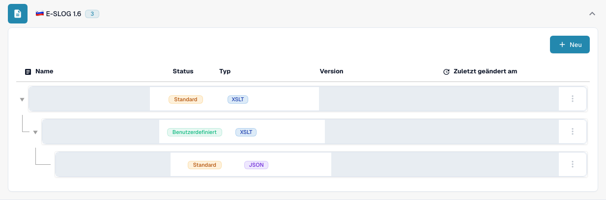
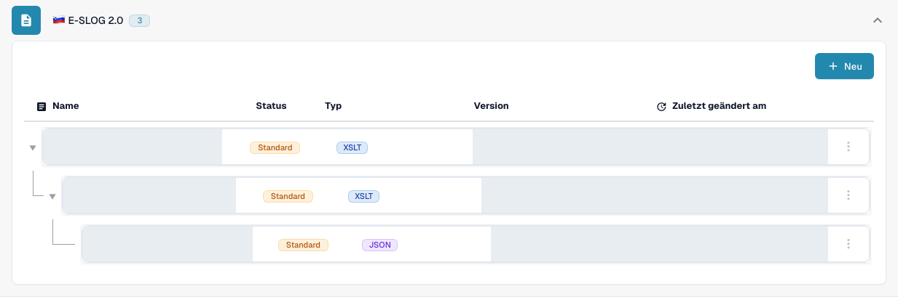

# eSLOG 1.6 und 2.0

**eSLOG 1.6** und **eSLOG 2.0** erscheinen in DocBits als getrennte Formate für elektronische Rechnungen. Wählen Sie die Version, die Ihre eingehende slowenische Rechnung verwendet. Die Screenshots unten zeigen eine echte deutsche DocBits-Testansicht; sie belegen nicht, dass eine Rechnung der jeweiligen Version erfolgreich verarbeitet wurde.

## Die Konfigurationen finden

1. Gehen Sie zu **Einstellungen → Dokumenttypen → Rechnung → E-Doc**.
2. Klappen Sie **E-SLOG 1.6** oder **E-SLOG 2.0** auf. Jedes Format hat seine eigenen drei Einträge.

<figure><figcaption>E-SLOG 1.6: von oben nach unten Transformation, Vorschau und Extraktionspfade. Die Testansicht enthält zwei Standardzeilen und eine vorhandene benutzerdefinierte Zeile. Namen, Versionen und Zeitangaben sind maskiert.</figcaption></figure>

<figure><figcaption>E-SLOG 2.0: getrennte Einträge für dieselben drei Schritte, hier jeweils als Standard. Namen, Versionen und Zeitangaben sind maskiert.</figcaption></figure>

| Eintrag | Was er steuert | Nächste Anleitung |
| --- | --- | --- |
| **TRANSFORMATION (XSLT)** | Wandelt die Quelldaten des Formats in strukturiertes XML um. | [Transformation](edi/edi-transformation-file-guide.md) |
| **PREVIEW (XSLT)** | Definiert die lesbare Dokumentansicht. | [Vorschau](edi/edi-preview-file-guide.md) |
| **EXTRACTION PATHS (JSON)** | Ordnet XML-Werte den DocBits-Feldern und Tabellenspalten zu. | [Extraktionspfade](edi/edi-extraction-paths-file-guide.md) |

Klicken Sie auf eine Zeile, um ihre Versionen und Konfiguration zu sehen. **Standard** kennzeichnet den mitgelieferten Eintrag; **Benutzerdefiniert** eine eigene Variante. **Zuletzt geändert am** zeigt, wann dieser Eintrag zuletzt geändert wurde. Die Schaltfläche **Neu** startet einen zusätzlichen Konfigurationseintrag. Das Drei-Punkte-Menü einer Standard-Zeile bietet **Anpassen**, wodurch unmittelbar eine organisationsspezifische Kopie erstellt wird, und **Löschen**; prüfen Sie die ausgewählte Zeile sorgfältig, bevor Sie Löschen verwenden.

Innerhalb einer Konfiguration erstellt der Stift neben einer aktiven Version einen Entwurf. Prüfen Sie einen Entwurf mit dem Testbereich **Preview** und der ID eines repräsentativen hochgeladenen Dokuments, bevor Sie ihn mit dem Häkchen aktivieren. Das Papierkorb-Symbol eines Entwurfs entfernt diesen Entwurf. Die tatsächlichen Feldnamen und XML-Pfade hängen von Ihrer eSLOG-Datei ab; Details zum Editor finden Sie in der jeweiligen Anleitung oben.
