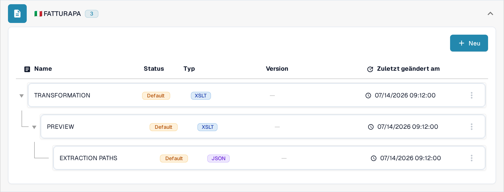
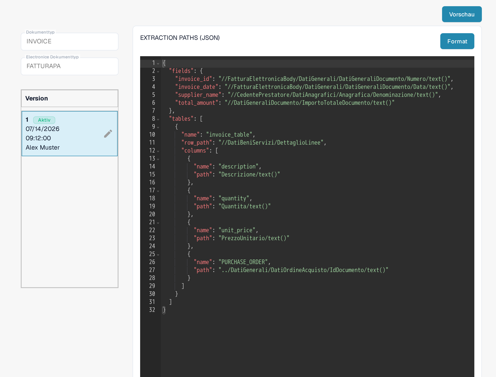
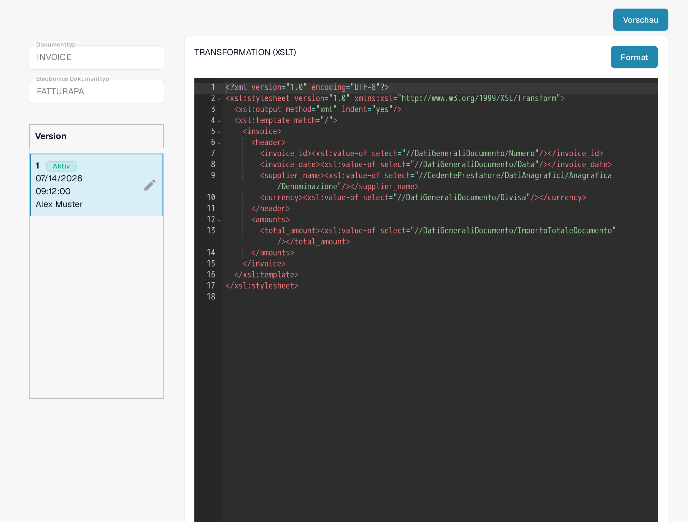
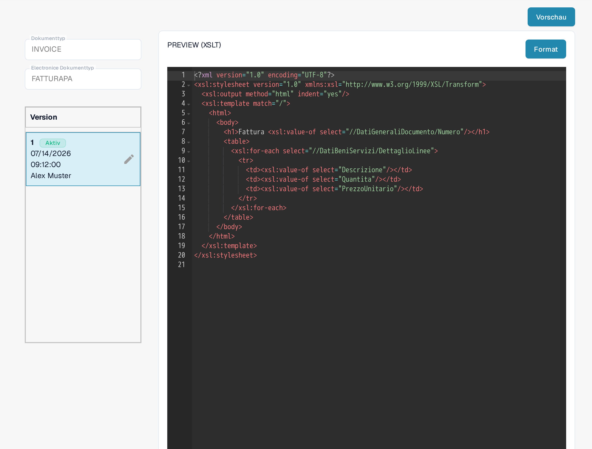

# FatturaPA: Attribut in Rechnungspositionen anzeigen

FatturaPA ist das italienische Format für elektronische Rechnungen. Diese Seite erklärt, wo Sie ein Positionsattribut, wie eine Bestellnummer, prüfen, bevor Sie dessen Mapping oder die Rechnungsvorschau ändern. **Fügen Sie keine zweite `PURCHASE_ORDER`-Spalte hinzu, ohne zuvor das aktive Mapping zu prüfen:** das aktuelle Sandbox-Mapping enthält bereits eine.

## Die drei FatturaPA-Dateien finden

Öffnen Sie **Einstellungen → Dokumenttypen → E-Doc**, wählen Sie **Invoice** und klappen Sie **FATTURAPA** auf. Die aktuelle Liste enthält drei verschiedene Dateien:

* **TRANSFORMATION (XSLT)** liest die FatturaPA-XML-Quelldatei und erzeugt die normalisierten Rechnungsdaten.
* **PREVIEW (XSLT)** erstellt aus diesen Daten die visuelle HTML/PDF-artige Rechnungsvorschau.
* **EXTRACTION PATHS (JSON)** bildet die normalisierten Werte auf DocBits-Felder und Tabellenspalten ab.

<figure><figcaption>
Die aktuelle FATTURAPA-Dateiliste in der deutschen Sandbox.
</figcaption></figure>

## Den extrahierten Positionswert prüfen

Öffnen Sie **EXTRACTION PATHS (JSON)**. Suchen Sie in der aktiven Version das `tables`-Array und dessen `columns`. Die sichtbare Sandbox-Version enthält bereits `{"name": "PURCHASE_ORDER", "path": "PURCHASE_ORDER"}`. Prüfen Sie den Wert in einer echten Testrechnung, bevor Sie ihn ändern. Benötigen Sie ein weiteres Attribut, ermitteln Sie dessen Wert in den normalisierten Daten und fügen Sie dann in einer Entwurfsversion einen eigenen Spaltennamen und den zugehörigen Pfad hinzu.

<figure><figcaption>
Das aktive JSON-Extraktionsmapping enthält bereits eine Bestellnummer-Spalte.
</figcaption></figure>

## Transformation oder Vorschau nur bei Bedarf ändern

Wenn der normalisierte Wert fehlt, prüfen Sie **TRANSFORMATION (XSLT)** und den XML-Quellpfad, der ihn liefern soll. Eine Änderung hier wirkt sich auf die Daten aus, die nachfolgende Mapping- und Preview-Schritte verwenden. Wird der Wert korrekt extrahiert, in der visuellen Rechnung aber nicht angezeigt, prüfen Sie **PREVIEW (XSLT)** und die betreffende Tabellenzeile in dieser Vorlage. Die beiden XSLT-Dateien haben unterschiedliche Zwecke.

<figure><figcaption>
Die Transformation liest die XML-Quelldatei und erzeugt die normalisierten Rechnungsfelder.
</figcaption></figure>

<figure><figcaption>
Die Preview steuert die visuelle Rechnungsausgabe.
</figcaption></figure>

Verwenden Sie den Stift auf einer Versionskarte, um eine Änderung vorzubereiten. Prüfen Sie den Entwurf und verwenden Sie **Preview** mit einer repräsentativen FatturaPA-Rechnung, bevor Sie ihn aktivieren. Die Screenshots zeigen die aktuell aktiven Versionen; in dieser Sandbox-Sitzung wurde kein Entwurf gespeichert oder kein Preview-Test ausgeführt.

Die frühere Anweisung, alle E-Dokumente hätten Großbritannien als Ursprung, ist keine sichere allgemeine Regel. Prüfen Sie Land, Währung und Zahlenformat der Rechnung anhand des Quelldokuments und der Konfiguration Ihrer Organisation.
