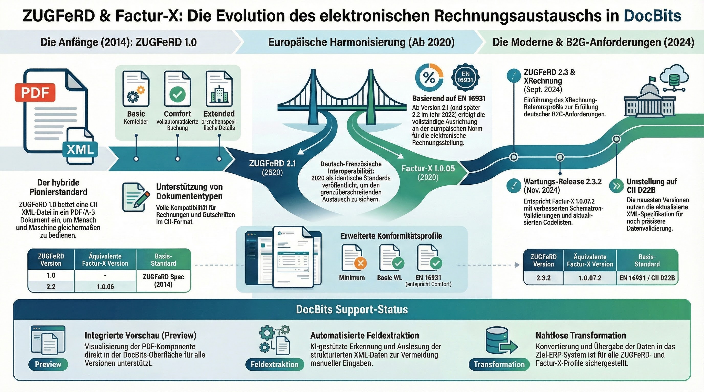
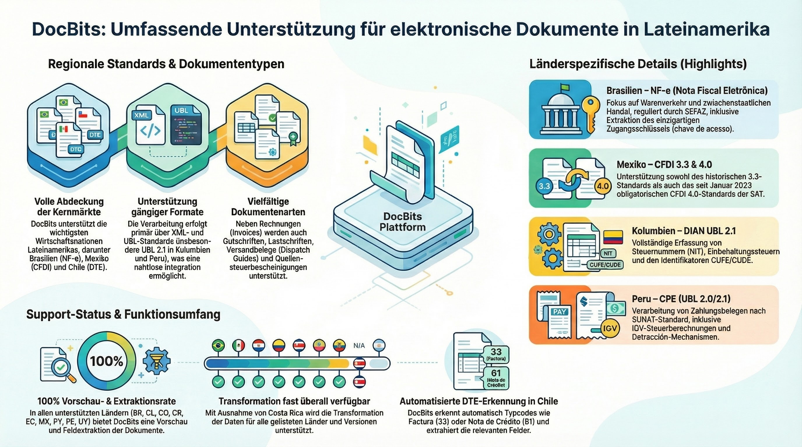
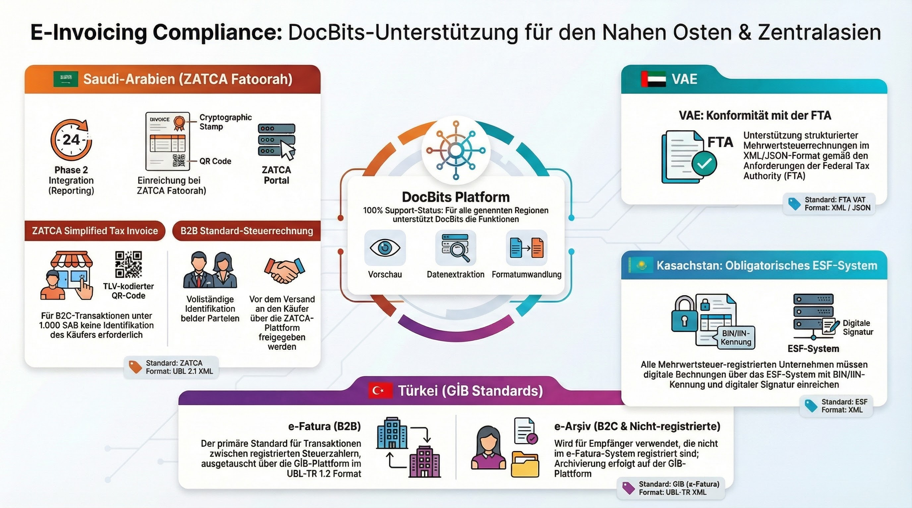

# Unterstützte elektronische Dokumente

DocBits unterstützt **120+ elektronische Rechnungs- und Dokumentenstandards** in **30+ Ländern**. Jedes Format wird automatisch erkannt, geparst und die Felder für eine nahtlose Dokumentenverarbeitung extrahiert.

## Wie elektronische Dokumente in DocBits funktionieren

1. **Hochladen** — XML/EDI-Datei ablegen oder per API/E-Mail empfangen
2. **Automatische Erkennung** — DocBits identifiziert den genauen Standard und die Version
3. **Vorschau** — Eine menschenlesbare HTML-Vorschau wird generiert
4. **Feldextraktion** — Schlüsselfelder (Rechnungsnummer, Beträge, Positionen) werden extrahiert
5. **Validierung & Export** — Daten werden validiert und in Ihr ERP-System exportiert


Für die detaillierte Konfiguration, siehe [EDI-Einstellungen](../). Für Peppol, XRechnung und ZUGFeRD, siehe die dedizierten Seiten unten.


## Schnelllinks

| Thema                          | Link                                                                                                                                                                                                                    |
| ------------------------------ | ----------------------------------------------------------------------------------------------------------------------------------------------------------------------------------------------------------------------- |
| EDI-Übersicht                  | [EDI-Einstellungen](../)                                                                                                                                                                                                |
| XRechnung (alle Versionen)     | [XRechnung](https://github.com/Fellow-Consulting-AG/docbits/tree/de/readme/administration-and-setup/settings/global-settings/document-types/edi/xrechnung/README.md)                                                    |
| ZUGFeRD / Factur-X             | [ZUGFeRD](../zugferd/)                                                                                                                                                                                                  |
| Peppol BIS 3.0                 | [Peppol BIS Billing](https://github.com/Fellow-Consulting-AG/docbits/tree/de/readme/administration-and-setup/settings/global-settings/document-types/edi/peppol-bis-billing-3.0)                                        |
| Übersicht E-Rechnungsstandards | [Aktuell unterstützte Standards](https://github.com/Fellow-Consulting-AG/docbits/tree/de/readme/administration-and-setup/settings/global-settings/document-types/edi/currently-supported-e-invoice-standards/README.md) |

***

## Europa

<figure><figcaption>
Europäische E-Rechnungsstandards – Übersicht
</figcaption></figure>

### 🇩🇪 Deutschland

<figure><figcaption>
XRechnung — Alle 26 Versionen (CII &#x26; UBL)
</figcaption></figure>

<figure><figcaption>
ZUGFeRD / Factur-X — Alle Versionen
</figcaption></figure>

### 🇦🇹 Österreich

| Standard                | Seite                                                 |
| ----------------------- | ----------------------------------------------------- |
| ebInterface (Übersicht) | [AUSTRIA EBINTERFACE](austria-ebinterface.md)         |
| ebInterface 6.0         | [AUSTRIA EBINTERFACE 6.0](austria-ebinterface-6-0.md) |
| ebInterface 6.1         | [AUSTRIA EBINTERFACE 6.1](austria-ebinterface-6-1.md) |

### 🇩🇰 Dänemark

| Standard           | Seite                                                                                                                                                                                                  |
| ------------------ | ------------------------------------------------------------------------------------------------------------------------------------------------------------------------------------------------------ |
| OIOUBL (Übersicht) | [DENMARK OIOUBL](https://github.com/Fellow-Consulting-AG/docbits/tree/de/readme/administration-and-setup/settings/global-settings/document-types/edi/supported-electronic-documents/denmark-oioubl.md) |
| OIOUBL 2.1         | [OIOUBL 2.1](https://github.com/Fellow-Consulting-AG/docbits/tree/de/readme/administration-and-setup/settings/global-settings/document-types/edi/supported-electronic-documents/oioubl-2-1.md)         |

### 🇫🇮 Finnland

| Standard      | Seite                                                                                                                                                                                                |
| ------------- | ---------------------------------------------------------------------------------------------------------------------------------------------------------------------------------------------------- |
| Finvoice 1.3  | [FINVOICE 1.3](https://github.com/Fellow-Consulting-AG/docbits/tree/de/readme/administration-and-setup/settings/global-settings/document-types/edi/supported-electronic-documents/finvoice-1-3.md)   |
| Finvoice 2.0  | [FINVOICE 2.0](https://github.com/Fellow-Consulting-AG/docbits/tree/de/readme/administration-and-setup/settings/global-settings/document-types/edi/supported-electronic-documents/finvoice-2-0.md)   |
| Finvoice 2.01 | [FINVOICE 2.01](https://github.com/Fellow-Consulting-AG/docbits/tree/de/readme/administration-and-setup/settings/global-settings/document-types/edi/supported-electronic-documents/finvoice-2-01.md) |
| Finvoice 3.0  | [FINVOICE 3.0](https://github.com/Fellow-Consulting-AG/docbits/tree/de/readme/administration-and-setup/settings/global-settings/document-types/edi/supported-electronic-documents/finvoice-3-0.md)   |
| TEAPPSXML     | [TEAPPSXML](https://github.com/Fellow-Consulting-AG/docbits/tree/de/readme/administration-and-setup/settings/global-settings/document-types/edi/supported-electronic-documents/teappsxml.md)         |

### 🇫🇷 Frankreich

| Standard                          | Seite                                                                                                                                                                                                                    |
| --------------------------------- | ------------------------------------------------------------------------------------------------------------------------------------------------------------------------------------------------------------------------ |
| Factur-X (Allgemein)              | [FACTURX](https://github.com/Fellow-Consulting-AG/docbits/tree/de/readme/administration-and-setup/settings/global-settings/document-types/edi/supported-electronic-documents/facturx.md)                                 |
| Factur-X 1.0.05 / ZUGFeRD 2.1     | [FACTURX 1.0.05](https://github.com/Fellow-Consulting-AG/docbits/tree/de/readme/administration-and-setup/settings/global-settings/document-types/edi/supported-electronic-documents/facturx-1-0-05-zugferd-2-1.md)       |
| Factur-X 1.0.07.2 / ZUGFeRD 2.3.2 | [FACTURX 1.0.07.2](https://github.com/Fellow-Consulting-AG/docbits/tree/de/readme/administration-and-setup/settings/global-settings/document-types/edi/supported-electronic-documents/facturx-1-0-07-2-zugferd-2-3-2.md) |

### 🇩🇪 Deutschland

| Standard                        | Seite                                                                                                                                                                                                                                    |
| ------------------------------- | ---------------------------------------------------------------------------------------------------------------------------------------------------------------------------------------------------------------------------------------- |
| XRechnung 1.0–3.0.2 (CII & UBL) | [26 Versionen](https://github.com/Fellow-Consulting-AG/docbits/tree/de/readme/administration-and-setup/settings/global-settings/document-types/edi/supported-electronic-documents/xrechnung-1-0-cii.md) — siehe vollständige Liste unten |
| ZUGFeRD 1.0–2.3.2               | [7 Versionen](https://github.com/Fellow-Consulting-AG/docbits/tree/de/readme/administration-and-setup/settings/global-settings/document-types/edi/supported-electronic-documents/zugferd-1-0.md) — siehe vollständige Liste unten        |

Alle 26 XRechnung-Versionen

| Version | CII                                                                                                                                                                                              | UBL                                                                                                                                                                                              |
| ------- | ------------------------------------------------------------------------------------------------------------------------------------------------------------------------------------------------ | ------------------------------------------------------------------------------------------------------------------------------------------------------------------------------------------------ |
| 1.0     | [CII](https://github.com/Fellow-Consulting-AG/docbits/tree/de/readme/administration-and-setup/settings/global-settings/document-types/edi/supported-electronic-documents/xrechnung-1-0-cii.md)   | [UBL](https://github.com/Fellow-Consulting-AG/docbits/tree/de/readme/administration-and-setup/settings/global-settings/document-types/edi/supported-electronic-documents/xrechnung-1-0-ubl.md)   |
| 1.1     | [CII](https://github.com/Fellow-Consulting-AG/docbits/tree/de/readme/administration-and-setup/settings/global-settings/document-types/edi/supported-electronic-documents/xrechnung-1-1-cii.md)   | [UBL](https://github.com/Fellow-Consulting-AG/docbits/tree/de/readme/administration-and-setup/settings/global-settings/document-types/edi/supported-electronic-documents/xrechnung-1-1-ubl.md)   |
| 1.2     | [CII](https://github.com/Fellow-Consulting-AG/docbits/tree/de/readme/administration-and-setup/settings/global-settings/document-types/edi/supported-electronic-documents/xrechnung-1-2-cii.md)   | [UBL](https://github.com/Fellow-Consulting-AG/docbits/tree/de/readme/administration-and-setup/settings/global-settings/document-types/edi/supported-electronic-documents/xrechnung-1-2-ubl.md)   |
| 1.2.1   | [CII](https://github.com/Fellow-Consulting-AG/docbits/tree/de/readme/administration-and-setup/settings/global-settings/document-types/edi/supported-electronic-documents/xrechnung-1-2-1-cii.md) | [UBL](https://github.com/Fellow-Consulting-AG/docbits/tree/de/readme/administration-and-setup/settings/global-settings/document-types/edi/supported-electronic-documents/xrechnung-1-2-1-ubl.md) |
| 1.2.2   | [CII](https://github.com/Fellow-Consulting-AG/docbits/tree/de/readme/administration-and-setup/settings/global-settings/document-types/edi/supported-electronic-documents/xrechnung-1-2-2-cii.md) | [UBL](https://github.com/Fellow-Consulting-AG/docbits/tree/de/readme/administration-and-setup/settings/global-settings/document-types/edi/supported-electronic-documents/xrechnung-1-2-2-ubl.md) |
| 2.0     | [CII](https://github.com/Fellow-Consulting-AG/docbits/tree/de/readme/administration-and-setup/settings/global-settings/document-types/edi/supported-electronic-documents/xrechnung-2-0-cii.md)   | [UBL](https://github.com/Fellow-Consulting-AG/docbits/tree/de/readme/administration-and-setup/settings/global-settings/document-types/edi/supported-electronic-documents/xrechnung-2-0-ubl.md)   |
| 2.0.1   | [CII](https://github.com/Fellow-Consulting-AG/docbits/tree/de/readme/administration-and-setup/settings/global-settings/document-types/edi/supported-electronic-documents/xrechnung-2-0-1-cii.md) | [UBL](https://github.com/Fellow-Consulting-AG/docbits/tree/de/readme/administration-and-setup/settings/global-settings/document-types/edi/supported-electronic-documents/xrechnung-2-0-1-ubl.md) |
| 2.1     | [CII](https://github.com/Fellow-Consulting-AG/docbits/tree/de/readme/administration-and-setup/settings/global-settings/document-types/edi/supported-electronic-documents/xrechnung-2-1-cii.md)   | [UBL](https://github.com/Fellow-Consulting-AG/docbits/tree/de/readme/administration-and-setup/settings/global-settings/document-types/edi/supported-electronic-documents/xrechnung-2-1-ubl.md)   |
| 2.2     | [CII](https://github.com/Fellow-Consulting-AG/docbits/tree/de/readme/administration-and-setup/settings/global-settings/document-types/edi/supported-electronic-documents/xrechnung-2-2-cii.md)   | [UBL](https://github.com/Fellow-Consulting-AG/docbits/tree/de/readme/administration-and-setup/settings/global-settings/document-types/edi/supported-electronic-documents/xrechnung-2-2-ubl.md)   |
| 2.3     | [CII](https://github.com/Fellow-Consulting-AG/docbits/tree/de/readme/administration-and-setup/settings/global-settings/document-types/edi/supported-electronic-documents/xrechnung-2-3-cii.md)   | [UBL](https://github.com/Fellow-Consulting-AG/docbits/tree/de/readme/administration-and-setup/settings/global-settings/document-types/edi/supported-electronic-documents/xrechnung-2-3-ubl.md)   |
| 3.0     | [CII](https://github.com/Fellow-Consulting-AG/docbits/tree/de/readme/administration-and-setup/settings/global-settings/document-types/edi/supported-electronic-documents/xrechnung-3-0-cii.md)   | [UBL](https://github.com/Fellow-Consulting-AG/docbits/tree/de/readme/administration-and-setup/settings/global-settings/document-types/edi/supported-electronic-documents/xrechnung-3-0-ubl.md)   |
| 3.0.1   | [CII](https://github.com/Fellow-Consulting-AG/docbits/tree/de/readme/administration-and-setup/settings/global-settings/document-types/edi/supported-electronic-documents/xrechnung-3-0-1-cii.md) | [UBL](https://github.com/Fellow-Consulting-AG/docbits/tree/de/readme/administration-and-setup/settings/global-settings/document-types/edi/supported-electronic-documents/xrechnung-3-0-1-ubl.md) |
| 3.0.2   | [CII](https://github.com/Fellow-Consulting-AG/docbits/tree/de/readme/administration-and-setup/settings/global-settings/document-types/edi/supported-electronic-documents/xrechnung-3-0-2-cii.md) | [UBL](https://github.com/Fellow-Consulting-AG/docbits/tree/de/readme/administration-and-setup/settings/global-settings/document-types/edi/supported-electronic-documents/xrechnung-3-0-2-ubl.md) |

Alle 7 ZUGFeRD-Versionen

| Version              | Seite                                                                                                                                                                                                              |
| -------------------- | ------------------------------------------------------------------------------------------------------------------------------------------------------------------------------------------------------------------ |
| ZUGFeRD 1.0          | [ZUGFERD 1.0](https://github.com/Fellow-Consulting-AG/docbits/tree/de/readme/administration-and-setup/settings/global-settings/document-types/edi/supported-electronic-documents/zugferd-1-0.md)                   |
| ZUGFeRD 1.0 Basic    | [ZUGFERD 1.0 BASIC](https://github.com/Fellow-Consulting-AG/docbits/tree/de/readme/administration-and-setup/settings/global-settings/document-types/edi/supported-electronic-documents/zugferd-1-0-basic.md)       |
| ZUGFeRD 1.0 Comfort  | [ZUGFERD 1.0 COMFORT](https://github.com/Fellow-Consulting-AG/docbits/tree/de/readme/administration-and-setup/settings/global-settings/document-types/edi/supported-electronic-documents/zugferd-1-0-comfort.md)   |
| ZUGFeRD 1.0 Extended | [ZUGFERD 1.0 EXTENDED](https://github.com/Fellow-Consulting-AG/docbits/tree/de/readme/administration-and-setup/settings/global-settings/document-types/edi/supported-electronic-documents/zugferd-1-0-extended.md) |
| ZUGFeRD 2.2          | [ZUGFERD 2.2](https://github.com/Fellow-Consulting-AG/docbits/tree/de/readme/administration-and-setup/settings/global-settings/document-types/edi/supported-electronic-documents/zugferd-2-2.md)                   |
| ZUGFeRD 2.3          | [ZUGFERD 2.3](https://github.com/Fellow-Consulting-AG/docbits/tree/de/readme/administration-and-setup/settings/global-settings/document-types/edi/supported-electronic-documents/zugferd-2-3.md)                   |
| ZUGFeRD 2.3.2        | [ZUGFERD 2.3.2](https://github.com/Fellow-Consulting-AG/docbits/tree/de/readme/administration-and-setup/settings/global-settings/document-types/edi/supported-electronic-documents/zugferd-2-3-2.md)               |

### 🇮🇹 Italien

| Standard  | Seite                                                                                                                                                                                        |
| --------- | -------------------------------------------------------------------------------------------------------------------------------------------------------------------------------------------- |
| FatturaPA | [FATTURAPA](https://github.com/Fellow-Consulting-AG/docbits/tree/de/readme/administration-and-setup/settings/global-settings/document-types/edi/supported-electronic-documents/fatturapa.md) |

### 🇳🇱 Niederlande

| Standard   | Seite                                                                                                                                                                                          |
| ---------- | ---------------------------------------------------------------------------------------------------------------------------------------------------------------------------------------------- |
| SI-UBL 2.0 | [SI-UBL 2.0](https://github.com/Fellow-Consulting-AG/docbits/tree/de/readme/administration-and-setup/settings/global-settings/document-types/edi/supported-electronic-documents/si-ubl-2-0.md) |

### 🇳🇴 Norwegen

| Standard        | Seite                                                                                                                                                                                                    |
| --------------- | -------------------------------------------------------------------------------------------------------------------------------------------------------------------------------------------------------- |
| EHF Invoice 3.0 | [EHF INVOICE 3.0](https://github.com/Fellow-Consulting-AG/docbits/tree/de/readme/administration-and-setup/settings/global-settings/document-types/edi/supported-electronic-documents/ehf-invoice-3-0.md) |

### 🇵🇱 Polen

| Standard | Seite                                                                                                                                                                                      |
| -------- | ------------------------------------------------------------------------------------------------------------------------------------------------------------------------------------------ |
| KSeF     | [KSEF](https://github.com/Fellow-Consulting-AG/docbits/tree/de/readme/administration-and-setup/settings/global-settings/document-types/edi/supported-electronic-documents/ksef.md)         |
| KSeF FA2 | [KSEF FA2](https://github.com/Fellow-Consulting-AG/docbits/tree/de/readme/administration-and-setup/settings/global-settings/document-types/edi/supported-electronic-documents/ksef-fa2.md) |
| KSeF FA3 | [KSEF FA3](https://github.com/Fellow-Consulting-AG/docbits/tree/de/readme/administration-and-setup/settings/global-settings/document-types/edi/supported-electronic-documents/ksef-fa3.md) |

### 🇪🇸 Spanien

| Standard             | Seite                                                                                                                                                                                                  |
| -------------------- | ------------------------------------------------------------------------------------------------------------------------------------------------------------------------------------------------------ |
| Facturae (Übersicht) | [FACTURAE](https://github.com/Fellow-Consulting-AG/docbits/tree/de/readme/administration-and-setup/settings/global-settings/document-types/edi/supported-electronic-documents/facturae.md)             |
| Facturae 3.2         | [FACTURAE 3.2](https://github.com/Fellow-Consulting-AG/docbits/tree/de/readme/administration-and-setup/settings/global-settings/document-types/edi/supported-electronic-documents/facturae-3-2.md)     |
| Facturae 3.2.1       | [FACTURAE 3.2.1](https://github.com/Fellow-Consulting-AG/docbits/tree/de/readme/administration-and-setup/settings/global-settings/document-types/edi/supported-electronic-documents/facturae-3-2-1.md) |
| Facturae 3.2.2       | [FACTURAE 3.2.2](https://github.com/Fellow-Consulting-AG/docbits/tree/de/readme/administration-and-setup/settings/global-settings/document-types/edi/supported-electronic-documents/facturae-3-2-2.md) |

### 🇸🇪 Schweden

| Standard       | Seite                                                                                                                                                                                                  |
| -------------- | ------------------------------------------------------------------------------------------------------------------------------------------------------------------------------------------------------ |
| Svefaktura 1.0 | [SVEFAKTURA 1.0](https://github.com/Fellow-Consulting-AG/docbits/tree/de/readme/administration-and-setup/settings/global-settings/document-types/edi/supported-electronic-documents/svefaktura-1-0.md) |

***

## Asien-Pazifik

<figure><figcaption>
Asien-Pazifik E-Rechnungsstandards – Übersicht
</figcaption></figure>

### 🇦🇺 Australien / 🇳🇿 Neuseeland

| Standard               | Seite                                               |
| ---------------------- | --------------------------------------------------- |
| AUNZ PINT              | [AUNZ PINT](aunz-pint.md)                           |
| AUNZ PINT Self-Billing | [AUNZ PINT SELF-BILLING](aunz-pint-self-billing.md) |
| PINT A-NZ              | [PINT A-NZ](pint-a-nz.md)                           |

### 🇮🇳 Indien

| Standard      | Seite                                                                                                                                                                                                            |
| ------------- | ---------------------------------------------------------------------------------------------------------------------------------------------------------------------------------------------------------------- |
| GST E-Invoice | [INDIA GST E-INVOICE](https://github.com/Fellow-Consulting-AG/docbits/tree/de/readme/administration-and-setup/settings/global-settings/document-types/edi/supported-electronic-documents/india-gst-e-invoice.md) |

### 🇮🇩 Indonesien

| Standard | Seite                                                                                                                                                                                                          |
| -------- | -------------------------------------------------------------------------------------------------------------------------------------------------------------------------------------------------------------- |
| E-Faktur | [INDONESIA E-FAKTUR](https://github.com/Fellow-Consulting-AG/docbits/tree/de/readme/administration-and-setup/settings/global-settings/document-types/edi/supported-electronic-documents/indonesia-e-faktur.md) |

### 🇨🇳 China

| Standard           | Seite                                                                                                                                                                                              |
| ------------------ | -------------------------------------------------------------------------------------------------------------------------------------------------------------------------------------------------- |
| Fapiao (Übersicht) | [CHINA FAPIAO](https://github.com/Fellow-Consulting-AG/docbits/tree/de/readme/administration-and-setup/settings/global-settings/document-types/edi/supported-electronic-documents/china-fapiao.md) |

### 🇯🇵 Japan

| Standard             | Seite                                                                                                                                                                                                              |
| -------------------- | ------------------------------------------------------------------------------------------------------------------------------------------------------------------------------------------------------------------ |
| JP PINT              | [JP PINT](https://github.com/Fellow-Consulting-AG/docbits/tree/de/readme/administration-and-setup/settings/global-settings/document-types/edi/supported-electronic-documents/jp-pint.md)                           |
| JP PINT Self-Billing | [JP PINT SELF-BILLING](https://github.com/Fellow-Consulting-AG/docbits/tree/de/readme/administration-and-setup/settings/global-settings/document-types/edi/supported-electronic-documents/jp-pint-self-billing.md) |

### 🇰🇷 Korea

| Standard      | Seite                                                                                                                                                                                                            |
| ------------- | ---------------------------------------------------------------------------------------------------------------------------------------------------------------------------------------------------------------- |
| E-Tax Invoice | [KOREA E-TAX INVOICE](https://github.com/Fellow-Consulting-AG/docbits/tree/de/readme/administration-and-setup/settings/global-settings/document-types/edi/supported-electronic-documents/korea-e-tax-invoice.md) |
| NTS           | [KOREA NTS](https://github.com/Fellow-Consulting-AG/docbits/tree/de/readme/administration-and-setup/settings/global-settings/document-types/edi/supported-electronic-documents/korea-nts.md)                     |

### 🇲🇾 Malaysia

| Standard | Seite                                                                                                                                                                                      |
| -------- | ------------------------------------------------------------------------------------------------------------------------------------------------------------------------------------------ |
| MyInvois | [MYINVOIS](https://github.com/Fellow-Consulting-AG/docbits/tree/de/readme/administration-and-setup/settings/global-settings/document-types/edi/supported-electronic-documents/myinvois.md) |

### 🇵🇭 Philippinen

| Standard | Seite                                                                                                                                                                                                    |
| -------- | -------------------------------------------------------------------------------------------------------------------------------------------------------------------------------------------------------- |
| EIS      | [PHILIPPINES EIS](https://github.com/Fellow-Consulting-AG/docbits/tree/de/readme/administration-and-setup/settings/global-settings/document-types/edi/supported-electronic-documents/philippines-eis.md) |

### 🇸🇬 Singapur

| Standard      | Seite                                                                                                                                                                                                |
| ------------- | ---------------------------------------------------------------------------------------------------------------------------------------------------------------------------------------------------- |
| InvoiceNow    | [INVOICENOW](https://github.com/Fellow-Consulting-AG/docbits/tree/de/readme/administration-and-setup/settings/global-settings/document-types/edi/supported-electronic-documents/invoicenow.md)       |
| InvoiceNow SG | [INVOICENOW SG](https://github.com/Fellow-Consulting-AG/docbits/tree/de/readme/administration-and-setup/settings/global-settings/document-types/edi/supported-electronic-documents/invoicenow-sg.md) |

### 🇹🇼 Taiwan

| Standard | Seite                                                                                                                                                                                            |
| -------- | ------------------------------------------------------------------------------------------------------------------------------------------------------------------------------------------------ |
| eGUI     | [TAIWAN EGUI](https://github.com/Fellow-Consulting-AG/docbits/tree/de/readme/administration-and-setup/settings/global-settings/document-types/edi/supported-electronic-documents/taiwan-egui.md) |

### 🇹🇭 Thailand

| Standard      | Seite                                                                                                                                                                                                                  |
| ------------- | ---------------------------------------------------------------------------------------------------------------------------------------------------------------------------------------------------------------------- |
| E-Tax Invoice | [THAILAND E-TAX INVOICE](https://github.com/Fellow-Consulting-AG/docbits/tree/de/readme/administration-and-setup/settings/global-settings/document-types/edi/supported-electronic-documents/thailand-e-tax-invoice.md) |

### 🇻🇳 Vietnam

| Standard  | Seite                                                                                                                                                                                                        |
| --------- | ------------------------------------------------------------------------------------------------------------------------------------------------------------------------------------------------------------ |
| E-Invoice | [VIETNAM E-INVOICE](https://github.com/Fellow-Consulting-AG/docbits/tree/de/readme/administration-and-setup/settings/global-settings/document-types/edi/supported-electronic-documents/vietnam-e-invoice.md) |

***

## Lateinamerika

<figure><figcaption>
Lateinamerika E-Rechnungsstandards – Übersicht
</figcaption></figure>

### 🇦🇷 Argentinien

| Standard                                 | Seite                                                             |
| ---------------------------------------- | ----------------------------------------------------------------- |
| AFIP (Factura A)                         | [ARGENTINA AFIP](argentina-afip.md)                               |
| Factura Electrónica (alle anderen Typen) | [ARGENTINA FACTURA ELECTRONICA](argentina-factura-electronica.md) |

### 🇧🇷 Brasilien

| Standard | Seite                          |
| -------- | ------------------------------ |
| NF-e     | [BRAZIL NF-E](brazil-nfe.md)   |
| NFC-e    | [BRAZIL NFC-E](brazil-nfce.md) |
| CT-e     | [BRAZIL CT-E](brazil-cte.md)   |
| NFS-e    | [BRAZIL NFS-E](brazil-nfse.md) |

### 🇨🇱 Chile

| Standard | Seite                     |
| -------- | ------------------------- |
| DTE      | [CHILE DTE](chile-dte.md) |

### 🇨🇴 Kolumbien

| Standard | Seite                                                                                                                                                                                                |
| -------- | ---------------------------------------------------------------------------------------------------------------------------------------------------------------------------------------------------- |
| DIAN     | [COLOMBIA DIAN](https://github.com/Fellow-Consulting-AG/docbits/tree/de/readme/administration-and-setup/settings/global-settings/document-types/edi/supported-electronic-documents/colombia-dian.md) |

### 🇨🇷 Costa Rica

| Standard               | Seite                                                                                                                                                                                          |
| ---------------------- | ---------------------------------------------------------------------------------------------------------------------------------------------------------------------------------------------- |
| Elektronische Rechnung | [COSTA RICA](https://github.com/Fellow-Consulting-AG/docbits/tree/de/readme/administration-and-setup/settings/global-settings/document-types/edi/supported-electronic-documents/costa-rica.md) |

### 🇪🇨 Ecuador

| Standard | Seite                                                                                                                                                                                            |
| -------- | ------------------------------------------------------------------------------------------------------------------------------------------------------------------------------------------------ |
| SRI      | [ECUADOR SRI](https://github.com/Fellow-Consulting-AG/docbits/tree/de/readme/administration-and-setup/settings/global-settings/document-types/edi/supported-electronic-documents/ecuador-sri.md) |

### 🇲🇽 Mexiko

| Standard | Seite                                                                                                                                                                                                    |
| -------- | -------------------------------------------------------------------------------------------------------------------------------------------------------------------------------------------------------- |
| CFDI 3.3 | [MEXICO CFDI 3.3](https://github.com/Fellow-Consulting-AG/docbits/tree/de/readme/administration-and-setup/settings/global-settings/document-types/edi/supported-electronic-documents/mexico-cfdi-3-3.md) |
| CFDI 4.0 | [MEXICO CFDI 4.0](https://github.com/Fellow-Consulting-AG/docbits/tree/de/readme/administration-and-setup/settings/global-settings/document-types/edi/supported-electronic-documents/mexico-cfdi-4-0.md) |

### 🇵🇾 Paraguay

| Standard  | Seite                                                                                                                                                                                                          |
| --------- | -------------------------------------------------------------------------------------------------------------------------------------------------------------------------------------------------------------- |
| DTE       | [PARAGUAY DTE](https://github.com/Fellow-Consulting-AG/docbits/tree/de/readme/administration-and-setup/settings/global-settings/document-types/edi/supported-electronic-documents/paraguay-dte.md)             |
| SIFEN     | [PARAGUAY SIFEN](https://github.com/Fellow-Consulting-AG/docbits/tree/de/readme/administration-and-setup/settings/global-settings/document-types/edi/supported-electronic-documents/paraguay-sifen.md)         |
| SIFEN 150 | [PARAGUAY SIFEN 150](https://github.com/Fellow-Consulting-AG/docbits/tree/de/readme/administration-and-setup/settings/global-settings/document-types/edi/supported-electronic-documents/paraguay-sifen-150.md) |

### 🇵🇪 Peru

| Standard            | Seite                                                                                                                                                                                                                      |
| ------------------- | -------------------------------------------------------------------------------------------------------------------------------------------------------------------------------------------------------------------------- |
| CPE                 | [PERU CPE](https://github.com/Fellow-Consulting-AG/docbits/tree/de/readme/administration-and-setup/settings/global-settings/document-types/edi/supported-electronic-documents/peru-cpe.md)                                 |
| CPE UBL 2.0         | [PERU CPE UBL 2.0](https://github.com/Fellow-Consulting-AG/docbits/tree/de/readme/administration-and-setup/settings/global-settings/document-types/edi/supported-electronic-documents/peru-cpe-ubl-2-0.md)                 |
| CPE UBL 2.1         | [PERU CPE UBL 2.1](https://github.com/Fellow-Consulting-AG/docbits/tree/de/readme/administration-and-setup/settings/global-settings/document-types/edi/supported-electronic-documents/peru-cpe-ubl-2-1.md)                 |
| Factura Electronica | [PERU FACTURA ELECTRONICA](https://github.com/Fellow-Consulting-AG/docbits/tree/de/readme/administration-and-setup/settings/global-settings/document-types/edi/supported-electronic-documents/peru-factura-electronica.md) |

### 🇺🇾 Uruguay

| Standard       | Seite                                                                                                                                                                                                                  |
| -------------- | ---------------------------------------------------------------------------------------------------------------------------------------------------------------------------------------------------------------------- |
| CFE            | [URUGUAY CFE](https://github.com/Fellow-Consulting-AG/docbits/tree/de/readme/administration-and-setup/settings/global-settings/document-types/edi/supported-electronic-documents/uruguay-cfe.md)                       |
| CFE 24         | [URUGUAY CFE 24](https://github.com/Fellow-Consulting-AG/docbits/tree/de/readme/administration-and-setup/settings/global-settings/document-types/edi/supported-electronic-documents/uruguay-cfe-24.md)                 |
| CFE 25         | [URUGUAY CFE 25](https://github.com/Fellow-Consulting-AG/docbits/tree/de/readme/administration-and-setup/settings/global-settings/document-types/edi/supported-electronic-documents/uruguay-cfe-25.md)                 |
| E-Factura      | [URUGUAY E-FACTURA](https://github.com/Fellow-Consulting-AG/docbits/tree/de/readme/administration-and-setup/settings/global-settings/document-types/edi/supported-electronic-documents/uruguay-e-factura.md)           |
| E-Nota Credito | [URUGUAY E-NOTA CREDITO](https://github.com/Fellow-Consulting-AG/docbits/tree/de/readme/administration-and-setup/settings/global-settings/document-types/edi/supported-electronic-documents/uruguay-e-nota-credito.md) |

***

## Naher Osten & Zentralasien

<figure><figcaption>
Naher Osten &#x26; Zentralasien E-Rechnungsstandards – Übersicht
</figcaption></figure>

### 🇰🇿 Kasachstan

| Standard | Seite                                                                                                                                                                                                  |
| -------- | ------------------------------------------------------------------------------------------------------------------------------------------------------------------------------------------------------ |
| ESF      | [KAZAKHSTAN ESF](https://github.com/Fellow-Consulting-AG/docbits/tree/de/readme/administration-and-setup/settings/global-settings/document-types/edi/supported-electronic-documents/kazakhstan-esf.md) |

### 🇸🇦 Saudi-Arabien

| Standard          | Seite                                                                                                                                                                                                        |
| ----------------- | ------------------------------------------------------------------------------------------------------------------------------------------------------------------------------------------------------------ |
| ZATCA Fatoorah    | [ZATCA FATOORAH](https://github.com/Fellow-Consulting-AG/docbits/tree/de/readme/administration-and-setup/settings/global-settings/document-types/edi/supported-electronic-documents/zatca-fatoorah.md)       |
| ZATCA Reporting   | [ZATCA REPORTING](https://github.com/Fellow-Consulting-AG/docbits/tree/de/readme/administration-and-setup/settings/global-settings/document-types/edi/supported-electronic-documents/zatca-reporting.md)     |
| ZATCA Simplified  | [ZATCA SIMPLIFIED](https://github.com/Fellow-Consulting-AG/docbits/tree/de/readme/administration-and-setup/settings/global-settings/document-types/edi/supported-electronic-documents/zatca-simplified.md)   |
| ZATCA Tax Invoice | [ZATCA TAX INVOICE](https://github.com/Fellow-Consulting-AG/docbits/tree/de/readme/administration-and-setup/settings/global-settings/document-types/edi/supported-electronic-documents/zatca-tax-invoice.md) |

### 🇹🇷 Türkei

| Standard | Seite                                                                                                                                                                                                    |
| -------- | -------------------------------------------------------------------------------------------------------------------------------------------------------------------------------------------------------- |
| E-Arsiv  | [TURKEY E-ARSIV](https://github.com/Fellow-Consulting-AG/docbits/tree/de/readme/administration-and-setup/settings/global-settings/document-types/edi/supported-electronic-documents/turkey-e-arsiv.md)   |
| E-Fatura | [TURKEY E-FATURA](https://github.com/Fellow-Consulting-AG/docbits/tree/de/readme/administration-and-setup/settings/global-settings/document-types/edi/supported-electronic-documents/turkey-e-fatura.md) |

### 🇦🇪 Vereinigte Arabische Emirate

| Standard    | Seite                                                                                                                                                                                                    |
| ----------- | -------------------------------------------------------------------------------------------------------------------------------------------------------------------------------------------------------- |
| VAT Invoice | [UAE VAT INVOICE](https://github.com/Fellow-Consulting-AG/docbits/tree/de/readme/administration-and-setup/settings/global-settings/document-types/edi/supported-electronic-documents/uae-vat-invoice.md) |

***

## Internationale Standards

<figure><figcaption>
Internationale Standards – Übersicht (Peppol, UBL, EDIFACT, SPS Commerce)
</figcaption></figure>

| Standard               | Seite                                                                                                                                                                                                                  |
| ---------------------- | ---------------------------------------------------------------------------------------------------------------------------------------------------------------------------------------------------------------------- |
| PEPPOL BIS 3.0         | [PEPPOL BIS 3.0](https://github.com/Fellow-Consulting-AG/docbits/tree/de/readme/administration-and-setup/settings/global-settings/document-types/edi/supported-electronic-documents/peppol-bis-3-0.md)                 |
| UBL 2.1                | [UBL 2.1](https://github.com/Fellow-Consulting-AG/docbits/tree/de/readme/administration-and-setup/settings/global-settings/document-types/edi/supported-electronic-documents/ubl-2-1.md)                               |
| INVOIC02 (EDIFACT)     | [INVOIC02](https://github.com/Fellow-Consulting-AG/docbits/tree/de/readme/administration-and-setup/settings/global-settings/document-types/edi/supported-electronic-documents/invoic02.md)                             |
| SPS Commerce RSX 7.7.4 | [SPS COMMERCE RSX 7.7.4](https://github.com/Fellow-Consulting-AG/docbits/tree/de/readme/administration-and-setup/settings/global-settings/document-types/edi/supported-electronic-documents/sps-commerce-rsx-7-7-4.md) |
