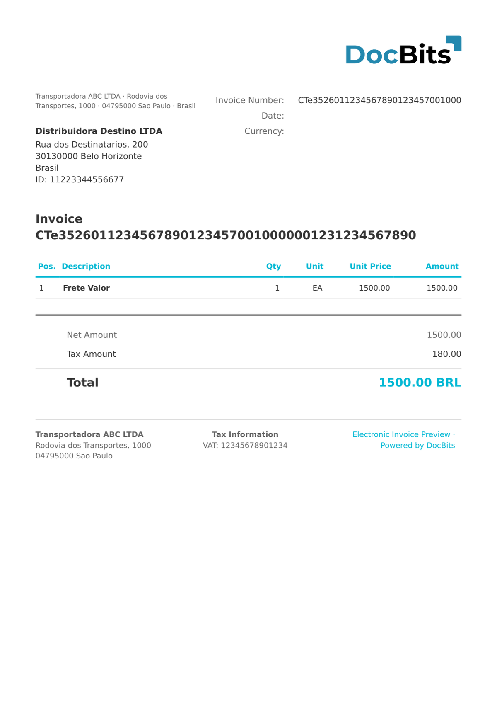

# 🇧🇷 BRAZIL CT-E

<!-- edocs-country-scope -->


Die Länderanleitung enthält Versionsgrenzen, die tatsächlich verwendete Konfiguration und das Erklärvideo zum Land. [Brasilien](countries/brazil.md). Dies sind unterschiedliche Dokumentfamilien. Eine konfigurierte NFS-e-Version bestätigt nicht jedes kommunale Schema oder jedes nationale Format für Dienstleistungsrechnungen.


| Eigenschaft          | Wert                                                       |
| -------------------- | ---------------------------------------------------------- |
| **Land / Region**    | Brasilien                                                  |
| **Dokumenttypen**    | Transportrechnung (Conhecimento de Transporte Eletrônico)  |
| **Format**           | XML                                                        |
| **Standard**         | CT-e 3.0 (elektronischer Fracht-/Transportfrachtbrief)     |
| **Locale**           | `pt_BR`                                                    |

CT-e (Conhecimento de Transporte Eletrônico, `<mod>57</mod>`) ist das brasilianische elektronische Transportdokument, das von Logistik- und Frachtunternehmen ausgestellt wird. Es dokumentiert den Transportdienst, den Frachtwert, die Herkunfts- und Zielgemeinden (`cMunIni` / `cMunFim`) und den Frachtpreis (`vTPrest`). Im Gegensatz zur NF-e verwendet CT-e `cteProc` als Wurzelelement und verweist auf verknüpfte NF-e-Dokumente.

## Unterstützungsstatus

| Komponente       | Status         |
| ---------------- | -------------- |
| Vorschau         | ✅ Unterstützt |
| Feldextraktion   | ✅ Unterstützt |
| Transformation   | ✅ Unterstützt |

## Standardvorschau

<figure><figcaption><p>Standardvorschau von DocBits für ein BRAZIL-CT-E-Dokument</p></figcaption></figure>

## Feldzuordnung

### Kopffelder

| DocBits-Feld    | Quell-XPath                                            | Hinweise                         |
| --------------- | ------------------------------------------------------ | -------------------------------- |
| `invoice_id`    | `//*[local-name()='ide']/*[local-name()='nCT']`        | CT-e-Nummer                      |
| `invoice_date`  | `//*[local-name()='ide']/*[local-name()='dhEmi']`      | ISO 8601 mit BRT-Offset          |
| `currency`      | Fest: `BRL`                                            | Immer Brasilianischer Real       |
| `total_amount`  | `//*[local-name()='vPrest']/*[local-name()='vTPrest']` | Gesamtwert des Transportdienstes |
| `net_amount`    | `//*[local-name()='vPrest']/*[local-name()='vRec']`    | Zu empfangender Betrag           |
| `tax_amount`    | `//*[local-name()='ICMS']//*[local-name()='vICMS']`    | ICMS auf den Transportdienst     |
| `supplier_name` | `//*[local-name()='emit']/*[local-name()='xNome']`     | Name des Frachtführers (transportadora) |
| `supplier_id`   | `//*[local-name()='emit']/*[local-name()='CNPJ']`      | CNPJ des Frachtführers           |
| `buyer_name`    | `//*[local-name()='dest']/*[local-name()='xNome']`     | Name des Empfängers (destinatário) |
| `buyer_id`      | `//*[local-name()='dest']/*[local-name()='CNPJ']`      | CNPJ des Empfängers              |

> CT-e enthält keine Positionstabelle – der Transportdienst ist eine einzelne Gebühr auf Dokumentebene.

## Klassifizierungsregel

DocBits erkennt BRAZIL-CT-E-Dokumente anhand von:

```
http://www.portalfiscal.inf.br/cte
```

im XML-Namensraum (Wurzelelement `<cteProc>`).

## Verwandte Seiten

* [BRAZIL NF-E](brazil-nfe.md)
* [BRAZIL NFC-E](brazil-nfce.md)
* [BRAZIL NFS-E](brazil-nfse.md)
* [Unterstützte elektronische Dokumente](./)
