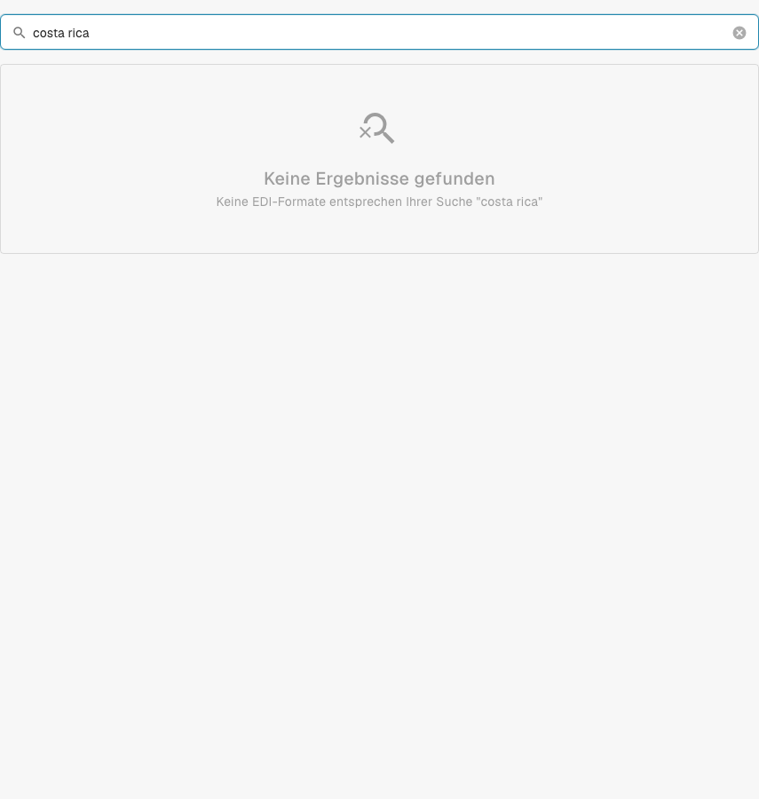

# Costa Rica

Verwenden Sie diese Anleitung, um die konfigurierte Familie und den Versionsumfang zu ermitteln, bevor Sie eine Quelldatei testen.

[Alle Länder und Umfang der Unterstützung](../README.md)

## Erklärvideo zum Land

Ein Sprechertext und WebVTT-Untertitel in der jeweiligen Sprache erklären Formatauswahl, Konfiguration und Abnahmeprüfungen.

Dieser lesende Rundgang zeigt die in DocBits vorhandene Konfiguration für das Land. Prüfen Sie die verwendete Quelle und aktive Version und testen Sie repräsentative Rechnungen, Gutschriften und Exporte in Ihrer eigenen Organisation.



[Costa Rica — Erklärvideo zum Land](https://docbits-videos.fra1.cdn.digitaloceanspaces.com/settings-assistant/edocs_country_costa_rica/v2/de.mp4)

[WebVTT](https://docbits-videos.fra1.cdn.digitaloceanspaces.com/settings-assistant/edocs_country_costa_rica/v2/de.vtt)

## Varianten und Versionsgrenzen

Die ältere Dokumentation nennt Costa Rica. Im geprüften Entwicklungskatalog wurde jedoch kein passender Klassifizierungs- oder Konfigurationseintrag gefunden.

**Syntax:** Nicht bestätigt

Diese Prüfung bestätigt die aktuelle integrierte Verarbeitung nicht. Bitten Sie den Support, die bereitgestellte Zuordnung zu prüfen, und testen Sie vor der Einführung eine repräsentative Quelldatei.

Die Tabellen dokumentieren eine Prüfung des Entwicklungskatalogs vom 17. Oktober 2026 und des zugehörigen Verarbeitungscodes. Sie beschreiben verfügbare Regeln und Konfigurationskomponenten, bestätigen jedoch nicht jede Datei, jede gesetzliche Anforderung oder die Einführung in Produktion. Ihre Organisation kann die Standardregeln überschreiben.

## Geprüfte Regel- und Komponentenmatrix

Es wurde kein passender Klassifizierungs- oder Konfigurationseintrag gefunden. Diese Prüfung bestätigt die aktuelle integrierte Unterstützung nicht.

## Die Zuordnung in DocBits finden

<figure><figcaption>
Echte Entwicklungsoberfläche: Die Suche nach diesem Ländernamen ergab im geprüften Katalog keinen passenden Konfigurationseintrag.
</figcaption></figure>

## Abnahmeprüfungen

Eine Komponentenprüfung bestätigt das Vorhandensein einer Konfiguration. Sie ist kein vollständiger Verarbeitungstest für jede Version. Testen Sie den genauen Dateninhalt und den von Ihrer Integration benötigten Verarbeitungsweg für Rechnungen oder Gutschriften.

## Ein Format in Ihrer Organisation prüfen

1. Bewahren Sie das ursprüngliche XML oder das PDF mit seinem eingebetteten XML auf. Lesen Sie den Namespace, die Schema- oder Anpassungskennung sowie die angegebene Version und das Profil.

2. Öffnen Sie Einstellungen → Dokumenttypen → E-Doc für den entsprechenden Geschäftsdokumenttyp. Suchen Sie nach dem genauen elektronischen Dokumentformat aus der Anleitung.

3. Prüfen Sie die tatsächlich verwendete Quelle Default oder Custom und ihre aktive Konfigurationsversion. Prüfen Sie Transformation, Preview und Extraction Paths. Das Speichern eines Entwurfs aktiviert ihn nicht.

4. Testen Sie repräsentative Quelldateien für jede benötigte Syntax, Version und jeden Geschäftsdokumenttyp. Prüfen Sie wichtige Felder, Beträge, Steuern, die Klassifizierung als Rechnung oder Gutschrift und den ERP-Export.

5. Bestätigen Sie die Validierungsrichtlinie und den Übertragungsweg separat. Erhalten Sie angepasste Zuordnungen und prüfen Sie Freigaben und Exporthistorie, bevor Sie vorhandene Dokumente neu starten.

## Weiterführende Formatreferenz

- [🇨🇷 COSTA RICA](../costa-rica.md)
