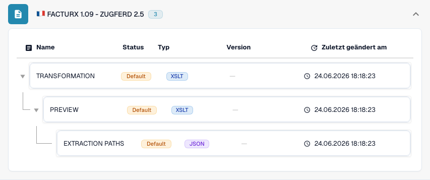

# Frankreich

Verwenden Sie diese Anleitung, um die konfigurierte Familie und den Versionsumfang zu ermitteln, bevor Sie eine Quelldatei testen.

[Alle Länder und Umfang der Unterstützung](../README.md)

## Erklärvideo zum Land

Ein Sprechertext und WebVTT-Untertitel in der jeweiligen Sprache erklären Formatauswahl, Konfiguration und Abnahmeprüfungen.

Dieser lesende Rundgang zeigt die in DocBits vorhandene Konfiguration für das Land. Prüfen Sie die verwendete Quelle und aktive Version und testen Sie repräsentative Rechnungen, Gutschriften und Exporte in Ihrer eigenen Organisation.



[Frankreich — Erklärvideo zum Land](https://docbits-videos.fra1.cdn.digitaloceanspaces.com/settings-assistant/edocs_country_france/v2/de.mp4)

[WebVTT](https://docbits-videos.fra1.cdn.digitaloceanspaces.com/settings-assistant/edocs_country_france/v2/de.vtt)

## Varianten und Versionsgrenzen

Für Factur-X gibt es generische und veröffentlichungsspezifische Einträge, darunter 1.0.05, 1.08 und 1.09. VRBL FR CIUS 1.0 ist separat.

**Syntax:** CII / PDF + XML

Die XML-Kennung 1p0 und Factur-X XMP Version 1.0 identifizieren keine Veröffentlichungsversion. Behalten Sie die generische Bezeichnung bei, wenn die Veröffentlichung unbekannt ist.

Die Tabellen dokumentieren eine Prüfung des Entwicklungskatalogs vom 17. Oktober 2026 und des zugehörigen Verarbeitungscodes. Sie beschreiben verfügbare Regeln und Konfigurationskomponenten, bestätigen jedoch nicht jede Datei, jede gesetzliche Anforderung oder die Einführung in Produktion. Ihre Organisation kann die Standardregeln überschreiben.

## Geprüfte Regel- und Komponentenmatrix

| Genaue Formatbezeichnung | Dokumentschlüssel der Regel | Verfügbare Komponenten |
| --- | --- | --- |
| `FACTURX` | `INVOICE` | C / T / P / E |
| `FACTURX 1.0.05 - ZUGFERD 2.1` | `INVOICE` | C / T / P / E |
| `FACTURX 1.0.05 BASIC` | `INVOICE` | C / T / P / E |
| `FACTURX 1.0.05 EN16931` | `INVOICE` | C / T / P / E |
| `FACTURX 1.0.05 EXTENDED` | `INVOICE` | C / T / P / E |
| `FACTURX 1.08 - ZUGFERD 2.4` | `INVOICE` | C / T / P / E |
| `FACTURX 1.09 - ZUGFERD 2.5` | `INVOICE` | C / T / P / E |
| `VRBL FR CIUS 1.0` | `INVOICE` | C / T / P / E |

C = Klassifizierung, T = Transformation, P = Preview, E = Extraction Paths. Der Dokumentschlüssel dient zur Suche nach Regeln und Konfigurationen; er garantiert nicht den endgültig gespeicherten Wert von invoice_type. Eine Transformation kann eine Gutschrift über eine INVOICE-Zuordnung klassifizieren.

Ein Strich bedeutet, dass die Statusprüfung für genau diese Kombination aus Format und Dokumentschlüssel keine eigene Komponente gemeldet hat. Eine gemeinsam genutzte Zuordnung oder eine Ausweichzuordnung ist damit nicht ausgeschlossen. Prüfen Sie die tatsächlich verwendete Auflösungslogik und eine repräsentative Datei, bevor Sie sich auf diesen Pfad verlassen.

### Zusätzliche Konfigurationsbezeichnungen

Für diese Bezeichnungen gibt es Konfigurationseinträge, aber keine eigenständige Klassifizierungsregel im geprüften Katalog. Über eine generische Formatfamilie oder eine präzisere Identifizierung kann ein kompatibler Pfad ausgewählt werden. Das bloße Vorhandensein der Einträge belegt nicht die automatische Erkennung dieser Veröffentlichung oder dieses Profils.

- `FACTURX 1.0.05 BASIC WL`
- `FACTURX 1.0.05 MINIMUM`
- `FACTURX 1.0.06 BASIC`
- `FACTURX 1.0.06 BASIC WL`
- `FACTURX 1.0.06 EN16931`
- `FACTURX 1.0.06 EXTENDED`
- `FACTURX 1.0.06 MINIMUM`
- `FACTURX 1.0.07 BASIC`
- `FACTURX 1.0.07 BASIC WL`
- `FACTURX 1.0.07 EN16931`
- `FACTURX 1.0.07 EXTENDED`
- `FACTURX 1.0.07 MINIMUM`
- `FACTURX 1.0.07.2 - ZUGFERD 2.3.2`
- `FACTURX 1.0.07.2 BASIC`
- `FACTURX 1.0.07.2 BASIC WL`
- `FACTURX 1.0.07.2 EN16931`
- `FACTURX 1.0.07.2 EXTENDED`
- `FACTURX 1.0.07.2 MINIMUM`
- `FACTURX 1.08 BASIC`
- `FACTURX 1.08 BASIC WL`
- `FACTURX 1.08 EN16931`
- `FACTURX 1.08 EXTENDED`
- `FACTURX 1.08 MINIMUM`
- `FACTURX 1.09 BASIC`
- `FACTURX 1.09 BASIC WL`
- `FACTURX 1.09 EN16931`
- `FACTURX 1.09 EXTENDED`
- `FACTURX 1.09 MINIMUM`

### Factur-X / ZUGFeRD: keine Veröffentlichungsversion erfinden

Eine harmonisierte CII Guideline ID kann eine Familie und ein Profil identifizieren, obwohl mehrere Veröffentlichungen dieselbe Kennung 1p0 verwenden. Factur-X XMP Version 1.0 ist eine Schemakennung, keine Veröffentlichung wie 1.08 oder 1.09. ZUGFeRD-XMP kann seine Version angeben. Fehlen maßgebliche Metadaten, behalten Sie das generische Familienergebnis bei und klären Sie die ursprüngliche Datei mit dem Absender.

MINIMUM und BASIC WL können Positionsinformationen auslassen, die in nachgelagerten Schritten benötigt werden. BASIC, EN16931/COMFORT und EXTENDED decken unterschiedliche Datenumfänge ab. Ein umfangreicheres Profil kann Felder enthalten, die Ihre Extraktionszuordnung nicht verwendet. Prüfen Sie die erforderlichen Felder anhand tatsächlicher Beispiele.

## Die Zuordnung in DocBits finden

<figure><figcaption>
Echte Entwicklungsoberfläche: das repräsentative Format und seine verfügbaren Konfigurationskomponenten. Weitere Versionen sind in der Matrix aufgeführt.
</figcaption></figure>

## Abnahmeprüfungen

Eine Komponentenprüfung bestätigt das Vorhandensein einer Konfiguration. Sie ist kein vollständiger Verarbeitungstest für jede Version. Testen Sie den genauen Dateninhalt und den von Ihrer Integration benötigten Verarbeitungsweg für Rechnungen oder Gutschriften.

## Ein Format in Ihrer Organisation prüfen

1. Bewahren Sie das ursprüngliche XML oder das PDF mit seinem eingebetteten XML auf. Lesen Sie den Namespace, die Schema- oder Anpassungskennung sowie die angegebene Version und das Profil.

2. Öffnen Sie Einstellungen → Dokumenttypen → E-Doc für den entsprechenden Geschäftsdokumenttyp. Suchen Sie nach dem genauen elektronischen Dokumentformat aus der Anleitung.

3. Prüfen Sie die tatsächlich verwendete Quelle Default oder Custom und ihre aktive Konfigurationsversion. Prüfen Sie Transformation, Preview und Extraction Paths. Das Speichern eines Entwurfs aktiviert ihn nicht.

4. Testen Sie repräsentative Quelldateien für jede benötigte Syntax, Version und jeden Geschäftsdokumenttyp. Prüfen Sie wichtige Felder, Beträge, Steuern, die Klassifizierung als Rechnung oder Gutschrift und den ERP-Export.

5. Bestätigen Sie die Validierungsrichtlinie und den Übertragungsweg separat. Erhalten Sie angepasste Zuordnungen und prüfen Sie Freigaben und Exporthistorie, bevor Sie vorhandene Dokumente neu starten.

## Weiterführende Formatreferenz

- [🇫🇷 FACTURX](../facturx.md)
- [🇫🇷 FACTURX 1.0.05 - ZUGFERD 2.1](../facturx-1-0-05-zugferd-2-1.md)
- [🇫🇷 FACTURX 1.0.07.2 - ZUGFERD 2.3.2](../facturx-1-0-07-2-zugferd-2-3-2.md)
- [🇫🇷 FACTURX 1.09 - ZUGFERD 2.5](../facturx-1-09-zugferd-2-5.md)
