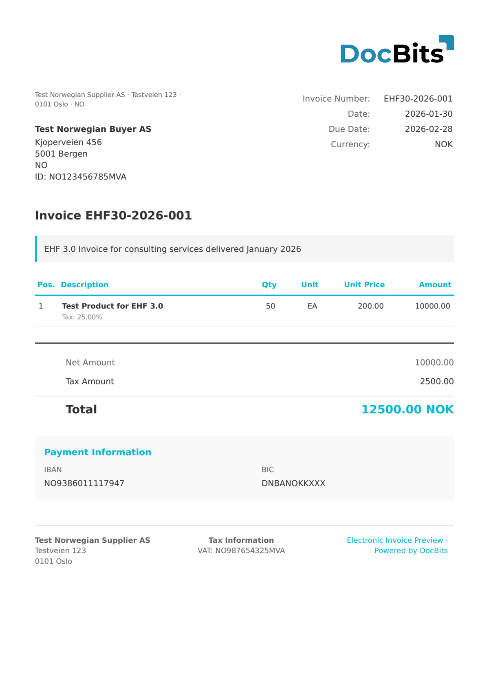

# 🇳🇴 EHF INVOICE 3.0

<!-- edocs-country-scope -->


Die Länderanleitung enthält Versionsgrenzen, die tatsächlich verwendete Konfiguration und das Erklärvideo zum Land. [Norwegen](countries/norway.md). Wählen Sie die Zuordnung für den tatsächlichen Geschäftsdokumenttyp. Eine Bestellung oder Versandanzeige ist keine Rechnung.


| Eigenschaft | Wert |
| ----------- | ---- |
| **Land / Region** | Norwegen |
| **Dokumenttypen** | Rechnung, Gutschrift |
| **Format** | UBL 2.1 XML |
| **Standard** | EHF Invoice 3.0 (basierend auf Peppol BIS Billing 3.0) |

EHF (Elektronisk Handelsformat) Invoice 3.0 ist der norwegische E-Rechnungsstandard, der von der Agency for Public Management and eGovernment (Difi) gepflegt wird. Version 3.0 ist an Peppol BIS Billing 3.0 angelehnt, wodurch norwegische E-Rechnungen im gesamten europäischen Peppol-Netzwerk interoperabel sind.

## Unterstützungsstatus

| Komponente | Status |
| ---------- | ------ |
| Vorschau | ✅ Unterstützt |
| Feldextraktion | ✅ Unterstützt |
| Transformation | ✅ Unterstützt |

## Standard-Vorschau

<figure><figcaption>
Standard-DocBits-Vorschau für eine norwegische EHF Invoice 3.0
</figcaption></figure>

## Verwandte Themen

* [Supported Electronic Documents](./)
* [Peppol BIS 3.0](peppol-bis-3-0.md)
