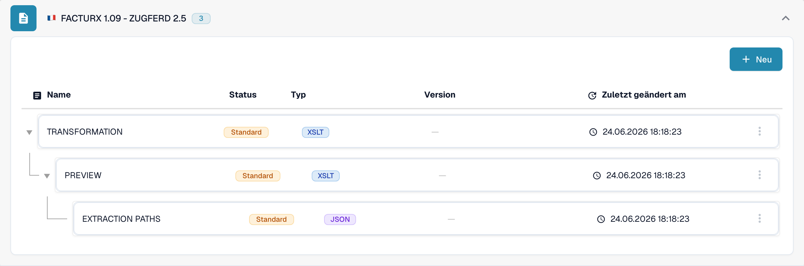

# 🇫🇷 FACTURX 1.09 - ZUGFERD 2.5

<!-- edocs-country-scope -->


Die Länderanleitung enthält Versionsgrenzen, die tatsächlich verwendete Konfiguration und das Erklärvideo zum Land. [Frankreich](countries/france.md). Die XML-Kennung 1p0 und Factur-X XMP Version 1.0 identifizieren keine Veröffentlichungsversion. Behalten Sie die generische Bezeichnung bei, wenn die Veröffentlichung unbekannt ist.


| Eigenschaft | Wert |
|-------------|------|
| **Land / Region** | Frankreich / Deutschland |
| **Dokumenttypen** | Rechnung, Gutschrift (tatsächlich verwendete Zuordnung prüfen) |
| **Format** | CII (PDF/A-3 eingebettet) |
| **Standard** | Factur-X 1.09 / ZUGFeRD 2.5 |
| **Basiert auf** | EN 16931 |

ZUGFeRD 2.5 und Factur-X 1.09 sind gleichwertige Veröffentlichungen. Das hybride Format bettet CII-D22B-XML in PDF/A-3 ein; UBL ist nicht seine XML-Syntax. Siehe die [Veröffentlichungsreferenz von FeRD](https://www.ferd-net.de/publikationen-produkte/publikationen/detailseite/zugferd-25-english).

Der Standard definiert die Profile MINIMUM, BASIC WL, BASIC, EN16931 und EXTENDED. Ein Profilname im Katalog belegt weder die automatische Erkennung noch eine vollständige Feldabdeckung. MINIMUM und BASIC WL können Positionsinformationen auslassen, die Ihre Integration benötigt.

Diese Seite beschreibt die Veröffentlichung vom Juni 2026. Die spätere [Veröffentlichung Factur-X 1.09.2 / ZUGFeRD 2.5.2](https://fnfe-mpe.org/factur-x/factur-x_en/) muss gesondert identifiziert werden; die Familienkennung `1p0` allein genügt dafür nicht.

## Unterstützungsstatus

Die lesende Prüfung des Entwicklungskatalogs am 31. Oktober 2026 zeigte den Eintrag `FACTURX 1.09 - ZUGFERD 2.5` für `INVOICE`.

| Komponente | Beobachtete Konfiguration |
|-----------|---------------------------|
| Vorschau | `PREVIEW` (XSLT) |
| Feldextraktion | `EXTRACTION_PATHS` (JSON) |
| Transformation | `TRANSFORMATION` (XSLT) |

Diese Einträge bestätigen vorhandene Konfiguration, nicht die erfolgreiche Verarbeitung jeder Datei oder jedes Profils. Prüfen Sie die tatsächlich verwendete Quelle Default oder Custom und die aktive Version in Ihrer Organisation. Die Abwärtskompatibilität eines Standards garantiert keine unveränderten Extraktions- oder Transformationsergebnisse. Testen Sie repräsentative Rechnungen und Gutschriften, benötigte Felder und den ERP-Export separat; rechtliche Validierung und Anforderungen des Übertragungsnetzes benötigen eine eigene Abnahme.

<figure><figcaption>
Lesende deutsche Entwicklungsansicht vom 31. Oktober 2026: der Katalogeintrag für INVOICE und seine vorhandenen Standardkomponenten. Die Aufnahme zeigt keinen Dateiverarbeitungstest.
</figcaption></figure>

## Verwandte Themen

- [ZUGFeRD 2.5](zugferd-2-5.md)
- [ZUGFeRD-Konfiguration](../zugferd/configuration.md)
- [ZUGFeRD-Feldzuordnung](../zugferd/README.md)
- [Unterstützte elektronische Dokumente](./)
