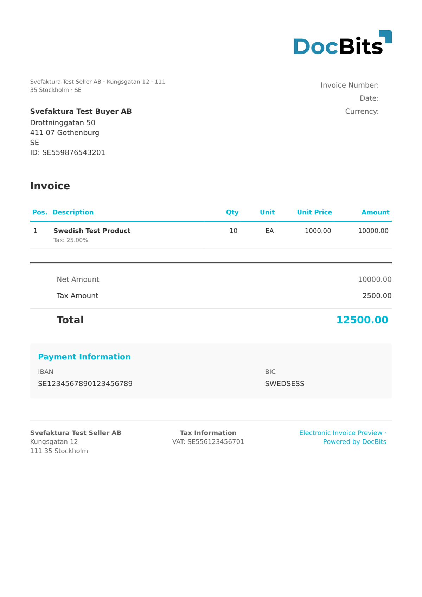

# 🇸🇪 SVEFAKTURA 1.0

<!-- edocs-country-scope -->


Die Länderanleitung enthält Versionsgrenzen, die tatsächlich verwendete Konfiguration und das Erklärvideo zum Land. [Schweden](countries/sweden.md). Unterscheiden Sie diese ältere Familie von Peppol BIS Billing 3.0. Prüfen Sie, welches Profil der Empfänger erwartet.


| Eigenschaft | Wert |
| ----------- | ---- |
| **Land / Region** | Schweden |
| **Dokumenttypen** | Rechnung |
| **Format** | UBL XML |
| **Standard** | Svefaktura 1.0 |

Svefaktura 1.0 ist das schwedische E-Rechnungsformat auf UBL-Basis, das vom schwedischen Verband der Kommunen und Regionen (SFTI) gepflegt wird. Auch wenn die schwedische E-Rechnung inzwischen auf Peppol BIS umgestiegen ist, wird Svefaktura 1.0 weiterhin verwendet und für die Verarbeitung älterer Dokumente unterstützt.

## Unterstützungsstatus

| Komponente | Status |
| ---------- | ------ |
| Vorschau | ✅ Unterstützt |
| Feldextraktion | ✅ Unterstützt |
| Transformation | ✅ Unterstützt |

## Standard-Vorschau

<figure><figcaption>
Standard-Vorschau in DocBits für eine schwedische Svefaktura-1.0-Rechnung
</figcaption></figure>

## Verwandte Themen

* [Unterstützte elektronische Dokumente](./)
