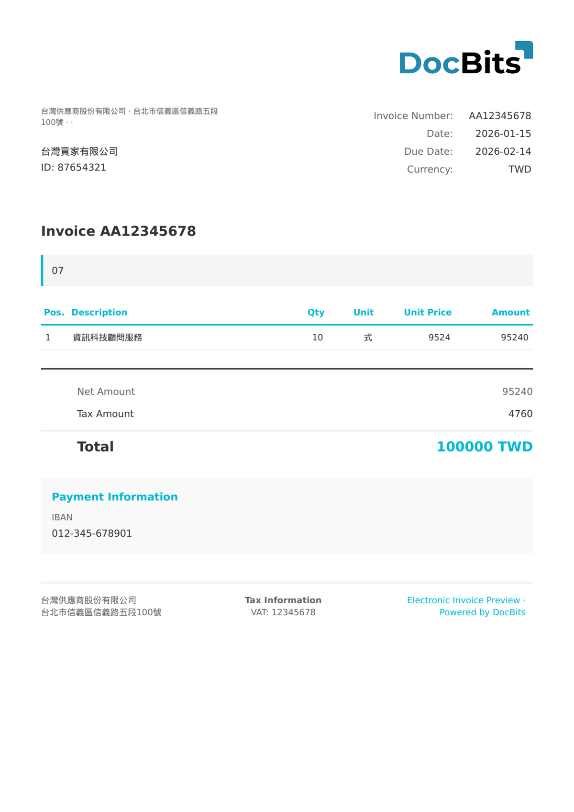

# 🇹🇼 TAIWAN EGUI

<!-- edocs-country-scope -->


Die Länderanleitung enthält Versionsgrenzen, die tatsächlich verwendete Konfiguration und das Erklärvideo zum Land. [Taiwan](countries/taiwan.md). Die Familienbezeichnung bestätigt nicht jede MIG-Veröffentlichung. Prüfen Sie das tatsächliche XML-Schema und testen Sie repräsentative elektronische Rechnungen.


| Eigenschaft | Wert |
| ----------- | ---- |
| **Land / Region** | Taiwan |
| **Dokumenttypen** | Rechnung (Uniform Invoice), Gutschrift |
| **Format** | XML |
| **Standard** | eGUI (Electronic Government Uniform Invoice) |

Taiwan eGUI ist das elektronische Government-Uniform-Invoice-System des Finanzministeriums. Es ist ein verpflichtender E-Rechnungsstandard für alle Geschäftsvorgänge in Taiwan. Die Rechnungen werden auf der staatlichen Plattform gespeichert und anhand eines eindeutigen Rechnungsnummernformats identifiziert.

## Unterstützungsstatus

| Komponente | Status |
| ---------- | ------ |
| Vorschau | ✅ Unterstützt |
| Feldextraktion | ✅ Unterstützt |
| Transformation | ✅ Unterstützt |

## Standard-Vorschau

<figure><figcaption>
Standard-Vorschau in DocBits für eine Taiwan-eGUI-Rechnung
</figcaption></figure>

## Verwandte Themen

* [Unterstützte elektronische Dokumente](./)
