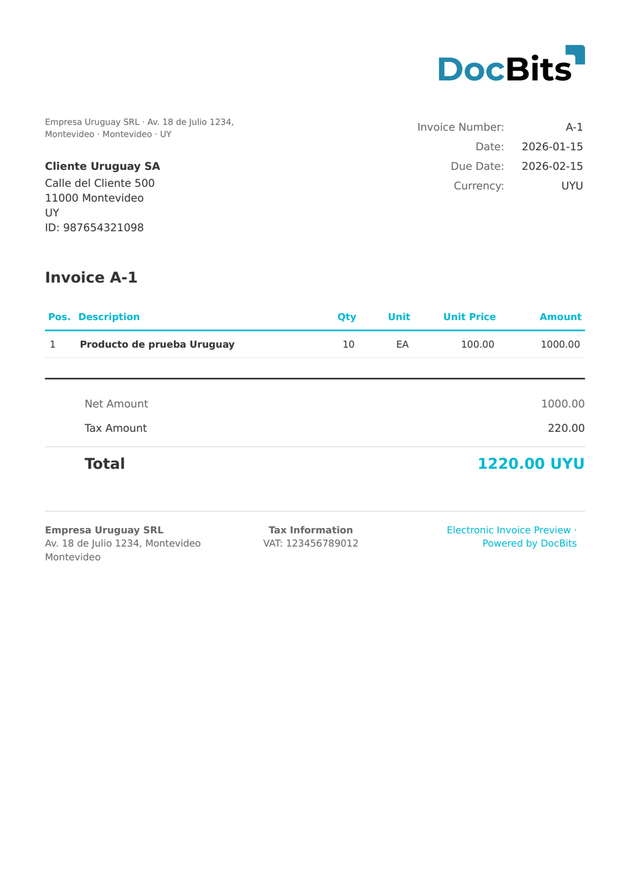

# 🇺🇾 URUGUAY E-FACTURA

| Eigenschaft | Wert |
| ----------- | ---- |
| **Land / Region** | Uruguay |
| **Dokumenttypen** | e-Rechnung (e-Factura) |
| **Format** | XML |
| **Standard** | e-Factura (CFE-Typ 111) |

Uruguay e-Factura ist der Dokumenttyp für elektronische Rechnungen innerhalb des CFE-Systems und wird über den Typcode 111 identifiziert. Er wird für formelle B2B-Transaktionen zwischen RUT-registrierten Unternehmen verwendet und enthält alle von der DGI geforderten Felder zur Steueridentifikation und Steuerberechnung.

## Unterstützungsstatus

| Komponente | Status |
| ---------- | ------ |
| Vorschau | ✅ Unterstützt |
| Feldextraktion | ✅ Unterstützt |
| Transformation | ✅ Unterstützt |

## Standard-Vorschau

<figure><figcaption>
Standard-Vorschau in DocBits für eine Uruguay-E-Factura-Rechnung
</figcaption></figure>

## Verwandte Themen

* [Unterstützte elektronische Dokumente](./)
